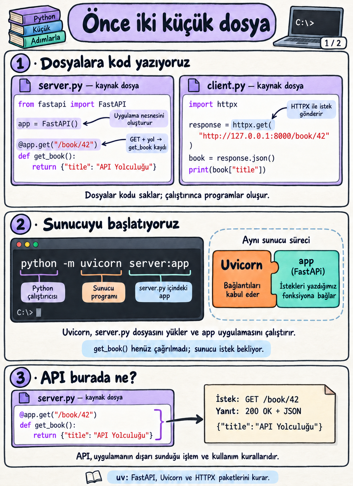
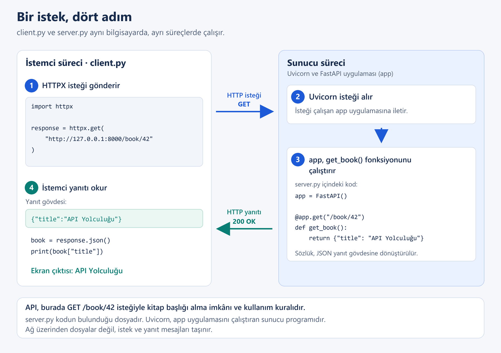
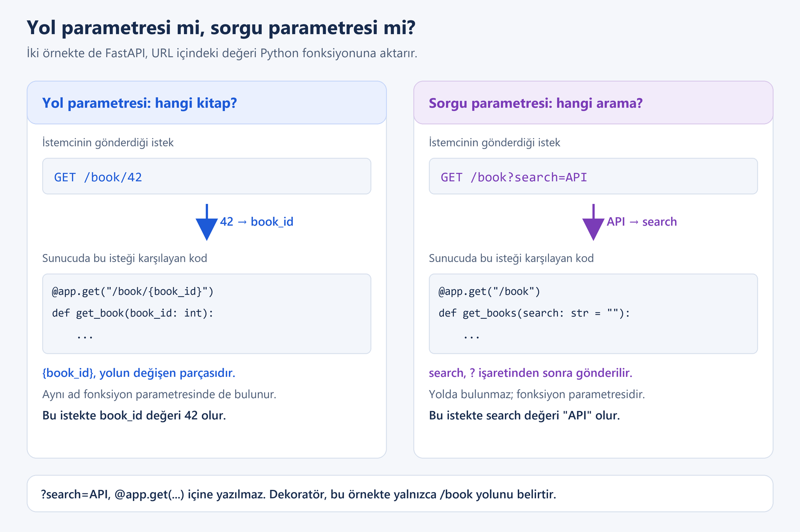

# Hafta 01 — Lecture Notes

## Yaptığımız kitap uygulaması üzerinden API, HTTP ve JSON

**Bu notun amacı:** Uygulamada çalıştırdığımız kodları, kullandığımız araçları ve gördüğümüz sonuçları anlamlandırmak.

Önce bir kitabın başlığını isteyen iki küçük programla başlayacağız. Ardından isteğin nasıl karşılandığını, kitap bilgisinin nasıl taşındığını ve karşılaştığımız hataların ne anlattığını inceleyeceğiz. Terimleri, ilgili örneğin yanında açıklayacağız.

Kurulum adımları ve deneylerdeki dosyaların tam sürümleri [Practice](02_Practice.md) içindedir. Buradaki kısa kodlar, o uygulamanın belirli parçalarını açıklamak içindir. Örneklerde aynı kitapları, alan adlarını ve adresleri kullanıyoruz.

**Okuma sırası**

1. [İki küçük program ne yapıyor?](#bolum-01)
2. [Bu örnekte API nerede, araçlar ne yapıyor?](#bolum-02)
3. [İstek giderken ve yanıt gelirken ne olur?](#bolum-03)
4. [Adres hangi fonksiyona, hangi bilgiyi götürüyor?](#bolum-04)
5. [JSON içindeki kitap bilgisini okuyalım](#bolum-05)
6. [Arama ve filtreleme nasıl sonuç üretiyor?](#bolum-06)
7. [200, 404, 422 ve bağlantı hatası neyi anlatıyor?](#bolum-07)
8. [JSON'u okumak ile bilgiyi kontrol etmek neden ayrı işler?](#bolum-08)
9. [API'nin kullanım yerini toparlayalım](#bolum-09)

<a id="bolum-01"></a>
## 1. İki küçük program ne yapıyor?

Kitap uygulamamızın en küçük hâlini düşünelim. Bir program kitap bilgisini sunuyor, diğeri bu bilgiyi istiyor. Görevleri görmek için burada yalnızca kitap başlığını kullanıyoruz.

**`server.py` — kitap bilgisini sunan taraf**

```python
from fastapi import FastAPI

app = FastAPI()

@app.get("/book/42")
def get_book():
    return {"title": "API Yolculuğu"}
```

**`client.py` — kitap bilgisini isteyen taraf**

```python
import httpx

response = httpx.get("http://127.0.0.1:8000/book/42")
book = response.json()
print(book["title"])
```

Uygulamada kullandığımız ortamda, bu dosyaların bulunduğu klasörde sunucuyu şu komutla başlatırız:

```bash
python -m uvicorn server:app
```

Sunucu çalışırken ikinci terminalde istemciyi çalıştırırız:

```bash
python client.py
```

İstemcinin çıktısı:

```text
API Yolculuğu
```

Sunucudaki `{"title": "API Yolculuğu"}` bir **Python sözlüğüdür**. `title` alanının değeri kitap başlığıdır. İstemci bu bilgiyi sunucudan alır; `book["title"]` ile başlığı seçip terminale yazdırır. İki program arasındaki aktarımı birazdan adım adım açacağız.

Bu iletişimde bilgiyi isteyen programa **istemci (client)**, isteği karşılayan tarafa **sunucu (server)** diyoruz. Burada iki program da aynı bilgisayarda çalışıyor. İstemci veya sunucu olmak, programın bu iletişimde üstlendiği görevdir.

<a id="bolum-02"></a>
## 2. Bu örnekte API nerede, araçlar ne yapıyor?

### API, bu örnekte hangi işlemi sunuyor?

İstemci, kitap başlığını almak için şu kurala uyuyor:

> `GET` isteğini `/book/42` adres yoluna gönder. Başarılı yanıtta, `title` alanını içeren kitap bilgisini JSON biçiminde al.

**API (Application Programming Interface), bir yazılımın başka yazılımların kullanımına sunduğu işlemleri ve bu işlemlerin kullanım kurallarını ifade eder.** Bu örnekte sunulan işlem, kitap bilgisini okumaktır. Hangi adrese nasıl istek yapılacağı ve yanıtta hangi bilginin geleceği bu arayüzün parçalarıdır.

İstemci sunucudaki fonksiyonun adını bilmek zorunda değildir. Kodda `get_book` yerine başka bir fonksiyon adı kullansak da dışarıya sunduğumuz metot, adres ve yanıt aynı kaldığı sürece istemci aynı isteği yapabilir.

Bir kullanıcı ekranında “Kitabı göster” düğmesi bulunabilir. Düğmeye basıldığında o ekranın arkasındaki istemci kodu API'ye istek gönderir. Bizim örneğimizde aynı işi `client.py` yapıyor; sonucu terminalde görüyoruz.

### FastAPI, Uvicorn ve HTTPX neden ayrı adlar?

Program yazarken başkalarının hazırladığı kodlardan yararlanırız. Kullanmak üzere kurduğumuz bu kodlar **paketler** hâlinde dağıtılır. `uv pip install fastapi uvicorn httpx` komutuyla uygulamada ihtiyaç duyduğumuz paketleri kurmuştuk.

| Ad | Ne olduğu ve bu örnekte yaptığı iş |
|---|---|
| **FastAPI** | Python ile HTTP API geliştirmemizi sağlayan bir **uygulama çatısıdır (framework)**. Gelen isteğin hangi fonksiyona verileceğini ve parametrelerin nasıl okunacağını yönetir. Paket olarak kurulur; kodumuzda içinden `FastAPI` sınıfını alırız. |
| **`app = FastAPI()`** | Bu sınıftan bizim uygulama nesnemizi oluşturur. `/book/42` ile `get_book` arasındaki ilişkiyi bu uygulamaya kaydederiz. |
| **Uvicorn** | Bağlantıları dinleyen ve FastAPI uygulamamızı çalıştıran **sunucu programıdır**. İsteği uygulamaya ulaştırır, oluşan yanıtı istemciye gönderir. |
| **HTTPX** | İstemci kodundan HTTP isteği göndermemizi ve yanıtı okumamızı sağlayan bir **kütüphanedir**; yani kodumuzda çağırarak kullandığımız hazır işlevler sunar. `httpx.get(...)` bunlardan biridir. |
| **uv** | Projenin Python ortamını ve paketlerini yönetmek için kullandığımız araçtır. Bu çalışmada paketleri kurarken kullandık. |

`server.py`, bizim yazdığımız kaynak kod dosyasıdır. Uvicorn bu dosyadaki `app` uygulamasını çalıştırır. Uygulamanın istemciye sunduğu kitap okuma işlemi ve kullanım kuralları da API'yi oluşturur.



Başlatma komutunu da bu ayrımla okuyabiliriz:

| Komut parçası | Anlamı |
|---|---|
| `python -m uvicorn` | Seçili Python ortamındaki Uvicorn'u çalıştır. |
| `server:app` | `server.py` dosyasındaki `app` adlı uygulamayı kullan. |

Sunucu programının görevi için [Uvicorn belgelerine](https://uvicorn.dev/), uygulama nesnesi ve yol tanımları için [FastAPI'nin ilk adımlarına](https://fastapi.tiangolo.com/tutorial/first-steps/) bakılabilir.

<a id="bolum-03"></a>
## 3. İstek giderken ve yanıt gelirken ne olur?

`httpx.get(...)` çalıştığında istemci, sunucuya bir **istek (request)** gönderir. Sunucu isteği karşılayıp bir **yanıt (response)** gönderir. Bu mesajların nasıl düzenleneceğini **HTTP** adlı iletişim kuralları belirler. Böyle bir ortak kurallar bütününe **protokol** denir.



1. **İstemci ister:** HTTPX, `GET /book/42` isteğini `127.0.0.1:8000` adresindeki sunucuya gönderir. `GET`, bu örnekte kitap bilgisini okumak için kullandığımız HTTP metodudur.
2. **Sunucu isteği karşılar:** Uvicorn isteği `app` uygulamasına aktarır. FastAPI, kayıtlı metot ve yola bakarak `get_book()` fonksiyonunu çağırır.
3. **Kitap bilgisi hazırlanır:** Fonksiyon Python sözlüğünü döndürür. FastAPI bu örnekte sözlüğü JSON biçiminde bir yanıt gövdesine dönüştürür. Uvicorn yanıtı istemciye gönderir.
4. **İstemci okur:** HTTPX yanıtı alır. `response.json()` gövdedeki JSON'u Python verisine dönüştürür; `print(...)` başlığı gösterir.

Dosyaların kendisi gönderilmez. Çalışan programlar arasında istek ve yanıt mesajları taşınır. **Süreç (process)**, işletim sisteminde çalışan program örneğidir; burada istemci ile Uvicorn'un çalıştırdığı sunucu uygulaması ayrı süreçlerdir. Uvicorn ile `app` ise bu başlangıç komutunda aynı sunucu süreci içinde çalışır.

### Yanıtın üç bölümünü ayıralım

İlk örneğimizdeki yanıtın ilgili parçaları şöyledir:

| Yanıt parçası | Örneğimizdeki değer | İstemcide nasıl bakıyoruz? |
|---|---|---|
| **Durum kodu (status code)** | `200`: kitap isteği başarıyla karşılandı. | `response.status_code` |
| **Başlık (header)** | `Content-Type: application/json`: gövde JSON biçimindedir. | `response.headers["content-type"]` |
| **Gövde (body)** | `{"title":"API Yolculuğu"}`: taşınan kitap bilgisi. | `response.text` |

`response`, yalnızca kitap bilgisi değildir; durum kodunu, başlıkları ve gövdeyi içeren yanıt nesnesidir. `book = response.json()` satırındaki `book` ise bu örnekte yalnızca gövdeden elde edilen Python sözlüğüdür. [HTTPX belgeleri](https://www.python-httpx.org/quickstart/) bu erişimleri örneklerle gösterir.

Uygulamada **`Accept: application/json`** başlığını da göndermiştik. İstemci bununla “JSON biçiminde yanıt kabul ediyorum.” bilgisini isteğe ekler. Sunucu istemciye sonradan nasıl cevap vereceğini sormaz. Bizim sunucumuz zaten JSON döndürür; bu başlığı eklemek sunucuya yeni bir yanıt biçimi öğretmez. Yanıttaki `Content-Type`, sunucunun gerçekten gönderdiği gövdenin biçimini bildirir.

<a id="bolum-04"></a>
## 4. Adres hangi fonksiyona, hangi bilgiyi götürüyor?

### Önce adresi okuyalım

İstemcinin kullandığı tam adrese **URL** denir:

```text
http://127.0.0.1:8000/book/42
```

| Parça | Bu örnekteki anlamı |
|---|---|
| `http://` | HTTP kullanarak iletişim kuruyoruz. |
| `127.0.0.1` | İstemcinin çalıştığı bilgisayarın kendisini gösterir. |
| `8000` | Uvicorn'un dinlediği **port**, yani bağlantı kurulacak numaralı iletişim noktasıdır. |
| `/book/42` | O sunucuda istenen işlemin **yolu (path)**. Biz bu yolu 42 numaralı kitabı okumak için tanımladık. |

Adresteki `book`, İngilizcede “kitap” demektir; kitaplarla ilgili işlemleri belirtmek için bu adı biz seçtik. Kullanılacak yolu sunucuda `@app.get(...)` içine yazarız. İstemci de isteğini bu yola gönderir.

Bu HTTP API'de metot ve yolun birlikte belirlediği işleme **uç nokta (endpoint)** diyebiliriz: `GET /book/42`. İşlemde eriştiğimiz kitap da bir **kaynak (resource)** örneğidir.

### Adreste yalnızca `/` kullanabilir miyiz?

Evet. Adreste `book` gibi bir kelime bulunması zorunlu değildir. Yalnızca `/` kullanabiliriz; buna **kök yol (root path)** denir. Kitap başlığını bu yoldan sunan küçük bir örneğe bakalım.

**`server.py` — bu örneğin tamamı**

```python
from fastapi import FastAPI

app = FastAPI()

@app.get("/")
def get_book():
    return {"title": "API Yolculuğu"}
```

**`client.py` — bu örneğin tamamı**

```python
import httpx

response = httpx.get("http://127.0.0.1:8000/")
book = response.json()
print(book["title"])
```

Sunucu bu kodla çalışırken istemci yine `API Yolculuğu` yazdırır. `@app.get("/")`, kök yola gelen `GET` isteğini `get_book()` fonksiyonuyla eşleştirir. İstemci adresindeki son `/` yazılmasa da aynı kök yol istenir; sunucudaki tanımı ise `@app.get("/")` biçiminde yazarız.

**O hâlde neden `/book` ve `/book/42` gibi yollar kullanıyoruz?** Sunucu farklı işlemler sunduğunda bunları ayırt etmek için. Kitap uygulamamızda `/book` kitap listesini, `/book/42` belirli bir kitabı istemek için kullanılır. Tek işlemli bu küçük örnekte `/` yeterlidir. Bir uygulamanın API sunması, adresinde `api` kelimesinin bulunmasına bağlı değildir.

Aşağıdaki açıklamalarda kitap uygulamamızın `/book` yollarıyla devam ediyoruz.

### `httpx.get(...)` ile `@app.get(...)` aynı işi mi yapıyor?

| İstemcide | Sunucuda |
|---|---|
| `httpx.get("http://127.0.0.1:8000/book/42")` | `@app.get("/book/42")` |
| Adrese bir HTTP `GET` isteği **gönderir**. | Bu metot ve yola gelen isteği altındaki fonksiyonla **eşleştirir**. |

`@` ile başlayan yazım, Python'ın **dekoratör (decorator)** özelliğidir. Dekoratör, altındaki fonksiyonu başka bir işleme verir; o işlem fonksiyonu kaydedebilir veya davranışını değiştirebilir. FastAPI burada fonksiyonu bir HTTP işleminin karşılayıcısı olarak kaydeder. `get_book` fonksiyonunun gövdesi kayıt sırasında çalışmaz; uygun istek geldiğinde çağrılır.

### Sabit sayıdan yol parametresine

İlk kodda yol `/book/42` idi. `/book/99` için kayıtlı bir yol bulunmadığından istek `404` yanıtı alıyordu. Uygulamanın sonraki adımında değişebilen sayıyı şöyle tanımladık:

```python
@app.get("/book/{book_id}")
def get_book(book_id: int):
    for book in books:
        if book["id"] == book_id:
            return book

    raise HTTPException(status_code=404, detail="Book not found")
```

Bu parça, `books` listesi ile `HTTPException` içe aktarımının bulunduğu sunucu koduna aittir. `books`, fonksiyonun dışında tanımladığımız kitap listesidir; fonksiyon bu listeyi okuyabilir. Her kitap için `id` değerine bakar. Eşleşince `return book` ile o kitabı döndürür ve fonksiyon biter. Döngü bittiği hâlde eşleşme yoksa son satır `404` hata yanıtını oluşturmak üzere `HTTPException` üretir.

`/book/42` isteğinde `{book_id}` yerine `42` gelir. FastAPI bunu `int` bildirimi nedeniyle tam sayıya dönüştürür; fonksiyon **`book_id=42` ile** çalışır. `{book_id}` bir **yol parametresidir**: değeri adresin yolundan alınır. [FastAPI yol parametreleri](https://fastapi.tiangolo.com/tutorial/path-params/) bu ilişkiyi açıklar.

### Arama sözcüğü neden dekoratörün içinde değil?

Başlıkta arama yaparken ise adresimiz şöyledir:

```text
http://127.0.0.1:8000/book?search=API
```

Burada yol `/book`, `?` sonrasındaki bölüm ise **sorgu (query)** bölümüdür. `search=API`, adı `search`, değeri `API` olan bir **sorgu parametresidir**. Sunucudaki ilgili tanımın başlangıcı şöyledir:

```python
@app.get("/book")
def get_books(search: str = ""):
    # Başlık araması yapan kod bu fonksiyonun içindedir.
    ...
```

Bu kısa parçada `...`, açıklamadığımız fonksiyon gövdesinin yerini gösterir. Arama kodunu 6. bölümde göreceğiz.

FastAPI hem dekoratördeki yola hem fonksiyonun parametrelerine bakar. **Bu örnekte** `book_id`, yol tanımındaki `{book_id}` ile eşleştiği için yoldan alınır. `search` ise yolda bulunmayan bir metin parametresi olduğu için sorgu bölümünden alınır. URL'deki `search=API`, fonksiyona `search="API"` olarak verilir. [FastAPI sorgu parametreleri](https://fastapi.tiangolo.com/tutorial/query-params/) aynı yöntemi kullanır.



`{book_id}` bölümünü yoldan kaldırıp yalnızca `def get_book(book_id: int):` yazsaydık, bu basit tanımda FastAPI `book_id` değerini sorgu parametresi olarak beklerdi: `/book?book_id=42`. Yalnızca fonksiyon parametresini yazmak, adresteki `/42` parçasını ona bağlamaz.

<a id="bolum-05"></a>
## 5. JSON içindeki kitap bilgisini okuyalım

Python sözlüğünü sunucunun belleğinde kullanabiliriz. Başka bir programa gönderirken veriyi iki tarafın da okuyabileceği bir biçimde yazmamız gerekir. **JSON (JavaScript Object Notation)** bu amaçla kullanılan bir metin biçimidir. Python, JavaScript veya başka bir dilde yazılmış programlar bu biçimi okuyabilir.

İlk örnekte dönüşüm sırası şudur:

```text
Sunucuda: Python sözlüğü
    {"title": "API Yolculuğu"}
                 ↓ FastAPI yanıtı hazırlar.
Yanıt gövdesinde: JSON
    {"title":"API Yolculuğu"}
                 ↓ İstemci response.json() ile okur.
İstemcide: Python sözlüğü
    book["title"] → "API Yolculuğu"
```

Yazımları benzer görünse de birinde çalışan Python programının verisi, diğerinde mesajla taşınan metin vardır. Veriyi JSON metni olarak yazmaya **serileştirme (serialization)**; JSON metnini okuyup programda kullanılabilir veriye dönüştürmeye **ayrıştırma (parsing)** denir.

### Uygulamadaki kitabın JSON karşılığı

Kitaba yeni alanlar eklediğimizde yanıt gövdesinde şu bilgi yer alıyordu:

```json
{
  "id": 42,
  "title": "API Yolculuğu",
  "author": {
    "first_name": "Deniz",
    "last_name": "Kaya"
  },
  "available": true,
  "tags": ["software", "education"],
  "rating": null
}
```

| Gördüğümüz parça | Türü ve anlamı | Python'da okuduktan sonra |
|---|---|---|
| Dıştaki `{ ... }` | **Nesne (object):** adlandırılmış alanları bir arada tutar. Burada bir kitabı temsil eder. | Sözlük (`dict`) |
| `"title": "API Yolculuğu"` | `title` alanının değeri bir **metindir (string)**. | `book["title"]` bir `str` değeridir. |
| `"id": 42` | Alanın değeri bir **sayıdır (number)**. | `book["id"]` bu örnekte tam sayıdır (`int`). |
| `"available": true` | **Mantıksal değer (boolean):** kitap şu anda okuyucuya verilebilir. `false` olsaydı verilemezdi. | `True` veya `False` (`bool`) |
| `"tags": ["software", "education"]` | **Dizi (array):** birden fazla değeri sıralı tutar. | Liste (`list`) |
| `"rating": null` | Kitaba henüz puan verilmediğini belirtmek için kullandığımız değer. | `None` |

JSON'da alan adları ve metin değerleri çift tırnakla yazılır. `true`, `false` ve `null` tırnaksızdır. Bunların Python kodundaki yazımları sırasıyla `True`, `False` ve `None` olur. Dönüşüm tablosu [Python'ın JSON belgelerinde](https://docs.python.org/3/library/json.html#encoders-and-decoders) de bulunur.

### `author` neden artık nesne?

Önceden `author` alanında ad ve soyadı içeren tek bir metin tutuyorduk: `"author": "Deniz Kaya"`. Şimdi bu alanın içine `first_name` ve `last_name` alanlarından oluşan bir JSON nesnesi koyuyoruz. Bu nedenle istemcinin yazar bilgisini okuma biçimini de değiştiriyoruz.

Burada `author` alanının değeri artık kendi alanları bulunan **bir JSON nesnesidir**. Bu nesnenin içindeki `first_name` ve `last_name` değerleri ise yine metindir. “Nesne” sözcüğü, yazarın gerçek bir kişi olmasını değil, verinin `{ ... }` içinde alanlara ayrılarak yazılmasını anlatır.

Tek kitap yanıtını `book = response.json()` ile okuduktan sonra:

```python
print(book["author"]["first_name"])  # Deniz
print(book["author"]["last_name"])   # Kaya
```

İlk köşeli parantez `author` alanındaki sözlüğü seçer; ikinci köşeli parantez onun içindeki alanı seçer. Sunucudaki `author` yapısını değiştirip istemciyi eski beklentiyle bırakırsak yazar bilgisi beklendiği gibi okunmaz. **Yanıt sözleşmesinin değişmesi** dediğimiz şey burada budur: istemcinin kullanacağı alanların yapısı değişmiştir.

### Bir kitap ile kitap listesi

`GET /book/42` tek kitabın bilgilerini, `GET /book` ise kitapların listesini verir.

Kitap listesini JSON biçiminde göndermek için bir **dizi (array)** kullanırız. Bu dizi `[` ile başlar, `]` ile biter. Dizideki **her kitap ayrı bir JSON nesnesidir**; o kitabın alanları `{` ile `}` arasında yazılır.

Aşağıdaki örnekte iki kitap var. Parantezlerin kullanımını kolayca görmek için her kitabın yalnızca kimliğini (`id`) ve başlığını (`title`) gösteriyoruz:

```json
[
  {"id": 42, "title": "API Yolculuğu"},
  {"id": 57, "title": "Veriyle İlk Adımlar"}
]
```

- En baştaki `[` ile en sondaki `]`, iki kitabı tek bir listede toplar.
- İlk `{ ... }` 42 numaralı kitabın, ikinci `{ ... }` 57 numaralı kitabın bilgilerini içerir.
- İki kitap nesnesi arasındaki virgül, bunları birbirinden ayırır.

İstemcide `response.json()` bu JSON dizisini bir Python listesine dönüştürür. Listedeki her kitap bir sözlüktür. `for` döngüsü kitapları sırayla alır ve her birinin başlığını yazdırır:

```python
books = response.json()
for book in books:
    print(book["title"])
```

`rating: null` ile `rating: 0` da aynı değildir. Bizim uygulamamızda `null` “henüz puan yok”, `0` ise “puan var ve değeri sıfır” anlamındadır. Bu nedenle puanın yokluğunu `if book["rating"] is None:` ile kontrol etmiştik. `tags: []` ise kitabın etiket listesinin boş olduğunu söyler.

<a id="bolum-06"></a>
## 6. Arama ve filtreleme nasıl sonuç üretiyor?

`/book?search=API` isteği “başlığında API geçen kitapları listele” anlamına gelir. Bu anlamı URL kendiliğinden üretmez; sunucudaki arama kodumuz belirler.

Uygulamadaki `books` listesi üzerinde çalışan fonksiyon:

```python
@app.get("/book")
def get_books(search: str = ""):
    results = []

    for book in books:
        if search.casefold() in book["title"].casefold():
            results.append(book)

    return results
```

`search: str = ""` tanımında `str`, metin beklediğimizi; `= ""`, parametre gönderilmezse boş metin kullanacağımızı söyler. FastAPI, gönderilen değeri bu parametreye verir. **Kitap başlığında arama yapan işlem ise bizim fonksiyonumuzdaki `in` karşılaştırmasıdır.**

`casefold()` büyük–küçük harf farkını azaltarak karşılaştırma yapmamıza yardım eder. `in`, soldaki metnin sağdaki metin içinde geçip geçmediğini kontrol eder. Sonuç `True` ise kitap `results` listesine eklenir. Koşulu sağlamayan kitap eklenmeden döngü devam eder.

İlk iki kitap üzerinde `search="API"` için:

| Kitap başlığı | `"api"` başlıkta geçiyor mu? | Sonuç |
|---|---|---|
| `API Yolculuğu` | `True` | Listeye eklenir. |
| `Veriyle İlk Adımlar` | `False` | Listeye eklenmez. |

`search` gönderilmezse boş metin kullanılır. Python'da boş metin her metnin içinde bulunduğu için bütün kitaplar sonuç listesine girer. Ancak tanımı `search: str` yapıp varsayılan değeri kaldırırsak parametre zorunlu olur; gönderilmediğinde fonksiyon çalıştırılmadan `422` yanıtı verilir. Bu kodun anlamını bir sonraki bölümde açıklayacağız.

### İkinci koşul: kitap şu anda verilebilir mi?

İstemcide iki sorgu parametresini birlikte göndermiştik:

```python
response = httpx.get(
    "http://127.0.0.1:8000/book",
    params={"search": "API", "available": True}
)
```

HTTPX bunları URL'ye ekler: `/book?search=API&available=true`. `&`, iki sorgu parametresini ayırır. Buradaki `true`, URL'nin içindeki metindir; FastAPI onu parametrenin türüne göre Python `True` değerine dönüştürür.

Sunucudaki fonksiyonun tanımı bu aşamada şöyledir:

```python
def get_books(search: str = "", available: bool | None = None):
    ...
```

`bool | None`, `available` değerinin `True`, `False` veya `None` olabileceğini söyler. `= None`, filtre gönderilmezse kullanacağımız varsayılan değerdir. `None` durumunda kitabın okuyucuya verilebilir olup olmamasına göre eleme yapmayız.

Bu sürümde döngünün içindeki kontrol:

```python
title_matches = search.casefold() in book["title"].casefold()
availability_matches = (
    available is None or book["available"] == available
)

if title_matches and availability_matches:
    results.append(book)
```

İlk iki atama yalnızca `True` veya `False` hesaplar. İlkinde başlığa, ikincisinde kitabın verilebilirlik durumuna bakılır. `or`, filtre gönderilmemişse veya kitabın değeri istenen değerle eşleşiyorsa ikinci koşulun sağlanmasını sağlar. `and` ise kitabı sonuç listesine almak için **iki koşulun da** sağlanmasını ister. Bir kitabın koşulu sağlamaması program hatası değildir; o kitap aranan sonuca dahil edilmez.

<a id="bolum-07"></a>
## 7. 200, 404, 422 ve bağlantı hatası neyi anlatıyor?

Sunucuya ulaşmak, istenen kitabı bulmak ve gelen veriyi kullanabilmek farklı aşamalardır. Uygulamada karşılaştığımız sonuçları bu sırayla okuyabiliriz.

| Gözlem | Ne oldu? |
|---|---|
| `200` ve kitap bilgisi | İstek başarıyla karşılandı. |
| Aramada `200` ve `[]` | Arama yapıldı; koşula uyan kitap bulunmadı. Sonuç boş bir listedir. |
| `404` | Bu örnekte istenen yol veya belirli kitap bulunamadı. |
| `422` | **422, sunucunun isteği aldığı ancak gönderilen bilgiler beklenen koşulları karşılamadığı için işleyemediği anlamına gelen HTTP durum kodudur.** Örneğin tam sayı beklenen `book_id` için `abc` gönderilmiştir. |
| `httpx.ConnectError: [Errno 111] Connection refused` | Bağlantı kurulamadı; bir HTTP yanıtı alınmadı. Uygulamada sunucu kapalıyken bunu gördük. |

**Arama ile tek kitap isteme farkı:** `/book?search=Astronomi` ile koşula uyan kitapların listesini isteriz. Hiçbiri uymuyorsa boş liste geçerli bir sonuçtur. `/book/999` ile ise kimliği tam olarak `999` olan kitabı isteriz. Böyle bir kitap yoksa sunucu `404` döndürür.

**Buradaki 111, HTTP durum kodu değil, işletim sisteminin bağlantı hatası numarasıdır.** `404` alırken sunucu bize yanıt vermiştir. Bağlantı reddedildiğinde ise kitap bulunup bulunmadığı henüz kontrol edilememiştir.

### FastAPI türü de kontrol ediyor

`book_id: int` yazdığımızda FastAPI yalnızca parametrenin varlığına bakmaz; gelen değeri tam sayıya çevirmeyi de dener. `/book/abc` isteğinde bunu yapamaz ve **`get_book` fonksiyonunun gövdesine girmeden** `422` yanıtı üretir. Sıradan Python'da tür bildirimi yazmak kendi başına böyle bir HTTP kontrolü yapmaz; burada bildirimi kullanarak kontrol yapan FastAPI'dir.

Uygulamadaki `/book/latest` deneyi de bununla ilgiliydi. `/book/{book_id}` tanımı önce kayıtlıysa `latest` o tanıma takılır; tam sayıya çevrilemediği için `422` gelir. Bu yüzden özel yol olan `/book/latest` tanımını genel `/book/{book_id}` tanımından önce yazmıştık.

### JSON yanıtı gelmesi, kitap geldiği anlamına gelmez

Sunucu hata bilgisini de JSON biçiminde gönderebilir:

```json
{"detail": "Book not found"}
```

Bu gövde JSON olarak okunur, fakat içinde `title` alanı yoktur. İstemci bunu kitap sanıp `book["title"]` yazarsa Python **`KeyError: 'title'`** üretir. Bu, sunucunun verdiği `404` yanıtından sonra istemci kodunda oluşan ayrı bir hatadır.

Tek kitap isteyen istemcide (`GET /book/42`), HTTP yanıtını aldıktan sonra kitap alanlarını yalnızca başarı durumunda okuruz:

```python
if response.status_code == 200:
    book = response.json()
    print(book["title"])
else:
    print("Book information could not be retrieved.")
```

Bağlantı hatası ise `response` elde edilmeden, `httpx.get(...)` çağrısı sırasında oluşur. Bu nedenle uygulamada onu `try` ve `except httpx.ConnectError` ile ayrıca ele almıştık.

<a id="bolum-08"></a>
## 8. JSON'u okumak ile bilgiyi kontrol etmek neden ayrı işler?

`response.json()`, JSON metnini Python verisine dönüştürür. Kitap bilgisinin bizim istediğimiz tür ve değerde olup olmadığını tek başına kontrol etmez.

Bu farkı görmek için uygulamada `page_count` adlı bir sayfa sayısı alanı kullanmıştık. **Bu alıştırmada belirlediğimiz kural**, sayfa sayısının pozitif tam sayı olarak gelmesiydi:

| Örnek metin | JSON okunur mu? | Bizim kontrolümüz ne der? |
|---|---|---|
| `{"page_count": 240,}` | Hayır; sondaki fazladan virgül JSON yazımına aykırıdır. | Veriye dönüşemediği için sayfa sayısı kontrolüne geçilemez. |
| `{"page_count": "240"}` | Evet; `"240"` bir metindir. | Türü tam sayı olmadığı için kabul edilmez. |
| `{"page_count": -20}` | Evet; `-20` tam sayıdır. | Değeri pozitif olmadığı için kabul edilmez. |
| `{"page_count": 240}` | Evet. | İki koşulu da sağlar. |

İlk sorun **JSON'un yazımıyla** ilgilidir. İkinci ve üçüncü satırda JSON okunmuştur; kabul etmeme kararını bizim kodumuz verir. İsteseydik `"240"` metnini sayıya dönüştürerek kabul eden bir program yazabilirdik. Pozitif tam sayı istemek JSON'un genel kuralı değildir.

Bu denemeleri `book_validation.py` dosyasında yapmıştık. Burada gerçek bir HTTP yanıtı almıyorduk (yani program sunucuya istek gönderip ondan cevap beklemiyordu); yanıtta gelebilecek örnek metinleri kendimiz yazıyorduk. Bu yüzden doğrudan metni okuyan `json.loads(response_body)` kullandık. `client.py` ise gerçek istekleri gönderen program olarak görevine devam ediyordu.

Deneydeki `try` / `except` / `else` sırası:

1. **`try`:** JSON metnini okumayı dene.
2. **`except json.JSONDecodeError`:** JSON yazımı yüzünden okuma başarısız olursa bu bölüme geç.
3. **`else`:** Okuma hatasız bittiyse sayfa sayısının türünü ve değerini kontrol et.

`try` işleminin hatasız tamamlanması, sayfa sayısının uygun olduğu anlamına gelmez; yalnızca JSON'un okunabildiğini gösterir. İçerikle ilgili karar bundan sonraki kontrol kodundadır.

<a id="bolum-09"></a>
## 9. API'nin kullanım yerini toparlayalım

### Aynı işi tek Python programında yapamaz mıydık?

Yapabilirdik. Aynı program içindeki `get_book(42)` çağrısı, fonksiyondan doğrudan sonuç alabilir. HTTP kullanmamızın nedeni, kitap bilgisini **ayrı çalışan bir programa** sunmaktır. Bu istemci bir Python programı, tarayıcıdaki bir uygulama veya telefon uygulaması olabilir. Sunucunun iç kodunu paylaşmaları gerekmez; sunulan işlemin kullanım kurallarını bilmeleri yeterlidir.

İstemci ve sunucu farklı bilgisayarlarda da çalışabilir. Bizim uygulamamızda ise ikisi de aynı bilgisayarda çalışıyor.

**`127.0.0.1` ne anlama gelir?** Programlar bağlantı kurarken hedefi belirtmek için **IP adresi** denilen sayısal adresler kullanır. `127.0.0.1`, özel olarak **“bu programın çalıştığı bilgisayarın kendisi”** anlamına gelen bir IP adresidir.

Örneğin istemcide `http://127.0.0.1:8000/book/42` yazdığımızda:

- `127.0.0.1`, istemcinin kendi bilgisayarına yönelmesini sağlar.
- `8000`, o bilgisayarda Uvicorn'un bağlantıları dinlediği port numarasıdır.
- `/book/42`, bağlandığımız sunucudan istediğimiz kitabın yoludur.

Bu adresi başka bir bilgisayarda kullanan program da o bilgisayarın kendisine yönelir. Farklı bilgisayardaki bir sunucuya ulaşmak için o sunucunun ağ üzerinden erişilebilen adresini kullanırız. Bizim örneğimizde iletişim aynı bilgisayar içinde gerçekleştiği için internet bağlantısı gerekmez.

### API yalnızca web uygulamalarında mı bulunur?

API daha geniş bir kavramdır. Örneğin Python'ın `json.loads(...)` fonksiyonu, `json` kütüphanesinin programcılara sunduğu arayüzün bir parçasıdır. Onu kullanırken hangi bilgiyi vereceğimizi ve hangi sonucu alacağımızı biliriz; HTTP isteği göndermeyiz.

Kitap çalışmamızda ise ayrı programların **HTTP üzerinden** kullandığı bir API yazdık. İstemci–sunucu iletişimi için mutlaka HTTP veya FastAPI gerekmez; başka iletişim kuralları da kullanılabilir. Hangi yöntem seçilirse seçilsin, tarafların gönderilen mesajların anlamı konusunda anlaşması gerekir.

### API türleri denildiğinde neye bakıyoruz?

İki ayrı soruyu ayırmak yeterlidir:

| Soru | Kısa örnek |
|---|---|
| **Nerede kullanılıyor?** | `json.loads(...)` program içinde kullanılan bir kütüphane API'sine; kitap sunucumuz HTTP üzerinden kullanılan bir web API'sine örnektir. |
| **Kimlerin kullanımına sunuluyor?** | Bir API yalnızca kurum içinde kullanılabilir (**private/internal**), belirli iş ortaklarına açılabilir (**partner**) veya dış geliştiricilerin kullanımına sunulabilir (**public**). |

“Public” olması, ücretsiz veya giriş yapmadan kullanılabilir olması gerektiği anlamına gelmez. Bu adlar API'nin kimlere sunulduğunu anlatır; JSON ise taşınan verinin yazım biçimidir.

HTTP mesajlarının ayrıntılarını ikinci haftada; REST, SOAP ve GraphQL yaklaşımlarını üçüncü haftada ele alacağız. Bu haftaki kitap örneğini anlamak için o karşılaştırmayı şimdiden öğrenmek gerekmiyor.

### Kendini kontrol et

| Soru | Kısa cevap |
|---|---|
| `server.py`, Uvicorn ve API neden farklı kavramlar? | `server.py` kod dosyasıdır. Uvicorn uygulamayı çalıştıran sunucu programıdır. API, uygulamanın dışarı sunduğu işlemler ve kullanım kurallarıdır. |
| `httpx.get(...)` çalışınca `get_book()` her zaman çağrılır mı? | Hayır. İstek o fonksiyonun kayıtlı metot ve yoluyla eşleşmeli, gerekli parametre kontrollerini geçmelidir. |
| `search` dekoratörde yoksa FastAPI onu nasıl bulur? | Bu örnekte fonksiyonun metin parametresini sorgu parametresi olarak kabul eder; URL'deki `search` değerini ona aktarır. |
| `response` ile `response.json()` aynı şey mi? | İlki HTTP yanıt nesnesidir. İkincisi gövdedeki JSON'u Python verisi olarak okuyan işlemdir. |
| Bir arama neden `200` ile boş liste dönebilir? | Arama başarıyla yapılmış, ancak koşula uyan kayıt bulunmamıştır. |
| JSON okunabildiyse bilgiler de istediğimiz gibi midir? | Bunu ayrıca kontrol etmemiz gerekir; metnin okunabilmesi, içindeki alanların tür ve değerlerinin beklentimizi karşıladığını göstermez. |
