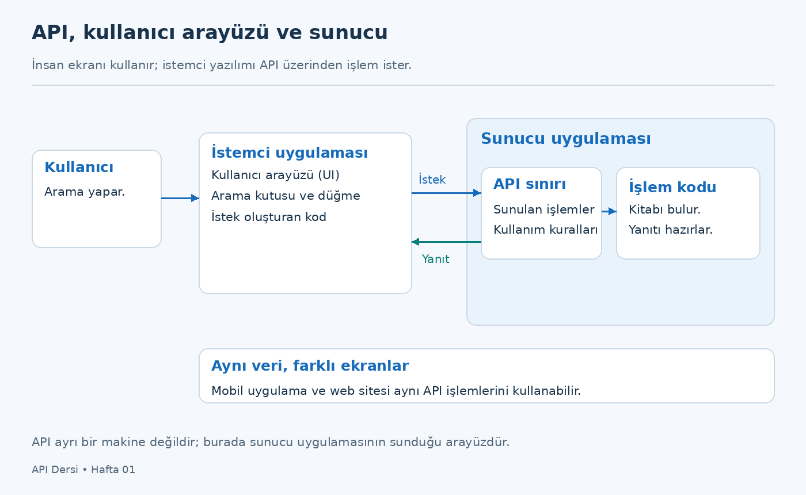
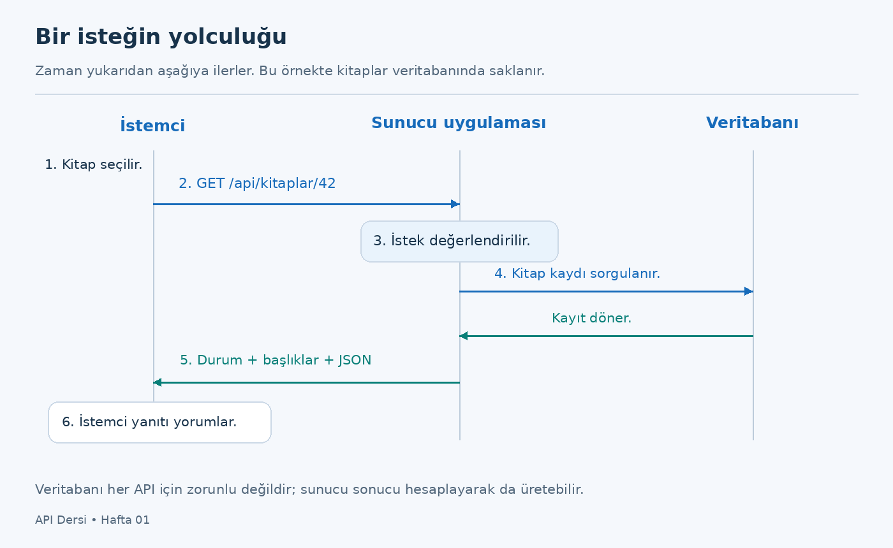
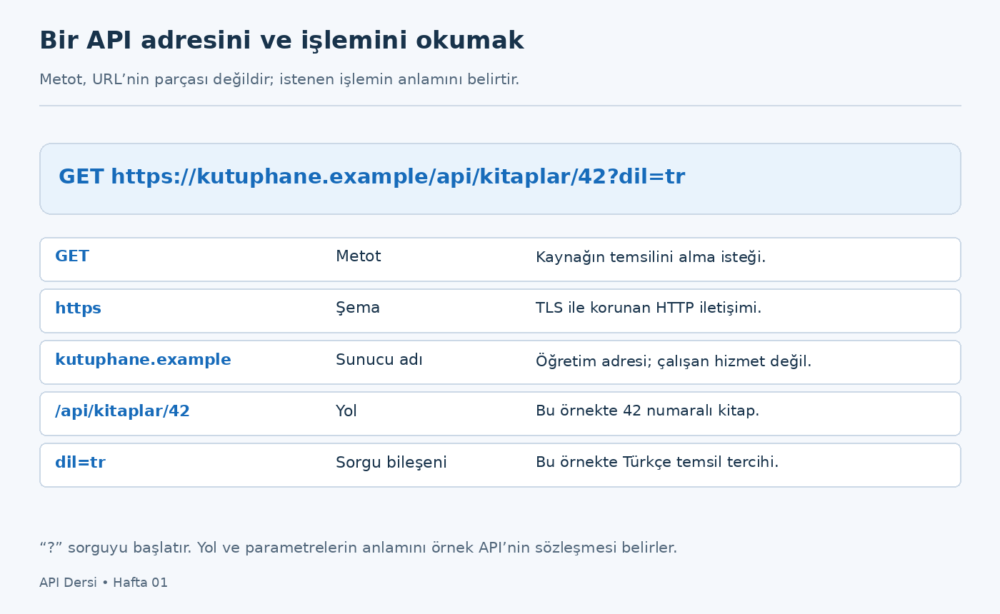
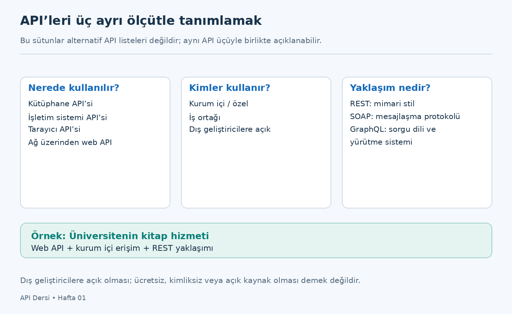
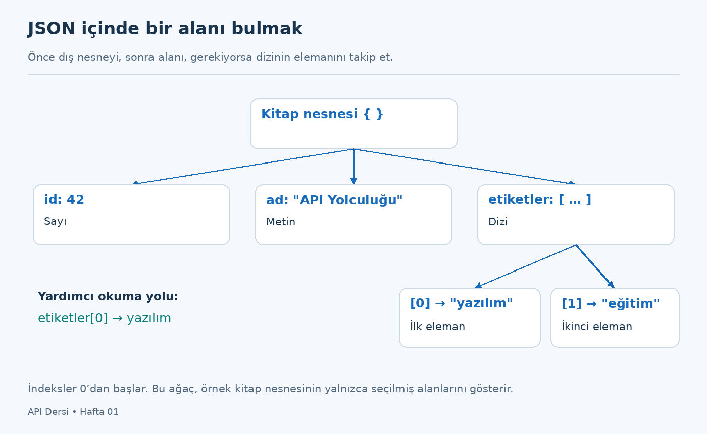

# Hafta 01 — Teorik Ders Notu

## API Kavramları ve Türleri, İstemci–Sunucu Mimarisi ve JSON’a Giriş

**Ders:** Uygulama Programı Arayüzü (API)  
**Süre:** 3 ders saati teori  
**Düzey:** API konusunda başlangıç  
**Belgenin amacı:** Konuyu kendi başına okuyarak anlamak ve ilk haftanın teorik dersine hazırlanmak  
**Sürüm:** 1.1 — 7 Eylül 2026

> **Bu not nasıl okunmalı?** Önce örneği oku, sonra kavramın tanımına dön. Kod kutularını çalıştırman gerekmiyor; bu haftaki amaç onların ne anlattığını okuyabilmek. “Dur ve düşün” bölümlerinde cevaba geçmeden önce kendi cümleni kur. Son bölümde cevap anahtarı var.

Bu bölümün ortak örneği, bir **kitap kataloğu uygulaması**. Örnek kitaplar ve adresler öğretim için oluşturulmuştur. `kutuphane.example` bir anlatım adresidir; çalışan bir API değildir. Kitap örneğini kullanmamız, dönem projesinin konusunu kesinleştirdiğimiz anlamına gelmez.

İlk haftanın sonunda bir API sunucusu yazman beklenmiyor. Önce neyi, neden kuracağımızı anlayacağız. Ayrıntılı HTTP metotları ikinci haftada, kendi ilk uç noktalarımız üçüncü haftada gelecek. Bu nottaki kısa HTTP örnekleri, iletişimin bütününü görebilmek içindir.

## İçindekiler

1. [Öğrenme hedefleri ve okuma akışı](#bolum-01)
2. [Bir düğmeye basınca gerçekte ne olur?](#bolum-02)
3. [API tam olarak nedir?](#bolum-03)
4. [API, ekran, uygulama ve veritabanı arasındaki fark](#bolum-04)
5. [İstemci–sunucu mimarisi](#bolum-05)
6. [Bir isteğin adım adım yolculuğu](#bolum-06)
7. [API adresini ve yanıtını okumak](#bolum-07)
8. [API türlerini doğru sınıflandırmak](#bolum-08)
9. [REST, SOAP ve GraphQL’e ilk bakış](#bolum-09)
10. [JSON: veriyi ortak biçimde yazmak](#bolum-10)
11. [JSON’u adım adım okumak](#bolum-11)
12. [JSON hataları ve veri anlamı](#bolum-12)
13. [Baştan sona kitap kataloğu örneği](#bolum-13)
14. [Sık karıştırılan noktalar](#bolum-14)
15. [Kısa terimler sözlüğü](#bolum-15)
16. [Kendini değerlendirme](#bolum-16)
17. [Gerekçeli cevap anahtarı](#bolum-17)
18. [Üç ders saati için anlatım akışı](#bolum-18)
19. [Kaynaklar ve ileri okuma](#bolum-19)

---

<a id="bolum-01"></a>
## 1. Öğrenme hedefleri ve okuma akışı

Bu notu bitirdiğinde aşağıdaki işleri yapabilmelisin:

- API’yi, yalnızca “iki uygulamayı bağlayan şey” demeden, **sunulan işlemler ve kullanım kuralları** üzerinden açıklamak.
- Bir örnekte insanı, istemci yazılımını, sunucu uygulamasını ve varsa veritabanını ayırt etmek.
- İstek ve yanıtın yönünü gösterip her birinin ne taşıdığını anlatmak.
- Bir API adresindeki sunucu adı, yol ve sorgu bileşenini tanımak.
- Bir API’nin kullanım ortamını, erişim kapsamını ve tasarım yaklaşımını ayrı ayrı ifade etmek.
- REST, SOAP ve GraphQL’i giriş düzeyinde karşılaştırmak.
- Basit bir JSON içindeki nesne, dizi, metin, sayı, mantıksal değer ve `null` değerini okumak.
- Bir yanıtın sözdizimsel olarak geçerli olmasıyla uygulama açısından doğru olmasının farklı şeyler olduğunu görmek.

Üç ders saatini üç düşünce etrafında toplayabiliriz:

| Ders saati | Temel soru | Notta ağırlık verilecek bölümler |
|---|---|---|
| 1 | Yazılımlar neden bir arayüze ihtiyaç duyar? | 2–5 |
| 2 | İstemci ile sunucu nasıl konuşur; hangi API yaklaşımları vardır? | 6–9 |
| 3 | Gelen veriyi nasıl okur ve doğru yorumlarız? | 10–13 |

Sonraki bölümler tekrar ve öz değerlendirme içindir. Notun her satırını sınıfta sesli okumak yerine, örnekleri açıklayarak ve soruları tartışarak ilerlemek daha uygundur. Kendi çalışmanda ise baştan sona okuyabilirsin.

<a id="bolum-02"></a>
## 2. Bir düğmeye basınca gerçekte ne olur?

Telefonunda bir kitap uygulaması olduğunu düşün. Arama kutusuna “API” yazıyor, **Ara** düğmesine basıyorsun. Bir süre sonra üç kitap görünüyor. Ekranda yalnızca başlıklar, yazarlar ve birkaç küçük resim var. Ancak o kısa etkileşimin arkasında birbirinden ayrı işler gerçekleşmiş olabilir.

Önce telefonundaki uygulama arama metnini alır. Sonra bu metni başka bir yazılımın anlayacağı biçimde bir isteğe dönüştürür. İstek sunucudaki uygulamaya ulaşır. Sunucu arama koşulunu değerlendirir, uygun kitapları bulur ve sonuçları geri gönderir. Telefonundaki uygulama gelen bilgileri kitap kartlarına dönüştürür.

Burada çok önemli bir ayrım var: **Kitapların bulunması ile kitapların ekranda güzel görünmesi aynı iş değildir.** Sunucu “şu kitaplar bulundu” bilgisini üretirken istemci “bu bilgiyi nasıl göstereyim?” sorusuyla ilgilenebilir. Örneğimizde telefon ve sunucu bu sorumlulukları paylaşır.

Aynı kitap verilerini bir web sitesi, bir mobil uygulama ve kütüphanedeki görevli ekranı kullanabilir. Üç ekranın görünüşü farklıdır. Buna rağmen kitap arama hizmetinin her ekran için ayrı ayrı yazılması gerekmeyebilir. Üzerinde anlaşılmış bir API üzerinden aynı sunucu uygulamasına başvurabilirler.

Bir an için API’nin olmadığını düşünelim. Her istemci verinin nerede saklandığını, tabloların nasıl düzenlendiğini ve hangi kuralların uygulandığını kendisi bilmek zorunda kalsa, sistemdeki küçük bir değişiklik birçok uygulamayı etkilerdi. API, istemcinin kullanacağı işlemleri görünür kılar; bu işlemlerin içeride nasıl gerçekleştirildiğini ayrı tutmamıza yardım eder.

Bu ayrımın değeri yalnızca kolaylık değildir. Kütüphanenin “ödünç verilebilir kitapları göster” kuralı değiştiğinde, kurala ilişkin kodu merkezî olarak güncelleyebilmek isteriz. Mobil uygulamanın veritabanındaki her ayrıntıyı bilmesini istemeyiz. Hangi bilginin dışarı verileceğini de açıkça belirlemek isteriz.

**Bu bölümün ana fikri:** Kullanıcının ekranda yaptığı bir hareket, arka planda yazılımlar arasında kurallı bir iletişime dönüşebilir. API’yi bu iletişimin hangi işlemlerle ve hangi biçimde yapılacağını belirleyen arayüz olarak düşünmeye başlayabiliriz.

> **Dur ve düşün 1:** Telefon uygulaması kitap listesini sunucudan alıyorsa, ekrandaki yazı tipini değiştirmek için sunucudaki kitap verilerini de değiştirmek gerekir mi? Cevabını, veri ile görünümün sorumluluklarını ayırarak ver.

<a id="bolum-03"></a>
## 3. API tam olarak nedir?

### 3.1. Adını açalım

**API**, İngilizce **Application Programming Interface** ifadesinin kısaltmasıdır. Türkçede “uygulama programlama arayüzü” karşılığı yaygındır; dersimizin kayıtlı adı “Uygulama Programı Arayüzü”dür. Her iki kullanımda da merkezdeki kelime **arayüz**dür.

Bir arayüz, bir sistemi kullanırken başvurabildiğimiz işlemleri ve bu işlemlerin kullanım biçimini tanımlar. API’de bu kullanımı çoğunlukla başka bir yazılım yapar. Bir fonksiyonun adı ve parametreleri, bir kütüphanenin sunduğu sınıflar veya bir web hizmetinin kabul ettiği istekler API’nin parçası olabilir. API kavramı bu nedenle web’den daha geniştir. [MDN — API](https://developer.mozilla.org/en-US/docs/Glossary/API)

Bu ders için kullanacağımız çalışma tanımı şöyledir:

> **API, bir yazılımın sunduğu veri veya işlevlerden başka yazılımların hangi işlemlerle, hangi girdilerle ve hangi sonuç beklentisiyle yararlanabileceğini tanımlayan arayüzdür.**

Örneğimizde “42 numaralı kitabı getir” bir işlemdir. Kitabın kimliği girdidir. Dönen başlık ve yazar bilgisi sonucun bir bölümüdür. Kitap yoksa nasıl bir yanıt alınacağı da kullanım kurallarına dahildir.

### 3.2. “Arayüz” her zaman ekran demek değildir

Günlük kullanımda arayüz denince düğmeler, menüler ve pencereler akla gelir. Bunlar **kullanıcı arayüzünün**, yani UI’ın parçalarıdır. API ise bir geliştiricinin koddan çağırabileceği işlemlerle ilgilidir. API’nin güzel bir sayfa olarak görünmesi zorunlu değildir.

Kitap uygulamasındaki **Ara** düğmesini insan kullanır. Uygulamanın oluşturduğu kitap arama isteğini ise sunucudaki API karşılar. Aynı hedefe hizmet etmelerine rağmen bu iki arayüzün kullanıcıları farklıdır: biri insanın etkileşimini, diğeri yazılımların etkileşimini düzenler.



*Şekil 1. Ekrandaki hareketin API isteğine dönüşmesi. Okların biri isteği, diğeri yanıtı gösterir. Şema, bir web API örneğini sadeleştirir.*

### 3.3. Menü benzetmesi: işe yarar, ama sınırları vardır

Bir restoranda menü, hangi yemekleri isteyebileceğini gösterir. “Menüde şu seçenek var; şu ek seçeneklerle sipariş verebilirim” dersin. Mutfağın ocak düzenini veya aşçının kullandığı bütün adımları bilmen gerekmez.

API’ye benzer biçimde bakarsak, menüdeki seçenekler sunulan işlemleri, sipariş ayrıntıları girdileri, gelen yemek de sonucu temsil edebilir. Bu benzetmenin yararı, **bir hizmeti kullanmak için onun iç işleyişini bütünüyle bilmek zorunda olmadığını** göstermesidir.

Ancak benzetmeyi fazla ileri götürmeyelim. Bir garson belirsiz bir cümleyi anlayıp açıklama isteyebilir. Bir yazılım çoğunlukla kesin alan adları ve veri türleri bekler. API “kitap kimliği sayı olmalı” diyorsa “geçen hafta baktığım mavi kapaklı kitap” ifadesini kendiliğinden anlamayabilir. API’yi yalnızca mesaj taşıyan bir garson olarak tanımlamak da eksik kalır; API aynı zamanda hangi taleplerin geçerli olduğunu belirleyen arayüzdür.

### 3.4. API bir sözleşme gibi okunabilir

Buradaki “sözleşme”, hukuk metni anlamında kullanılmıyor. İstemci ve sunucunun nasıl anlaşacağını belirleyen teknik kurallar bütününü kastediyoruz.

Kitap ayrıntısı işlemi için öğretim amaçlı bir sözleşme oluşturalım:

| Soru | Örneğimizdeki cevap |
|---|---|
| Hangi işlem sunuluyor? | Kimliği bilinen bir kitabın ayrıntısını okumak. |
| İşleme nasıl erişiliyor? | `GET /api/kitaplar/42` gibi bir istekle. |
| Girdi nedir? | Yolda verilen kitap kimliği. |
| Başarılı sonuç nedir? | Kitabın belirlenmiş alanlarını içeren bir yanıt. |
| Kitap bulunamazsa ne olur? | Bu API tasarımında `404` ve açıklayıcı bir hata gövdesi döner. |
| Kim kullanabilir? | Hizmetin ilan ettiği erişim kurallarına uyan istemciler. |

İstemci uygulamanın geliştiricisi bu bilgileri kullanarak kod yazabilir. Sunucunun Python mı başka bir dil mi kullandığını bilmesi her zaman gerekmez. Fakat “başlık bilgisi `ad` alanında gelir” diye kod yazmışsa, sunucunun o alanı haber vermeden kaldırması istemciyi bozabilir.

**Küçük değişikliğin büyük etkisi:** İstemci `ad` alanını kitap kartının başlığına yerleştiriyor olsun. Sunucu aynı bilgiyi ertesi gün yalnızca `kitap_adi` adıyla gönderirse veri hâlâ sunucuda vardır, fakat istemcinin beklediği sözleşme değişmiştir. Bu nedenle API tasarlarken yalnızca “benim sunucum çalışıyor” sorusuna değil, “başka yazılım bu yanıtı aynı biçimde okuyabilecek mi?” sorusuna da bakarız.

<a id="bolum-04"></a>
## 4. API, ekran, uygulama ve veritabanı arasındaki fark

### 4.1. Dört parçayı ayırmak

Kitap kataloğumuzda roller şöyle dağıtılabilir:

| Parça | Temel sorumluluk | Kitap örneği |
|---|---|---|
| Kullanıcı arayüzü | İnsanla etkileşim kurmak | Arama kutusu, kitap kartı, düğme. |
| API | Yazılıma sunulan işlemleri ve iletişim kurallarını tanımlamak | Kitap listeleme ve ayrıntı okuma işlemleri. |
| Uygulama mantığı | İsteğe göre kuralları yürütmek | İstenen kitabı bulmak, gösterilebilecek alanları seçmek. |
| Veritabanı | Verileri düzenli ve kalıcı biçimde saklamak | Kitap, yazar ve ödünç kayıtları. |

Bu tablo dört ayrı makine kurmak zorundayız demek değildir. API’yi karşılayan kod ile iş kuralları aynı uygulamada çalışabilir. Veritabanı da geliştirme sırasında aynı bilgisayarda bulunabilir. Burada fiziksel kutulardan önce **sorumlulukları** ayırıyoruz.

### 4.2. API, veritabanının kendisi değildir

Veritabanında bir kitap için çok sayıda alan bulunduğunu düşün: başlık, yazar, raf konumu, satın alma bedeli, tedarikçi notu ve iç denetim bilgileri. Mobil uygulamaya bu alanların tümünü göndermek zorunda değiliz. API yalnızca uygulamanın kullanacağı alanları sunabilir.

Örneğin dışarıya şu küçük temsil yeterli olabilir:

```json
{
  "id": 42,
  "ad": "API Yolculuğu",
  "yazar": "Deniz Kaya"
}
```

Bu, veritabanı tablosunun birebir kopyası olmak zorunda değildir. Birden fazla tablodan gelen bilgi tek yanıtta birleşebilir. Ayrıca her API’nin arkasında veritabanı bulunması da gerekmez: verilen iki sayıyı toplayan bir hizmet, sonucu yalnızca hesaplayarak üretebilir.

### 4.3. API, FastAPI veya Postman demek değildir

Bu üç adın içinde benzer harfler görmek kafa karıştırabilir:

- **API** geliştireceğimiz arayüzün genel kavramıdır.
- **FastAPI** Python ile web API geliştirmemize yardımcı olan çatıdır.
- **Postman** bir API’ye istek hazırlamak ve yanıtı incelemek için kullanacağımız istemci aracıdır.

Bir aşçılık benzetmesi yaparsak, API sunduğumuz hizmetin kullanım düzenine, FastAPI o hizmeti hazırlarken kullandığımız araç takımına daha yakındır. Postman ise hazırladığımız hizmeti deneyebilmek için kullandığımız araçlardan biridir. Aracı bilmek, kavramı bildiğimiz anlamına gelmez; kavramı öğrenince farklı araçları anlamak kolaylaşır.

FastAPI’nin başlangıç rehberinde tek bir yol ve onu karşılayan fonksiyonla küçük bir uygulama gösterilir. Bu ayrıntıya üçüncü haftada döneceğiz. Şimdilik bir **API işleminin arkasında çalışan kod** bulunduğunu bilmek yeterlidir. [FastAPI — First Steps](https://fastapi.tiangolo.com/tutorial/first-steps/)

> **Dur ve düşün 2:** Sunucu, veritabanındaki iç denetim notunu mobil uygulamaya göndermiyorsa API hatalı mı çalışıyor, yoksa bilinçli bir sınır mı koyuyor? İstemcinin gerçekten hangi bilgiye ihtiyacı olduğunu düşün.

<a id="bolum-05"></a>
## 5. İstemci–sunucu mimarisi

### 5.1. İstemci kimdir?

**İstemci (client)**, bu iletişimde bir hizmete istek gönderen yazılımdır. Kullanıcı bir insan olabilir; fakat ağ isteğini oluşturan ve yanıtı alan taraf yazılımdır. Bir tarayıcı, mobil uygulama, Postman veya başka bir sunucuda çalışan program istemci rolünü üstlenebilir.

**Sunucu (server)**, belirli istekleri karşılamak üzere çalışan yazılımı ve bağlama göre bu yazılımı barındıran sistemi ifade eder. İlk haftada “sunucu isteği alır” dediğimizde esas olarak isteği karşılayan yazılım rolünü kastediyoruz. Web üzerindeki istemci–sunucu iletişiminin temel modeli HTTP isteği ve HTTP yanıtıdır. [MDN — HTTP’ye genel bakış](https://developer.mozilla.org/en-US/docs/Web/HTTP/Guides/Overview)

### 5.2. Bu roller cihaz türü değildir

“Telefon istemcidir; büyük bilgisayar sunucudur” diye ezberlemek yanıltır. Kendi bilgisayarında bir API uygulaması çalıştırıp yine aynı bilgisayardaki Postman ile ona istek gönderebilirsin. Cihaz aynı olsa da iki farklı program rolü vardır.

Aynı yazılım bir görüşmede sunucu, başka bir görüşmede istemci olabilir. Kitap uygulamamıza gelen isteği karşılayan sunucu, kapak bilgisi için harici bir hizmete başvurursa bu ikinci ilişkide istemci olur. Rolü belirlemek için “bu mesajı kim başlatıyor, hangi yazılım karşılıyor?” sorusunu sormak daha yararlıdır.

### 5.3. İnternet her zaman gerekli midir?

Bir web API, yerel bilgisayarda veya kurum ağında çalışabilir. Kendi bilgisayarındaki hizmeti sınarken genel internete çıkman gerekmeyebilir. `localhost`, istemcinin çalıştığı cihazın kendisine başvurmak için kullanılan addır. Örneğin telefonundaki bir istemcide `localhost` yazarsan bu ad, masaüstündeki bilgisayarı değil telefonu işaret eder.

Bir sunucu uygulamasının bilgisayarında çalışıyor olması, dışarıdan herkesin ona ulaşabileceği anlamına da gelmez. Hangi ağ arayüzünde dinlediği, ağ erişimi ve güvenlik duvarı gibi koşullar önemlidir. Bunların kurulum ayrıntılarını daha sonra ele alacağız.

### 5.4. İstemcinin isteği bir talep, sonucu ise garanti değildir

Kullanıcı **Ara** düğmesine basınca “bir kitap listesi kesin gelir” diye düşünmek kolaydır. Oysa sunucuya ulaşılamayabilir, istek yanlış olabilir, kayıt bulunamayabilir veya sunucu isteği işlemekte zorlanabilir.

İki durumu ayırmak gerekir:

1. **Sunucu bir yanıt döndürdü:** Yanıt başarıyı veya bir hata durumunu açıklıyor olabilir.
2. **Kullanılabilir yanıt alınamadı:** Bağlantı sorunu, zaman aşımı veya başka bir ağ problemi yaşanmış olabilir.

Öğrenci “404 geldi, internet yok” diyorsa bu ayrımı kaçırmıştır. `404` gibi bir HTTP yanıtı alınmış olması, en azından bir HTTP sunucusunun yanıt verdiğini gösterir. İstenen kaynak ise bulunamamış olabilir. Yanıtı hangi sunucunun verdiğini ve hedef adresin doğru olup olmadığını ayrıca inceleriz.

<a id="bolum-06"></a>
## 6. Bir isteğin adım adım yolculuğu

Kitap kimliği `42` olsun. Kullanıcı bu kitabın ayrıntısına dokunuyor. Örneğimizdeki süreç aşağıdaki gibi ilerlesin:



*Şekil 2. Zaman yukarıdan aşağıya ilerler. Şemadaki veritabanı, bu örneğin uygulama tercihidir; her API için zorunlu bir bileşen değildir.*

### 6.1. İstek hazırlanır

İstemci hangi kaynağı istediğini belirtir: 42 numaralı kitap. Örneğimizde bunu `GET /api/kitaplar/42` işlemiyle ifade eder. Kullanıcının ekranda yaptığı hareket ile ağ isteğinin biçimi aynı değildir; uygulama bunların arasındaki dönüşümü yapar.

### 6.2. API uygulaması isteği değerlendirir

Sunucudaki uygulama gelen isteği karşılayacak işlemi bulur. İstenen adres tanımlı mı? `42` bu işlem için kabul edilen bir kimlik mi? İsteği yapan tarafın bu bilgiyi görmesine izin var mı? Bunlar farklı kontrol sorularıdır. Bu haftaki açık katalog örneğinde kimlik doğrulamayı ayrıntılandırmıyoruz.

### 6.3. Gerekli iş yapılır

Örneğimizde uygulama veritabanından kitap kaydını ister. Başka bir senaryoda bir hesaplama yapabilir, bir dosyayı okuyabilir veya başka hizmete başvurabilir. Sunucu tarafında yapılan iş ile istemcinin göreceği yanıtın biçimi ayrı konulardır. [MDN — İstemci–sunucu etkileşimi](https://developer.mozilla.org/en-US/docs/Learn_web_development/Extensions/Server-side/First_steps/Client-Server_overview)

### 6.4. Yanıt hazırlanır ve gönderilir

Uygulama kitabı bulduysa dışarıya vereceği alanları seçer. Bunları JSON biçiminde bir gövdeye dönüştürebilir. İşlemin sonucunu belirten durum kodunu ve gövdenin türünü açıklayan başlıkları da yanıtla birlikte gönderir.

Kitap bulunamazsa da bir yanıt üretilebilir. Bu durumda istemci “kitap kartı göster” yerine “kayıt bulunamadı mesajı göster” davranışına geçebilir. **Başarısız bir işlem de anlamlı ve düzenli bir yanıt üretebilir.**

### 6.5. İstemci yanıtı yorumlar

İstemci dönen bilgiyi ekranda gösterir veya başka bir işlemde kullanır. Mobil uygulama aynı kitap verisinden bir kart, web sitesi bir tablo, başka bir program ise bir rapor satırı oluşturabilir. Yanıtın JSON olması onun kendiliğinden bir kullanıcı ekranı olduğu anlamına gelmez.

> **Dur ve düşün 3:** Aynı API yanıtını telefon kart biçiminde, web sitesi tablo biçiminde gösteriyor. Burada API’nin iki ayrı yanıt üretmesi zorunlu mu? Hangi koşulda aynı veri iki görünüm için yeterli olur?

<a id="bolum-07"></a>
## 7. API adresini ve yanıtını okumak

### 7.1. URL, kaynak ve uç nokta

**URL**, bir kaynağa nasıl ve nereden erişileceğini belirten adrestir. **Kaynak (resource)** ise API’nin üzerinde işlem sunduğu kavramsal şey olabilir: kitap, kullanıcı, sipariş veya bir arama sonucu. Kaynağın mutlaka diskte duran bir dosya olması gerekmez.

**Uç nokta (endpoint)**, API’de belirli bir işlemin erişim noktasını anlatmak için kullanılır. Günlük dilde bazen yalnızca adres kastedilir. Bu derste karışıklığı azaltmak için bir işlemi çoğunlukla **HTTP metodu + yol** ile birlikte söyleyeceğiz: `GET /api/kitaplar` gibi.



*Şekil 3. Örnekte `/42` kitap kimliğini, `dil=tr` ise Türkçe temsil tercihini gösterir. Bu anlamlar adresin yazılışından evrensel olarak çıkmaz; örnek API’nin tasarımında tanımlanmıştır.*

`/api` ifadesi burada bir yol parçasıdır. Bir adresin API olması için mutlaka `/api` sözcüğünü içermesi gerekmez. Aynı şekilde bir adreste `kitaplar` yazması, o adresin kendiliğinden çalışacağı anlamına gelmez; sunucu uygulamasında buna karşılık gelen davranış bulunmalıdır.

### 7.2. İstek kabaca nasıl görünür?

Aşağıdaki örnek, bir HTTP/1.1 isteğinin öğretim amacıyla sadeleştirilmiş gösterimidir. Gerçek araçlar ek başlıklar gönderebilir; bütün ağ ayrıntıları burada verilmemiştir.

```http
GET /api/kitaplar/42 HTTP/1.1
Host: kutuphane.example
Accept: application/json
```

Bu örneği yüksek sesle şöyle okuyabilirsin:

> “`kutuphane.example` sunucusundaki `/api/kitaplar/42` kaynağının temsilini almak istiyorum. JSON yanıtı kabul ettiğimi belirtiyorum.”

`GET`, HTTP’nin tanımladığı metotlardan biridir. Burada temel amacı bilgi almaktır. `Accept` başlığı istemcinin kabul ettiği yanıt biçimini bildirir; sunucunun isteği mutlaka bu biçimde başarıyla karşılayacağı garantisi değildir. İstemciyle sunucu arasında veri taşıyan protokol HTTP, örnekte istenen veri biçimi ise JSON’dur. [RFC 9110 — HTTP Semantics](https://www.rfc-editor.org/rfc/rfc9110.html)

### 7.3. Başarılı yanıt nasıl okunur?

```http
HTTP/1.1 200 OK
Content-Type: application/json

{
  "id": 42,
  "ad": "API Yolculuğu",
  "odunc_alinabilir": true
}
```

Burada üç katmanı ayıralım:

- **Durum satırı:** `200 OK`, isteğin başarıyla karşılandığını bildirir.
- **Başlık:** `Content-Type: application/json`, gövdenin JSON olarak sunulduğunu bildirir.
- **Gövde (body):** Kitaba ilişkin asıl veriyi taşır.

Boş satır, bu gösterimde başlıklarla gövdeyi ayırır. Gövdedeki `id`, `ad` ve `odunc_alinabilir` alanları HTTP’nin zorunlu alanları değildir; örnek API’mizin seçtiği alanlardır.

### 7.4. Kitap yoksa ne olur?

Örneğimizde `9999` numaralı kitap bulunmasın:

```http
HTTP/1.1 404 Not Found
Content-Type: application/json

{
  "hata": "Kitap bulunamadi",
  "kitap_id": 9999
}
```

Hata açıklamasının JSON biçiminde olması, işlemin başarılı olduğu anlamına gelmez. İlk baktığımız sorulardan biri durum kodudur; sonra gövdeyi yorumlarız. Aynı zamanda `hata` adlı alanın evrensel bir HTTP standardı olmadığını unutma. Başka bir API başka bir hata yapısı kullanabilir.

> **404 her zaman kaynağın bulunmadığını kesin olarak göstermez.** Bazı hizmetler, erişim izni olmayan bir istemciye kaynağın varlığını açıklamamak için de `404` döndürür. Örneğin GitHub, özel bir depoya uygun kimlik doğrulaması olmadan erişildiğinde bu yanıtı verebilir. Bu nedenle adresi ve erişim bilgilerini birlikte kontrol ederiz. Kitap örneğimizde ise `404`, belirtilen kitabın bulunamadığını anlatır. [GitHub — Var olan bir kaynak için 404](https://docs.github.com/en/rest/using-the-rest-api/troubleshooting-the-rest-api#404-not-found-for-an-existing-resource)

İlk hafta için üç kodu tanımamız yeterlidir: `200` başarıyla karşılanan isteği, `404` bulunamayan kaynağı, `500` sunucunun isteği tamamlamasını engelleyen beklenmedik bir durumu anlatır. Bunlar bütün olasılıklar değildir. Ayrıntılı kod ailelerini ve metotları ikinci haftada inceleyeceğiz. [RFC 9110 — Durum kodları](https://www.rfc-editor.org/rfc/rfc9110.html#name-status-codes)

> **Dur ve düşün 4:** İstemci `200` aldı ama gövdede beklediği `ad` alanı yok. “Durum kodu başarılı, dolayısıyla uygulamam mutlaka doğru çalışır” diyebilir miyiz? Teknik başarı ile beklenen veri yapısını ayrı düşün.

<a id="bolum-08"></a>
## 8. API türlerini doğru sınıflandırmak

“Kaç çeşit API vardır?” sorusunun tek bir listeyle cevaplanması zordur. Çünkü insanlar API’leri farklı ölçütlerle sınıflandırır. **Nerede kullanılıyor? Kim erişebiliyor? Nasıl tasarlanmış?** Bunlar birbirinden ayrı sorulardır.



*Şekil 4. Bir web API aynı zamanda kurum içi ve REST yaklaşımında olabilir. Bu nitelikler birbirini dışlamaz.*

### 8.1. Kullanım ortamına göre

**Kütüphane API’si:** Programında kullandığın bir kütüphanenin sunduğu fonksiyonlar ve sınıflar. Örneğin bir görüntü işleme kütüphanesinin “resmi yeniden boyutlandır” işlemini çağırabilirsin. Bu çağrı için başka bir sunucuya bağlanmak zorunlu değildir.

**İşletim sistemi API’si:** Programın dosya, pencere veya cihaz gibi sistem olanaklarına belirlenmiş arayüzler üzerinden erişmesini sağlar. Programın diskin fiziksel hareketlerini kendisinin yönetmesi gerekmez.

**Tarayıcı API’si:** Tarayıcının web sayfasındaki koda sunduğu olanaklar. Örneğin sayfadaki öğelere erişmek veya kullanıcı izin verdiğinde konum bilgisini istemek. Tarayıcının API sunması, her işlemin harici bir web hizmeti çağrısı olduğu anlamına gelmez. [MDN — Web API’lerine giriş](https://developer.mozilla.org/en-US/docs/Learn_web_development/Extensions/Client-side_APIs/Introduction)

**Ağ üzerinden kullanılan web API:** İstemcinin genellikle HTTP/HTTPS üzerinden başka bir uygulamanın işlevlerine veya verilerine eriştiği arayüz. Bu dersin ana odağı budur. Postman ile karşıya istek gönderecek, ardından kendi API uygulamamızı geliştireceğiz.

### 8.2. Erişim kapsamına göre

Bu notta erişim düzenini üç pratik başlıkla konuşacağız:

| Kapsam | Kimlerin kullanması hedeflenir? | Öğretim örneği |
|---|---|---|
| Kurum içi / özel | Kurumun kendi uygulamaları veya yetkili kullanıcıları | Üniversitenin personel uygulamaları arasındaki hizmet. |
| İş ortağı | Anlaşma veya tanımlı yetki verilen dış kuruluşlar | Bir yayınevi ile dağıtıcı arasındaki stok hizmeti. |
| Dış geliştiricilere açık | İlan edilen koşullarla dışarıdan geliştiriciler | Kayıt olarak erişilebilen bir katalog hizmeti. |

Burada “açık” demek zorunlu olarak **ücretsiz**, **kimliksiz**, **sınırsız** veya **açık kaynak kodlu** demek değildir. Bir API dış geliştiricilere açık olabilir ama kayıt, anahtar ve kota isteyebilir. Kaynak kodunun lisansı, ücretlendirme ve erişim koşulları ayrı ayrı değerlendirilir.

Kurum içi bir API de internet üzerinden güvenli erişimle kullanılabilir. “Kurum içi” ifadesini yalnızca aynı binadaki ağa bağlı olmakla eşitlemeyelim. Kurumun kendi kullanımına ayrılmış olması, ağdaki konumundan farklı bir özelliktir.

### 8.3. Tasarım veya mesajlaşma yaklaşımına göre

REST, SOAP ve GraphQL bu başlık altında sıkça birlikte anılır. Ancak aynı türden üç ürün değildirler: biri mimari yaklaşım, biri mesajlaşma protokolü, diğeri sorgu dili ve yürütme sistemidir. Bunları karşılaştırırken önce hangi problemi nasıl ifade ettiklerine bakacağız.

> **Dur ve düşün 5:** “Bu API REST mi, yoksa kurum içi mi?” sorusunda ne yanlış? Aynı API için iki ifadenin birlikte doğru olabildiği bir örnek kur.

<a id="bolum-09"></a>
## 9. REST, SOAP ve GraphQL’e ilk bakış

### 9.1. REST: kaynaklar etrafında düşünmek

**REST**, dağıtık sistemler için tanımlanmış bir mimari stildir. Web API öğretiminde çoğunlukla kaynakları adreslerle tanımlama ve HTTP’nin anlamlarını tutarlı kullanma üzerinden tanıtılır. REST’in özgün tanımı; istemci–sunucu ayrımı, durumsuz iletişim, önbellek, ortak arayüz, katmanlı sistem ve isteğe bağlı kod gönderimi gibi kısıtlar içerir. Burada yalnızca ilk bakışı oluşturuyoruz. [Roy Fielding — REST mimari stili](https://ics.uci.edu/~fielding/pubs/dissertation/rest_arch_style.htm)

Kitap kataloğunu kaynak odaklı düşünelim:

```text
GET /api/kitaplar       → kitap koleksiyonunun temsili
GET /api/kitaplar/42    → 42 numaralı kitabın temsili
```

Buradaki **temsil**, kaynağı istemciye iletmek için kullandığımız gösterimdir. Kitabın kendisini ağdan göndermiyoruz; onunla ilgili alanları gönderiyoruz. JSON, bu temsil için kullanılabilecek biçimlerden biridir.

REST, “JSON gönderen her adres” demek değildir. JSON kullanmak tek başına REST koşullarının sağlandığını göstermez. REST ayrıca belirli bir programlama dili veya kurulacak bir paket değildir. Günlük dilde “REST API” denilen birçok hizmet, bu stilin bir bölümünü uygular; giriş örneklerimizi tam bir mimari uygunluk kanıtı olarak değerlendirmeyeceğiz.

**Durumsuzluk hakkında kısa not:** Bir isteğin anlaşılması önceki konuşmada sunucuda saklanan oturum bağlamına bağımlı olmamalıdır. Bu, sunucunun kitap kaydı saklayamayacağı anlamına gelmez. **Kaynak verisi** ile **istemcinin görüşme/oturum bağlamı** farklıdır. İlk hafta bu ayrımı tanımak yeterlidir; uygulama ayrıntılarına sonra döneceğiz.

### 9.2. SOAP: kuralları tanımlanmış XML mesajları

**SOAP**, yapılandırılmış bilgi alışverişi için tanımlanmış bir mesajlaşma protokolüdür. Mesajlarında XML tabanlı bir zarf yapısı kullanır. HTTP üzerinden taşınabilir; protokolün tanımı yalnızca HTTP’ye bağlı değildir. Aşağıdaki örnek yalnızca zarf ve gövde fikrini göstermek içindir. [W3C — SOAP 1.2](https://www.w3.org/TR/soap12-part1/)

```xml
<soap:Envelope xmlns:soap="http://www.w3.org/2003/05/soap-envelope">
  <soap:Body>
    <KitapGetir xmlns="urn:ornek:kutuphane">
      <KitapId>42</KitapId>
    </KitapGetir>
  </soap:Body>
</soap:Envelope>
```

İngilizce **envelope**, zarf; **body**, gövde demektir. Örnekte `KitapGetir` ve `KitapId` adlarını öğretim amacıyla biz seçtik. SOAP standardı “kitap böyle alınır” diye evrensel bir işlem tanımlamaz; hizmetin kendi sözleşmesi bunu belirler.

XML’i bu hafta ayrıntılı öğrenmen gerekmiyor. `<KitapId>42</KitapId>` yazımında bir açılış etiketi, değer ve kapanış etiketi bulunduğunu görmen yeterli. JSON’daki `"kitap_id": 42` ile aynı basit bilgiyi farklı bir gösterim düzeninde ifade edebiliriz.

### 9.3. GraphQL: gereken alanları sorguda belirtmek

**GraphQL**, API’ler için bir sorgu dili ve bu sorguların tanımlanmış bir şemaya göre yürütülmesini sağlayan sistemdir. İstemci, desteklenen alanlar arasından hangi bilgileri istediğini sorguda ifade eder. Bu yetenek “istemci veritabanında istediği her şeyi sorgular” anlamına gelmez; sunucu hangi alanların ve işlemlerin sunulduğunu belirler. [GraphQL — Learn](https://graphql.org/learn/)

Hayalî kitap şemamız şu sorguyu destekliyor olsun:

```graphql
{
  kitap(id: 42) {
    ad
    yazar
  }
}
```

Bu sorgunun cümlesi: “42 numaralı kitabın `ad` ve `yazar` alanlarını istiyorum.” Örnek yanıt şöyle olabilir:

```json
{
  "data": {
    "kitap": {
      "ad": "API Yolculuğu",
      "yazar": "Deniz Kaya"
    }
  }
}
```

Bu örnek şema ayrıca kurulmadıkça çalışmaz. Buradaki amaç GraphQL sunucusu kurmak değil, **istenen alanları sorguda belirtme** yaklaşımını görmek. Daha az alan istemek her durumda bütün sistemi daha hızlı yapar şeklinde bir sonuç da çıkaramayız; sorgunun maliyeti ve sunucunun tasarımı önemlidir.

### 9.4. Aynı ihtiyaca üç farklı anlatım

| Boyut | REST yaklaşımı | SOAP | GraphQL |
|---|---|---|---|
| Kavramın türü | Mimari stil | Mesajlaşma protokolü | Sorgu dili ve yürütme sistemi |
| Kitap örneğinin ifadesi | Kaynağa `GET` isteği | Zarf içindeki kitap getirme mesajı | Kitap için istenen alanları belirten sorgu |
| Bu örnekte veri gösterimi | JSON | XML | Sorgu dili; yanıtta JSON |
| İlk hafta bilmen gereken | Kaynak ve temsil fikri | XML zarf ve gövde fikri | İstenen alanları seçme fikri |

Bu tablo bir üstünlük sıralaması değildir. Dersin uygulama çizgisinde Python ve FastAPI ile HTTP üzerinde kaynak odaklı işlemler geliştireceğiz. SOAP ve GraphQL’i ise duyduğumuzda ne anlatıldığını anlayacak düzeyde tanıyoruz.

<a id="bolum-10"></a>
## 10. JSON: veriyi ortak biçimde yazmak

### 10.1. Neden ortak bir gösterim gerekir?

Kitap adını, sayfa sayısını ve ödünç durumunu başka bir programa göndermek istediğini düşün. Bunları tek bir cümlede yazabilirsin: “API Yolculuğu adlı kitap 240 sayfa ve ödünç alınabilir.” İnsan bu cümleyi anlayabilir; fakat programın başlığın nerede bittiğini ve sayının neyi anlattığını tahmin etmesini istemeyiz.

Alanları belirlenmiş bir gösterimde yazarsak veri daha açık olur:

```json
{
  "ad": "API Yolculuğu",
  "sayfa_sayisi": 240,
  "odunc_alinabilir": true
}
```

Artık `ad` alanının bir metin, `sayfa_sayisi` alanının bir sayı ve `odunc_alinabilir` alanının bir mantıksal değer taşıdığını görebiliriz. Başka bir dilde yazılmış program da bu gösterimi çözümleyebilir.

### 10.2. JSON nedir; ne değildir?

**JSON**, **JavaScript Object Notation** ifadesinin kısaltmasıdır. Metin tabanlı bir veri değişim biçimidir. Adında JavaScript geçmesine rağmen JavaScript’e özel değildir. Python ve birçok başka dil JSON okuyup üretebilir. JSON bir programlama dili, veritabanı veya ağ protokolü değildir. [RFC 8259 — JSON](https://www.rfc-editor.org/rfc/rfc8259)

Bir `.json` dosyası aynı biçimde veri saklayabilir; ancak API’den gelen JSON’un mutlaka diskte bir dosya olarak tutulması gerekmez. Sunucu yanıtı o anda oluşturabilir. “JSON geldi” derken çoğu zaman yanıt gövdesinin gösterim biçimini anlatıyoruz.

### 10.3. JSON’un değer türleri

JSON’da altı temel değer türü vardır. Nesne ve dizi başka değerleri bir araya getiren yapılardır; diğerleri tekil değerlerdir. [JSON.org — JSON veri yapıları](https://www.json.org/json-en.html)

| Tür | Türkçesi | Örnek | Nasıl okunur? |
|---|---|---|---|
| `string` | Metin / karakter dizisi | `"API Yolculuğu"` | Tırnak içindeki metin. |
| `number` | Sayı | `240`, `4.5` | Tırnaksız sayısal değer. |
| `boolean` | Mantıksal değer | `true`, `false` | Doğru veya yanlış. |
| `null` | Boş / yok değerini temsil eden özel değer | `null` | Alan var; değeri bu gösterimde yok/boş olarak bildirilmiş. |
| `object` | Nesne | `{"id": 42}` | Ad–değer çiftlerinin oluşturduğu yapı. |
| `array` | Dizi | `["yazılım", "eğitim"]` | Sıralı değerler topluluğu. |

`null` değerinin iş açısından tam olarak ne anlama geldiğini alanın tanımı belirler. Örneğin “baskı yılı bilinmiyor” veya “henüz değerlendirme yapılmadı” anlamına gelebilir. `null` tek başına bu nedenlerden hangisinin geçerli olduğunu söylemez.

### 10.4. Parantezleri ve ayırıcıları okuyalım

```json
{
  "id": 42,
  "ad": "API Yolculuğu"
}
```

- Dıştaki `{` ve `}` bir **nesne** olduğunu gösterir.
- `"id"` ve `"ad"` alan adlarıdır; JSON’da nesne alan adları çift tırnaklı metindir.
- `:` işareti alan adı ile değerini ayırır.
- `,` işareti iki alan–değer çiftini ayırır.
- Son alandan sonra ayrıca virgül bulunmaz.

Bu şekli bir kutu gibi düşünebilirsin: kutunun üzerinde birbiriyle ilişkili bilgileri taşıyan etiketli bölmeler var. Fakat bu yalnızca okuma benzetmesidir; JSON metninin içinde fiziksel bir kutu veya çalışan kod bulunmaz.

### 10.5. Sayı ile sayı gibi görünen metin farklıdır

```json
{
  "sayfa_sayisi": 240,
  "raf_kodu": "0240",
  "puan": 4.5
}
```

`240` sayıdır; `"0240"` metindir. Raf kodunun başındaki sıfır anlamlı olabilir. Raf kodlarıyla toplama yapmayı amaçlamadığımız için metin olarak tutmak uygundur. “İçinde rakam var, o hâlde sayı olmalı” doğru bir kural değildir. Telefon, öğrenci numarası ve ürün kodu gibi tanımlayıcılar için de veri anlamına bakılır.

JSON’daki ondalık gösterimde nokta kullanılır: `4.5`. Türkçe günlük yazımdaki `4,5` doğrudan aynı sayı gösterimi değildir; virgül JSON’da ayırıcı rolündedir. Bu yüzden ekrandaki yerel sayı biçimi ile veri aktarım biçimini ayırırız.

### 10.6. Metin içinde özel karakterler

Bir metnin içinde çift tırnak kullanmak istiyorsak bunu kaçış karakteriyle belirtiriz:

```json
{
  "aciklama": "Bu kitapta \"istemci\" kavramı anlatılır.",
  "not": "Birinci satır\nİkinci satır"
}
```

`\"`, metnin parçası olan çift tırnağı; `\n`, satır sonunu temsil eder. Bunlar iki ayrı alanın açılış–kapanış işaretleri değildir. Türkçe karakterler JSON metninde kullanılabilir. Sistemler arası JSON alışverişinde standart UTF-8 kodlamasını öngörür. [RFC 8259 — Metinler ve kodlama](https://www.rfc-editor.org/rfc/rfc8259)

<a id="bolum-11"></a>
## 11. JSON’u adım adım okumak

### 11.1. Önce en dış yapıya bak

Bir JSON yanıtı gördüğünde ilk işin bütün satırları ezberlemek olmasın. Önce şu soruyu sor: **Dış yapı nesne mi, dizi mi, yoksa tekil bir değer mi?** JSON metninin üst düzeyde mutlaka nesne olması gerekmez; örneklerimiz çoğunlukla nesne ve dizi kullanır.

Aşağıdaki kitap gösterimi nesneyle başlar:

> **Örnekteki yapı değişikliği:** Önceki örneklerde `yazar` alanını `"Deniz Kaya"` biçiminde tek bir metin olarak kullandık. İç içe nesneleri öğrenmek için bu örnekte yazar bilgisini `ad` ve `soyad` alanlarına ayırıyoruz. Bu, önceki yapının yanlış olduğu anlamına gelmez; farklı bir veri modeli gösteriyoruz. Gerçek bir API'de istemciler belirli bir yapı beklediğinden böyle bir değişiklik uyumluluk açısından değerlendirilmelidir. Bölüm 13'teki listeleme örneğinde yeniden metin biçimini kullanacağız.

```json
{
  "id": 42,
  "ad": "API Yolculuğu",
  "sayfa_sayisi": 240,
  "odunc_alinabilir": true,
  "puan": null,
  "yazar": {
    "ad": "Deniz",
    "soyad": "Kaya"
  },
  "etiketler": ["yazılım", "eğitim"]
}
```

Bu nesneyi bir kişinin kimlik formu gibi okuyabiliriz: tek bir kitabı anlatan alanlar bir arada. `yazar` alanının değeri başka bir nesne; `etiketler` alanının değeri ise bir dizidir. Yani bir JSON nesnesinin her alanı basit bir metin olmak zorunda değildir. [MDN — JSON ile çalışma](https://developer.mozilla.org/en-US/docs/Learn_web_development/Core/Scripting/JSON)

### 11.2. Alan alan anlam çıkar

| Alan | Tür | Bu örnekte anlattığı |
|---|---|---|
| `id` | Sayı | Kitabın örnek sistemdeki kimliği. |
| `ad` | Metin | Kitap başlığı. |
| `sayfa_sayisi` | Sayı | Kitabın sayfa sayısı. |
| `odunc_alinabilir` | Mantıksal değer | Örnekte ödünç alma işlemine uygunluk durumu. |
| `puan` | `null` | Bu gösterimde puan değeri verilmemiş. Nedeni sözleşmeden öğrenilir. |
| `yazar` | Nesne | Yazarın birden fazla alanla ifade edilen bilgisi. |
| `etiketler` | Dizi | Kitapla ilişkilendirilmiş etiketlerin sıralı listesi. |

Buradaki `id` evrensel bir kitap numarası değildir. Yalnızca örnek uygulamanın kimliğidir. Başka bir kütüphanede aynı `42` farklı bir kitabı gösterebilir. Bir değerin neyi tanımladığını bilmeden farklı sistemlerin kimliklerini eşitlemeyiz.

### 11.3. İç içe nesneye gir

`yazar` alanına baktığında doğrudan `"Deniz Kaya"` metni görmüyorsun. Onun yerine içinde `ad` ve `soyad` alanları bulunan bir nesne var. Bu seçim, bu iki bilgiyi ayrı işlemek istediğimiz anlamına gelebilir.

Bu notta okuma yolunu göstermek için şu kısa gösterimi kullanacağız:

```text
yazar.ad          → Deniz
yazar.soyad       → Kaya
etiketler[0]      → yazılım
etiketler[1]      → eğitim
```

Bu satırlar **JSON belgesi değildir**. Verinin içinde hangi yolu izlediğimizi anlatan yardımcı gösterimdir. Gerçek erişim kodu programlama diline göre değişir. Dizi konumlarını yazarken kullandığımız indeksleme sıfırdan başlar; ilk eleman için `0` yazıyoruz.



*Şekil 5. Önce dış nesneyi, sonra alanı, gerekiyorsa dizi elemanını takip et. Şema yukarıdaki nesnenin yalnızca seçilmiş alanlarını gösterir.*

### 11.4. Bir kitap ile kitap listesi aynı yapı değildir

Tek kitap için nesne kullanmıştık. İki kitabı bir arada göstermek için bir dizi kullanabiliriz:

```json
[
  {
    "id": 42,
    "ad": "API Yolculuğu"
  },
  {
    "id": 57,
    "ad": "Veriyle İlk Adımlar"
  }
]
```

En dıştaki `[` işareti artık bir **dizi** okuduğunu söyler. Dizinin iki elemanı vardır. Her eleman kendi içinde `id` ve `ad` alanlarına sahip bir nesnedir. İlk kitabı bulmak için ilk elemana, sonra onun `ad` alanına bakarsın.

Başka bir API aynı listeyi bir üst nesnenin içine yerleştirebilir:

```json
{
  "toplam": 2,
  "kitaplar": [
    {"id": 42, "ad": "API Yolculuğu"},
    {"id": 57, "ad": "Veriyle İlk Adımlar"}
  ]
}
```

Bu kez kökte bir nesne, onun `kitaplar` alanında bir dizi var. İstemci kodunu yalnızca “JSON geliyor” bilgisiyle yazamayız; **JSON’un beklenen yapısını da bilmeliyiz**. Bu iki yanıt aynı kitapları anlatsa bile erişim yolu aynı değildir.

### 11.5. Sıra nerede önemlidir?

Bir JSON nesnesini okurken alanları adlarıyla tanırız. `id` alanının metinde `ad` alanından önce veya sonra yazılmış olmasına güvenerek program kurmayız. Dizide ise elemanların sırası anlam taşır. Kitaplar popülerliğe göre sıralanmışsa ilk eleman ile ikinci elemanın yer değiştirmesi sunumun anlamını değiştirebilir.

JSON dizileri teknik olarak farklı türlerde değerler içerebilir. Fakat “kitap listesi” diye tanımlanmış bir alanda aynı tür kitap nesnelerini beklemek, uygulama sözleşmesinin bir kararıdır. **JSON’un izin verdiği her yapı, bizim API’miz için uygun yapı olmak zorunda değildir.**

<a id="bolum-12"></a>
## 12. JSON hataları ve veri anlamı

### 12.1. En sık görülen sözdizimi hataları

Aşağıdaki kutular özellikle hatalıdır; çalışır örnek olarak kopyalanmamalıdır.

**Hata A — tek tırnak kullanmak:**

```text
{'ad': 'API Yolculuğu'}
```

JSON nesnesindeki alan adları ve metin değerleri çift tırnakla yazılır. Düzeltilmiş biçimi:

```json
{"ad": "API Yolculuğu"}
```

**Hata B — son alandan sonra virgül bırakmak:**

```text
{"id": 42, "ad": "API Yolculuğu",}
```

Virgül burada sonraki alanı ayırmayı bekler; ama ardından nesne kapanır. Standart JSON’da sondaki bu virgül geçerli değildir. Son virgülü kaldırırız.

**Hata C — Python değerlerini JSON’a aynen taşımak:**

```text
{"odunc_alinabilir": True, "puan": None}
```

JSON’da bunlar `true` ve `null` yazılır:

```json
{"odunc_alinabilir": true, "puan": null}
```

**Hata D — yorum eklemek:**

```text
{
  "id": 42 // kitap kimliği
}
```

Standart JSON yorum sözdizimi içermez. VS Code ayarlarında gördüğün yorum destekli JSON benzeri biçimler farklı olabilir; onları bir API’nin standart JSON gövdesiyle karıştırmamak gerekir. Yorumun açıklamasını ders metnine koyabiliriz.

**Hata E — alanları virgülle ayırmamak:**

```text
{"id": 42 "ad": "API Yolculuğu"}
```

`42` ile sonraki alan adı arasına virgül gerekir. Bu örnekler, JSON’un insanın okuyabildiği ama yine de belirli bir dilbilgisine uyan bir metin biçimi olduğunu gösterir. [JSON.org — Sözdizimi kuralları](https://www.json.org/json-en.html)

### 12.2. Farklı “boşluk” durumları

```json
{
  "aciklama": "",
  "puan": null,
  "etiketler": [],
  "odunc_alinabilir": false,
  "yorum_sayisi": 0
}
```

Bunların hepsini “veri yok” diye aynı kabul edersek hata yapabiliriz:

- `""`: Metin var, fakat uzunluğu sıfır. Örneğin açıklama metni boş bırakılmış.
- `null`: Alan açıkça boş/yok değerini taşıyor. Alanın tanımı bunun anlamını belirler.
- `[]`: Dizi var, fakat içinde eleman yok. Bu örnekte etiket listesi boş.
- `false`: Mantıksal bir cevaptır. Burada “ödünç alınabilir değil” bilgisini verir.
- `0`: Sayısal bir değerdir. Burada sıfır yorum olduğunu söyler.

Bunlara bir de **alanın hiç bulunmaması** eklenir. `puan` alanı gönderilmemişse, bu `"puan": null` gönderilmesiyle her API’de aynı anlama gelmez. Örneğin kısmi güncellemede “alan gönderilmedi” mevcut değeri korumak, `null` ise değeri temizlemek şeklinde tanımlanabilir. Bu davranış evrensel JSON kuralı değildir; API sözleşmesinin kararıdır.

### 12.3. Geçerli JSON, doğru kitap verisi demek değildir

```json
{
  "id": 42,
  "ad": "",
  "sayfa_sayisi": -8
}
```

Bu örnek JSON sözdizimine uygundur. Parantezler, tırnaklar ve virgüller yerindedir. Fakat bizim kitap kataloğumuzda boş kitap adı ve negatif sayfa sayısı kabul edilmeyebilir.

Üç ayrı soruyu sırayla sormak yararlıdır:

1. **Sözdizimi doğru mu?** JSON ayrıştırıcısı bu metni okuyabiliyor mu?
2. **Beklenen yapı ve türler doğru mu?** Örneğin `sayfa_sayisi` gerçekten sayı mı?
3. **İş kuralları sağlanıyor mu?** Bu uygulamada sayfa sayısı pozitif mi olmalı?

`{"sayfa_sayisi": "240"}` da geçerli JSON’dur; fakat değer metindir. API sayı bekliyorsa bu ayrıca değerlendirilir. Bazı araçlar tür dönüşümü yapabilir, bazıları isteği reddedebilir. Bir sonraki konularda bu davranışları tesadüfe bırakmadan açıkça tanımlayacağız.

### 12.4. Tarih alanı neden metin olabilir?

```json
{"eklenme_tarihi": "2026-09-06"}
```

JSON’da ayrı bir tarih türü yoktur. Bu alan sözdizimsel olarak metindir. Onu tarih olarak okuyabilmemiz, alanın ne anlama geldiği ve hangi biçimde yazıldığı konusunda anlaşmış olmamıza bağlıdır. Aynı düşünce para birimi, ölçü birimi ve zaman dilimi için de önemlidir. `"sicaklik": 22` değerinin anlamını tam bilmek için hangi ölçü biriminin kullanıldığını öğrenmemiz gerekir.

### 12.5. Yinelenen alan adlarından kaçın

```text
{"id": 42, "id": 57}
```

Bu gösterime bakıp bütün sistemlerin aynı kitabı seçeceğini varsayamayız. Aynı nesnede alan adlarının benzersiz olması önerilir; farklı ayrıştırıcılar yinelenen adlara farklı davranabilir. Bu yüzden API verisi üretirken alan adlarını tekrarlamayacağız. Bunun “her ayrıştırıcı mutlaka sözdizimi hatası verir” demek olmadığını özellikle ayıralım. [RFC 8259 — Nesneler](https://www.rfc-editor.org/rfc/rfc8259)

### 12.6. Serileştirme ve ayrıştırma: iki yönlü dönüşüm

Programın belleğindeki veri yapısını aktarılabilir JSON metnine dönüştürmeye **serileştirme (serialization)** denir. JSON metnini okuyup programın kullanacağı veri yapısına dönüştürmeye **ayrıştırma (parsing)**, uygun bağlamlarda da **deserileştirme** denir.

```text
Sunucudaki veri yapısı
        ↓ serileştirme
JSON metni — ağ üzerinden taşınır
        ↓ ayrıştırma
İstemcinin kullanabildiği veri yapısı
```

Python’daki `json.dumps()` ve `json.loads()` bu dönüşümlerin örnekleridir. Python `True` değerinin JSON’da `true`, `None` değerinin `null` olarak temsil edilmesi dönüşümün neden gerekli olduğunu gösterir. Bu hafta kodu ezberlemek yerine iki yönü anlaman yeterlidir. [Python — json modülü](https://docs.python.org/3/library/json.html)

> **Dur ve düşün 6:** `"odunc_alinabilir": "false"` ile `"odunc_alinabilir": false` aynı türde veri midir? Bir uygulama bu ikisini karıştırırsa hangi yanlış çıkarımı yapabilir?

<a id="bolum-13"></a>
## 13. Baştan sona kitap kataloğu örneği

Şimdi kavramları tek bir olayda birleştirelim. Kullanıcı, “API” sözcüğünü içeren ve ödünç alınabilir kitapları listelemek istesin. Aşağıdaki davranışları **bu örnek hizmetin sözleşmesi** olarak kabul ediyoruz; başka bir API farklı adlandırmalar kullanabilir.

### 13.1. Kullanıcının niyeti

İnsan dilindeki niyet şudur:

> “Başlığında API geçen, şu anda ödünç alınabilir kitapları göster.”

Bu cümle henüz ağ isteği değildir. İstemci uygulama bunu kendi API’sinin desteklediği parametrelere dönüştürür.

### 13.2. İstemcinin hazırladığı istek

```http
GET /api/kitaplar?arama=API&odunc_alinabilir=true HTTP/1.1
Host: kutuphane.example
Accept: application/json
```

`?` sorgu bileşenini başlatır. `&` iki parametreyi ayırır. Burada `arama` ve `odunc_alinabilir` adlarını API tasarımımız belirledi.

URL içindeki `true` ifadesi, kendi başına bir JSON gövdesi değildir. Sunucu, sorgu parametresini tanımlı kurallara göre yorumlar ve gerekirse mantıksal değere dönüştürür. **Aynı kelimenin URL’de görünmesi ile JSON içindeki veri türü aynı şey değildir.**

### 13.3. Sunucunun yaptığı iş

Örnek uygulama arama koşulunu okur, uygun kitapları belirler ve istemciye verilecek alanları seçer. Veritabanında on bin kayıt olsa bile yanıt, istenen koşula uyan kayıtların belirlenmiş alanlarını içerebilir. Büyük listelerin nasıl parçalara bölüneceğini ileride sayfalama konusu altında göreceğiz.

### 13.4. Örnek başarılı yanıt

```http
HTTP/1.1 200 OK
Content-Type: application/json

{
  "arama": "API",
  "toplam": 2,
  "kitaplar": [
    {
      "id": 42,
      "ad": "API Yolculuğu",
      "yazar": "Deniz Kaya",
      "odunc_alinabilir": true,
      "etiketler": ["yazılım", "eğitim"]
    },
    {
      "id": 57,
      "ad": "API ile Veri Paylaşımı",
      "yazar": "Ece Yılmaz",
      "odunc_alinabilir": true,
      "etiketler": ["web"]
    }
  ]
}
```

Bu yanıtı okumak için şu sırayı izle:

1. `200` durumuyla karşılandığını gör.
2. Gövdenin JSON olduğunu başlıktan anla.
3. Dış yapının nesne olduğunu gör.
4. `toplam` alanının bu örnekte eşleşen kitap sayısını anlattığını bil.
5. `kitaplar` alanının bir dizi olduğunu belirle.
6. Dizinin iki nesne içerdiğini say.
7. İlk nesnenin `ad` alanını ve ilk etiketini bul.

İlk kitabın adı **API Yolculuğu**, ilk etiketi **yazılım**dır. İkinci kitabın bir etiketi vardır. İki kitapta da `odunc_alinabilir` gerçek bir JSON mantıksal değeridir; tırnak içine alınmamıştır.

### 13.5. Ekranda ne gösterilir?

İstemci bu yanıttan iki kart oluşturabilir. Kartta başlık ve yazar gösterip etiketleri küçük rozetlere dönüştürebilir. `id` değerini kullanıcıya göstermese bile ayrıntı isteğinde kullanmak için saklayabilir.

Bu noktada “API neden bana kitap kartı göndermedi?” sorusunun cevabı açıklaşır. Örneğimizde API veri sunar; kartın düzenini istemci oluşturur. Sunucu HTML de üretebilir, fakat burada seçtiğimiz tasarım JSON verisini ayrı bir istemcinin göstermesidir.

### 13.6. Hiç eşleşme yoksa

Bu örnek sözleşmede başarılı bir arama hiç kitap bulamazsa yanıt şöyle olsun:

```json
{
  "arama": "AranmayanBaslik",
  "toplam": 0,
  "kitaplar": []
}
```

İşlem başarıyla yapılmış, sonuç listesi boş kalmıştır. Bu hizmette buna `200` durumu eşlik eder. Bu durumu belirli bir kimlikle istediğimiz tek kitabın bulunamamasından ayırıyoruz. “Boş liste her API’de mutlaka 200 olur” diye evrensel bir kural ezberlemek yerine, bu sözleşmenin iki durumu nasıl ayırdığını öğreniyoruz.

### 13.7. Görünen bilgi bir anı temsil eder

Yanıtta `odunc_alinabilir: true` gördük diye kitabı daha sonra kesin ödünç alabileceğimiz sonucunu çıkaramayız. Arada başka bir kullanıcı kitabı almış olabilir. Listeleme yanıtı, örneğimizde sunucunun değerlendirdiği andaki durumu bildirir; sonraki işlem kendi koşullarını yeniden kontrol etmelidir.

Bu düşünceyi bugün ayrıntılı eşzamanlılık konusu yapmak gerekmiyor. Yalnızca **bilgi okumak ile bir işlemi gerçekleştirmek arasındaki farkı** fark etmek yeterli. Bankadaki bakiyeyi görmekle ödeme yapmak veya bir ürünü stokta görmekle satın almak da benzer ayrımlardır.

### 13.8. Bir öğrencinin doğru açıklaması nasıl duyulur?

> “Kullanıcı arama yaptı. İstemci uygulama bunu API’nin tanımladığı HTTP isteğine çevirdi. Sunucu koşulları işleyip JSON biçiminde bir kitap listesi döndürdü. İstemci, durum kodunu ve gövdeyi yorumlayarak kartları oluşturdu. Liste boş olsaydı kullanıcıya sonuç bulunamadığını gösterecekti.”

Bu açıklamayı ezberlemek yerine, her cümlenin şemadaki hangi parçaya karşılık geldiğini gösterebilmelisin.

<a id="bolum-14"></a>
## 14. Sık karıştırılan noktalar

| Yanılgı | Daha doğru düşünce |
|---|---|
| “API bir internet sitesidir.” | Bazı API’lere web üzerinden ulaşılır; API kavramı bir web sayfasından daha geniştir. |
| “API mutlaka internette çalışır.” | Yerel bilgisayarda veya kurum ağında da kullanılabilir. |
| “Sunucu, veritabanının diğer adıdır.” | İsteği işleyen uygulama ile veriyi saklayan sistem farklı sorumluluklardır. |
| “Postman API’yi oluşturur.” | Bu derste Postman istek gönderip yanıtı incelemek için kullanılan istemcidir. |
| “JSON bir programlama dilidir.” | JSON veri değişim biçimidir; kendi başına iş mantığı çalıştırmaz. |
| “REST, JSON’un diğer adıdır.” | REST mimari yaklaşım, JSON veri biçimidir. |
| “Public API herkesin her veriyi görebilmesidir.” | Erişim, ücret, kota ve yetki koşulları ayrıca tanımlanabilir. |
| “JSON geldiyse işlem başarılıdır.” | Hata açıklaması da JSON olabilir; durum ve gövde birlikte okunur. |
| “404 gördüm, sunucu hiç cevap vermedi.” | Bir HTTP yanıtı alınmıştır; hedef kaynak bulunmamış olabilir. |
| “`false`, `null` ve `0` aynıdır.” | Bunlar farklı tür ve anlamlara sahip değerlerdir. |
| “API, veritabanındaki bütün alanları döndürür.” | Dışarıya sunulan temsil, seçilmiş alanlardan oluşabilir. |
| “API kullanan iki uygulama aynı dilde olmalıdır.” | Ortak iletişim ve veri kuralları sayesinde farklı dillerle yazılabilirler. |

<a id="bolum-15"></a>
## 15. Kısa terimler sözlüğü

| Terim | Bu notta kullanılan anlam |
|---|---|
| API | Yazılımın dışarı sunduğu işlemler ve bunların kullanım arayüzü. |
| UI | İnsanın yazılımla etkileştiği kullanıcı arayüzü. |
| İstemci / client | Hizmete istek gönderen yazılım rolü. |
| Sunucu / server | İsteği karşılayan yazılım rolü; bağlama göre barındıran sistem. |
| İstek / request | İstemcinin belirli bir işlem için gönderdiği mesaj. |
| Yanıt / response | Sunucunun isteğe karşılık gönderdiği mesaj. |
| Protokol | İletişim mesajlarının anlamını ve etkileşim kurallarını tanımlayan düzen. |
| HTTP | Web’de istek–yanıt iletişiminde kullanılan uygulama protokolü. |
| HTTPS | TLS ile korunan HTTP iletişimi. |
| URL | Kaynağa nasıl ve nereden erişileceğini belirten adres. |
| Kaynak / resource | API’de üzerinde işlem sunulan kavramsal varlık veya sonuç. |
| Temsil / representation | Kaynağın istemciye iletilen gösterimi. |
| Uç nokta / endpoint | Belirli API işleminin erişim noktası. |
| Metot / method | HTTP isteğinin amaçlanan işlem anlamını belirten öğesi; örneğin GET. |
| Başlık / header | İstek veya yanıtın içeriği ve işlenmesi hakkında ek bilgi. |
| Gövde / body | Mesajın taşıdığı asıl veri bölümü; her mesajda bulunması gerekmez. |
| Durum kodu / status code | Sunucunun isteğin sonucu hakkında verdiği üç basamaklı kod. |
| JSON | Metin tabanlı, dilden bağımsız veri değişim biçimi. |
| Nesne / object | JSON’da ad–değer çiftleriyle ifade edilen yapı. |
| Dizi / array | JSON’da sıralı değerler topluluğu. |
| Şema / schema | Verinin beklenen alanlarını ve türlerini tanımlayan yapı. |
| Serileştirme | Program verisini aktarım veya saklama biçimine dönüştürme. |
| Ayrıştırma | Yapılandırılmış metni okuyup programın kullanacağı yapıya dönüştürme. |

<a id="bolum-16"></a>
## 16. Kendini değerlendirme

Bu bölümdeki soruları notu kapatarak cevapla. Ezberlenmiş tanım yerine kısa gerekçe yaz. Cevaplarını kontrol etmek için sonraki bölüme geçebilirsin.

### A. Kavramı kendi cümlenle anlat

**1.** API nedir? Cevabında “işlem”, “girdi” ve “beklenen sonuç” kavramlarını kullan.

**2.** Kitap uygulamasındaki **Ara** düğmesi ile `GET /api/kitaplar` işlemi arasındaki fark nedir?

**3.** Aynı bilgisayarda Postman ve bir API uygulaması çalışıyor. İstemci–sunucu ilişkisi kurulmuş sayılır mı? Neden?

**4.** API’nin veritabanındaki bütün sütunları istemciye göndermemesi için iki gerekçe yaz.

**5.** “Dış geliştiricilere açık bir REST web API’si” ifadesindeki üç farklı sınıflandırma ölçütünü ayır.

**6.** REST, SOAP ve GraphQL kavramlarını birer cümleyle anlat. Her biri için “kavramın türü”nü de belirt.

### B. İstek ve yanıtı yorumla

**7.** `GET https://kutuphane.example/api/kitaplar/57?dil=tr` gösteriminde metodu, sunucu adını, yolu ve sorgu bileşenini belirle.

**8.** Yanıtta `Content-Type: application/json` yazıyor. Bu bilgi sana ne söyler, neyi garanti etmez?

**9.** `404` ile bağlantı zaman aşımı arasındaki temel fark nedir?

**10.** Aynı JSON yanıtı bir mobil uygulamada kart, bir web sitesinde tablo olarak sunulabilir mi? Hangi parça görünümü belirliyor?

### C. JSON’u oku

11–15. soruları şu veriye göre cevapla:

```json
{
  "toplam": 2,
  "kitaplar": [
    {
      "id": 10,
      "ad": "Ağları Anlamak",
      "odunc_alinabilir": false,
      "etiketler": ["ağ", "başlangıç"]
    },
    {
      "id": 11,
      "ad": "Verinin Yolculuğu",
      "odunc_alinabilir": true,
      "etiketler": [],
      "puan": null
    }
  ]
}
```

**11.** En dış yapı nesne mi, dizi mi? `kitaplar` alanının türü nedir?

**12.** İlk kitabın ikinci etiketi nedir? Bu nottaki yol gösterimiyle nasıl ulaşırsın?

**13.** Hangi kitap bu veriye göre ödünç alınabilir?

**14.** İkinci kitabın `etiketler` ve `puan` alanları neden aynı türde “boşluk” değildir?

**15.** İlk kitapta `puan` alanının hiç bulunmamasını, ikinci kitapta `null` olmasını kesin olarak aynı yorumlayabilir miyiz?

### D. Hata bul ve düzelt

**16.** Aşağıdaki metindeki üç sorunu belirle ve geçerli JSON’a dönüştür:

```text
{'ad': 'API Yolculuğu', 'odunc_alinabilir': True,}
```

**17.** `{"sayfa_sayisi": -20}` geçerli JSON mudur? Kitap uygulaması bu veriyi kabul etmek zorunda mıdır?

**18.** `{"puan": "4.5"}` ile `{"puan": 4.5}` arasında ne fark vardır?

### E. Bütün süreci açıkla

**19.** Bir kullanıcı 42 numaralı kitabın ayrıntısını açıyor. Kullanıcının hareketinden verinin ekranda görünmesine kadar süreci altı kısa adımda anlat. Veritabanının hangi koşulda kullanıldığını belirt.

**20.** Arama başarıyla tamamlanıyor ama sonuç yok. Örneğimizde bunun boş diziyle anlatılması ile kimliği belirtilen tek kitabın bulunamaması arasındaki farkı açıkla.

**Öz değerlendirme önerisi:** Her soruya 0–2 puan ver: 0 = açıklayamıyorum; 1 = sonucu biliyorum, gerekçem eksik; 2 = doğru ve gerekçeli açıklıyorum. Toplam 40 üzerinden aldığın puan bir ders notu değildir. Özellikle 3, 8, 11, 16 ve 19. sorularda zorlanıyorsan ilgili bölümü tekrar oku; sonraki haftaların temeli bunlardır.

<a id="bolum-17"></a>
## 17. Gerekçeli cevap anahtarı

### “Dur ve düşün” cevapları

**1.** Gerekmez. Yazı tipi görünümle ilgilidir ve örnekte istemci tarafından belirlenir. Kitabın adı veya yazarı değişmediği sürece sunucudaki kitap verisinin değiştirilmesi gerekmez.

**2.** Bilinçli bir sınır olabilir. Mobil uygulamanın kitabı göstermesi için iç denetim notuna ihtiyacı yoksa bu alanı dışarı vermemek uygun bir tasarım tercihidir. API, veritabanının bütün iç ayrıntılarını açmak zorunda değildir.

**3.** Zorunlu değildir. İki görünüm de aynı alanlarla oluşturulabiliyorsa aynı veri yeterlidir. Mobil uygulama ve web sitesi kendi sunumlarını üretir. İhtiyaç duydukları bilgiler farklıysa ayrıca temsil veya alan seçimi tasarlanabilir.

**4.** Diyemeyiz. İstek HTTP açısından başarılı olsa bile istemcinin beklediği alan bulunmayabilir. API sözleşmesi, veri yapısı ve istemcinin bu yapıyı ele alma biçimi de önemlidir.

**5.** Soru, tasarım yaklaşımı ile erişim kapsamını birbirinin alternatifi gibi sunuyor. Üniversitenin kendi uygulamalarına sunduğu REST yaklaşımındaki kitap API’si hem kurum içi hem REST olabilir.

**6.** Aynı tür değildir. `"false"` bir metindir; `false` mantıksal değerdir. Bir uygulama metni yanlış yorumlayabilir veya beklenen tür sağlanmadığı için işlemi reddedebilir. Türleri açıkça kontrol etmek gerekir.

### Değerlendirme sorularının cevapları

**1.** API, bir yazılımın başka yazılımlara sunduğu işlemleri, bu işlemlerin girdilerini ve beklenen sonuçlarını tanımlayan arayüzdür. “42 numaralı kitabı oku; kitap varsa bu alanları, yoksa bu hata biçimini al” ifadesi bu tanıma örnektir.

**2.** Düğme, insanın kullandığı UI öğesidir. `GET /api/kitaplar`, yazılımın kullandığı API işlemini belirtir. İstemci uygulama düğmedeki etkileşimi bu isteğe dönüştürebilir.

**3.** Evet. İstemci ve sunucu fiziksel cihaz sınıfları değil, iletişimdeki rollerdir. Postman isteği gönderir; aynı bilgisayardaki API uygulaması karşılar.

**4.** İstemcinin ihtiyacı olmayan veya iç kullanıma ait bilgileri paylaşmamak; veri depolama düzenini istemciye bağımlı kılmamak. Ayrıca birden çok tablodaki bilgiyi istemcinin ihtiyacına uygun tek bir temsilde birleştirmek isteyebiliriz.

**5.** “Dış geliştiricilere açık” erişim kapsamını, “REST” tasarım yaklaşımını, “web API” kullanım/iletişim ortamını anlatır. Üçü aynı sistem için birlikte geçerlidir.

**6.** REST, kaynak ve temsil gibi kavramlarla dağıtık etkileşimi düzenleyen bir mimari stildir. SOAP, XML tabanlı zarflı mesajlaşmayı tanımlayan protokoldür. GraphQL, sunucunun sunduğu şema içinden istenen alanları ifade eden sorgu dili ve yürütme sistemidir.

**7.** Metot `GET`; sunucu adı `kutuphane.example`; yol `/api/kitaplar/57`; sorgu bileşeni `dil=tr`dir. `https` iletişim şemasıdır. Örnekteki yolun ve parametrenin anlamı API sözleşmesinde tanımlıdır.

**8.** Gövdenin JSON olarak sunulduğunu bildirir. İşlemin başarılı olduğunu, gövdenin beklediğimiz alanlara sahip olduğunu veya iş açısından doğru değerler içerdiğini tek başına garanti etmez. Başlık, içerik hakkında bir bildirimdir; hatalı bir sunucu yanlış bildirim de yapabilir.

**9.** `404`, alınmış bir HTTP yanıtındaki durum kodudur. Zaman aşımı, istemcinin belirlenen süre içinde gerekli yanıtı veya tamamlanmasını beklediği aşamayı alamadığını gösterebilir. “Yanıt geldi ama kaynak yok” ile “zamanında kullanılabilir yanıt alamadım” farklıdır.

**10.** Evet. Örneğimizde görünümü istemci uygulama belirler. Aynı kitap alanları, bir uygulamada kartın diğerinde tablonun içine yerleştirilebilir.

**11.** En dış yapı nesnedir; çünkü `{` ile başlar. `kitaplar` alanının değeri ise dizidir; `[` ile başlar ve iki kitap nesnesi içerir.

**12.** İkinci etiket `başlangıç`tır. Yardımcı yol gösterimi `kitaplar[0].etiketler[1]` olur: ilk kitap, ardından ikinci etiket.

**13.** `Verinin Yolculuğu` adlı, `id` değeri 11 olan kitap. Onun `odunc_alinabilir` alanı `true`dur. Bu bilgi, sonraki bir ödünç alma işleminin koşullarının değişmeyeceği garantisi değildir.

**14.** `etiketler: []` boş bir dizi, `puan: null` ise özel boş/yok değeridir. Birinde sıfır elemanlı bir koleksiyon vardır; diğerinde puan değeri verilmemiştir. Sebebini sözleşmeden öğreniriz.

**15.** Hayır. Alanın gönderilmemesi ile `null` gönderilmesi API’ye göre farklı anlamlar taşıyabilir. Sözleşmede eşdeğer oldukları belirtilmedikçe kesin eşitlemeyiz.

**16.** Tek tırnaklar, Python biçimindeki `True` ve sondaki virgül hatalıdır. Düzeltilmiş gösterim:

```json
{"ad": "API Yolculuğu", "odunc_alinabilir": true}
```

**17.** Geçerli JSON’dur. Negatif sayı yazmak JSON’da mümkündür. Ancak uygulamanın “sayfa sayısı pozitif olmalı” kuralı bu veriyi reddedebilir. Sözdizimi ile iş kuralı farklı katmanlardır.

**18.** İlkinde `puan` metindir, ikincisinde sayıdır. Görünüşte aynı rakamları taşısalar da veri türleri farklıdır; hesaplama veya doğrulamada aynı kabul edilmemelidir.

**19.** Kullanıcı ayrıntıyı açar; istemci uygun isteği oluşturur; sunucu isteği ilgili işleme yönlendirip değerlendirir; uygulama kitabı gerekli veri kaynağından bulur; durum, başlıklar ve gövdeyle yanıtı üretir; istemci yanıtı yorumlayıp gösterir. Kitap veritabanında saklanıyorsa sorgu yapılır; veritabanı her API için zorunlu değildir.

**20.** Arama bir koleksiyonda koşula uyanları bulma işlemidir; sıfır eşleşme normal bir sonuç olabilir. Kimliği belirtilmiş tek kaynağın istenmesinde ise o kaynağın bulunması beklenir. Örnek sözleşmemiz ilkini `200` ve boş diziyle, ikincisini `404` ile ifade eder.

<a id="bolum-18"></a>
## 18. Üç ders saati için anlatım akışı

Bu bölüm, notu okuyup derse hazırlanırken kullanabileceğin bir anlatım önerisidir. **Bir ders saatini 45 dakika varsayıyoruz**; kurumun ders saati farklıysa süreleri orantılı uyarlayabilirsin. Aralar bu sürelerin dışındadır. Üç saat boyunca yeni terim sıralamak yerine, açıklama ve küçük okuma görevlerini dönüşümlü kullanıyoruz.

| Blok | Süre | Anlatım / düşünme etkinliği |
|---|---:|---|
| 1. ders | 0–10 dk | Kitap arama senaryosu. “Düğmeye basınca kitabı kim buluyor?” sorusu. |
| 1. ders | 10–25 dk | API tanımı, UI ayrımı ve menü benzetmesinin sınırı. |
| 1. ders | 25–35 dk | İstemci, sunucu, uygulama mantığı ve veritabanını örnekte ayırma. |
| 1. ders | 35–45 dk | İlk iki “Dur ve düşün” sorusu; iki cümlelik API tanımı yazma. |
| 2. ders | 0–15 dk | İstek–yanıt şemasını, her adımı başka bir öğrenciye anlattırarak okuma. |
| 2. ders | 15–25 dk | Bir URL ile `200` ve `404` yanıt örneklerini yorumlama. |
| 2. ders | 25–40 dk | Üç sınıflandırma ekseni; REST, SOAP ve GraphQL’e kısa bakış. |
| 2. ders | 40–45 dk | Bir API’yi üç eksende tanımlama; kavram kontrolü. |
| 3. ders | 0–12 dk | JSON türleri ve tek kitap nesnesi. |
| 3. ders | 12–25 dk | İç içe nesne, kitap dizisi ve veri ağacı üzerinden alan bulma. |
| 3. ders | 25–35 dk | Hatalı JSON düzeltme; `false`, `null`, boş dizi ve tür ayrımı. |
| 3. ders | 35–45 dk | Bütün kitap senaryosunu anlatma ve kısa çıkış soruları. |

**Çıkış soruları:** “İstemci kim?”, “Sunucu ne döndürdü?”, “JSON’da dış yapı ne?” Bu üç soruya kendi cümlesiyle cevap verebilen öğrenci, uygulama saatinde ilk isteğini gönderirken neye bakacağını bilir.

**Kendi hazırlığında son kontrol:** Şekil 2’yi kapatıp bir kâğıda yeniden çiz. Ardından 13. bölümdeki yanıtı aç ve bir kitabın başlığına, ödünç durumuna ve ilk etiketine nasıl ulaştığını söyle. Çizimde veya okumada takıldığın yer, tekrar etmen gereken kavramı gösterir.

**İkinci haftaya geçiş:** Artık istemci–sunucu iletişiminin bütününü ve JSON’un temelini gördük. Sonraki hafta HTTP isteğinin parçalarını, metotlarını, başlıklarını ve durum kodlarını ayrıntılandıracağız. Bu haftanın iki saatlik uygulamasında ise kurulum ve ilk istek üzerinden bu kavramları gözlemleyeceğiz; adım adım işlemler ayrı uygulama föyünde hazırlanacaktır.

<a id="bolum-19"></a>
## 19. Kaynaklar ve ileri okuma

Bu not, aşağıdaki teknik kaynaklarla doğrulanan kavramlar üzerine hazırlanmış özgün bir öğretim metnidir. Kitap senaryoları, örnek veri, şemalar, sorular ve cevaplar bu ders için oluşturulmuştur. Bağlantılar teknik başvuru içindir; notu anlamak için hepsini baştan sona okuman gerekmez. Kaynaklar 6 Eylül 2026 tarihinde kontrol edilmiştir.

| Kaynak | Bu notta hangi amaçla kullanıldı? |
|---|---|
| [MDN — API](https://developer.mozilla.org/en-US/docs/Glossary/API) | API’nin genel tanımı ve kavramın web’den geniş olması. |
| [MDN — Introduction to web APIs](https://developer.mozilla.org/en-US/docs/Learn_web_development/Extensions/Client-side_APIs/Introduction) | Tarayıcı API’leri ile üçüncü taraf hizmetleri ayırma. |
| [MDN — Client-server overview](https://developer.mozilla.org/en-US/docs/Learn_web_development/Extensions/Server-side/First_steps/Client-Server_overview) | İsteklerin sunucuda işlenmesi ve yanıtın üretilmesi. |
| [MDN — Overview of HTTP](https://developer.mozilla.org/en-US/docs/Web/HTTP/Guides/Overview) | HTTP’nin istemci–sunucu istek–yanıt modeli. |
| [RFC 9110 — HTTP Semantics](https://www.rfc-editor.org/rfc/rfc9110.html) | GET, içerik başlıkları ve durum kodlarının anlamları. |
| [Roy Fielding — REST Architectural Style](https://ics.uci.edu/~fielding/pubs/dissertation/rest_arch_style.htm) | REST’in mimari stil oluşu ve temel kısıtları. |
| [W3C — SOAP 1.2 Part 1](https://www.w3.org/TR/soap12-part1/) | SOAP mesajı, XML zarfı ve gövdesi. |
| [GraphQL — Learn](https://graphql.org/learn/) | Şema üzerinden alan seçimi ve sorgu yaklaşımı. |
| [RFC 8259 — JSON](https://www.rfc-editor.org/rfc/rfc8259) | JSON değerleri, nesneler, metinler ve kodlama. |
| [JSON.org](https://www.json.org/json-en.html) | JSON’un değer türleri ve sözdizimi. |
| [MDN — Working with JSON](https://developer.mozilla.org/en-US/docs/Learn_web_development/Core/Scripting/JSON) | İç içe JSON yapılarının okunması. |
| [Python — json](https://docs.python.org/3/library/json.html) | Serileştirme, ayrıştırma ve dildeki değerlerin JSON karşılıkları. |
| [FastAPI — First Steps](https://fastapi.tiangolo.com/tutorial/first-steps/) | Çatı ile API kavramının ayrımı ve ileriki haftaya hazırlık. |
| [GitHub — REST API sorun giderme](https://docs.github.com/en/rest/using-the-rest-api/troubleshooting-the-rest-api#404-not-found-for-an-existing-resource) | Özel kaynakların varlığını gizlemek için 404 kullanımı; 7 Eylül 2026 tarihinde kontrol edildi. |

**Görseller hakkında:** `Gorseller` klasöründeki PNG dosyaları bu belgede göreli bağlantılarla gösterilir. Belge ve görseller birlikte bilgisayarına indirildiğinde çevrimdışı görüntülenebilir. Aynı adla bulunan SVG dosyaları düzenlenebilir vektör kaynaklarıdır. Belgeyi başka yere taşırken `Gorseller` klasörünü de yanında tut.
