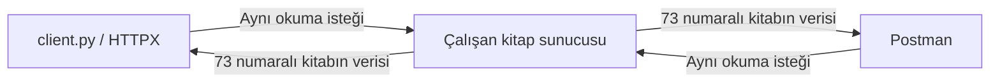

# Hafta 02 — Teorik Ders Notu

## Aynı Kitap Kataloğunda HTTP: İsteği Kurmak, Yanıtı Yorumlamak

**Ders:** Uygulama Programı Arayüzü (API)  
**Ön koşul:** Birinci haftanın üç kitaplı sunucusu ve çalışan HTTPX istemcisi  
**Sürüm:** 1.2 — 12 Eylül 2026 · Üzerinde çalışılıyor

Birinci haftanın uygulamasında önce tek kitabın başlığını gördük. Sonra durum kodunu, diğer alanları, listeleri, filtreleri ve hataları birer birer görünür hâle getirdik. Örneğin `rating` alanının gelmesiyle onun `null` veya `0` değerini kullanıcıya doğru göstermeyi ayrı adımlarda ele aldık.

İkinci haftada aynı tempoyla ilerliyoruz. Başlangıç sorumuz somut: **Kitapları okuyabiliyoruz. Yeni bir kitabı, `server.py` dosyasını elle değiştirmeden, istemciden nasıl gönderebiliriz?** Bunu anlayabilmek için önce bildiğimiz okuma isteğinin parçalarını açacağız; sonra yeni kitabın gidişini ve sunucunun yanıtını izleyeceğiz.

Bu teorik notu önce örnekler üzerinden oku. HTTP mesaj kutuları, iki program arasında taşınan bilgiyi gösterir; terminale yazılacak komutlar değildir. “Dur ve anlat” noktalarında sonucu kendi cümlenle açıklayıp gerekçeyle karşılaştır. Ardından [uygulama föyünde](02_Uygulama_Foyu.md) aynı örnekleri çalıştıracağız.

### Öğrenme yolu

| Sıra | Örneğin sorusu | Öğreneceğimiz kavram | Uygulama |
|---|---|---|---|
| 1 | Python'da çalışan isteği Postman da gönderebilir mi? | [İstemci ve ortak iletişim](#t01), [HTTP ile API'nin ilişkisi](#t02) | Hazırlık, Deney 1 |
| 2 | 57'yi istemekle uygun kitapları aramak aynı mı? | [Yol, sorgu ve sonuç seçimi](#t03) | Deney 2–3 |
| 3 | Kitap gelmediğinde tam olarak ne oldu? | [Yanıt kodu ve gövdesi](#t04) | Deney 3 |
| 4 | JSON istemekle JSON almak nasıl ayrılır? | [İstek ve yanıt başlıkları](#t05) | Deney 4 |
| 5 | Kitap okumak için yazılan yol kitap ekler mi? | [Metot ve yol](#t06) | Deney 5 |
| 6 | Yeni kitap bilgisi hangi biçimde gönderilecek? | [İstek gövdesi ve veri modeli](#t07) | Deney 6, 7A |
| 7 | Veri geri geldi; gerçekten kaydedildi mi? | [Alma, kaydetme, 201 ve Location](#t08) | Deney 7A–7B, 8 |
| 8 | Send'e ikinci kez basarsam ne değişir? | [Güvenli ve idempotent metot](#t09) | Deney 9 |
| 9 | Eksik alan, yanlış değer ve bozuk JSON aynı hata mı? | [Doğrulama katmanları](#t10) | Deney 10–12 |
| 10 | Diğer istemci yeni kitabı nasıl görür? | [Yanıtı yorumlama ve verinin ömrü](#t11) | Deney 13A–13B, 14–15 |

[Bölüm 12](#t12) sonraki haftalarda uygulayacağımız metot ve kodların karşılaştırma bölümüdür. Ana akışta GET ve POST üzerinde çalışacağız. Bütün kodları ezberlemek veya çalışmayı iki ders saatine sığdırmak için adımları atlamak hedefimiz değil.

<a id="t01"></a>

## 1. Bildiğimiz sonuçtan başlayalım

Birinci haftanın sonunda istemcide şu sonucu görmüştük:

```text
Book count: 1
Book title: Python ile Web API
Book author: Can Demir
Availability: Available to borrow
```

İstemci “başlığında Python geçen ve ödünç alınabilen kitapları istiyorum” dedi. Sunucu listesinde 73 numaralı kitap bu iki koşula uydu. İstemci aldığı bilgiyi yukarıdaki satırlara dönüştürdü. Kitabı bulma işi ile ekrana yazma işi iki ayrı programda gerçekleşti.

Şimdi aynı isteği Postman'da hazırladığımızı düşün. Aynı sunucu ve aynı veriler duruyorsa yine aynı kitabı alırız. Postman JSON'u gösterebilir; `client.py` başlığı ve yazarı ayrı satırlarda yazabilir. **Ekran farklı, alınan kitap aynı olabilir.**



Postman, kitap kataloğunun verisini tutan yeni bir sunucu değildir. Gönderilecek isteği arayüzden hazırlayan istemcidir. İnsan Send'e basar; HTTP mesajını gönderen yazılım Postman'dır. Python'da ise aynı işi HTTPX yapar.

Bu haftanın sonunda yeni kitabı Postman'dan gönderip Python'dan okuyacağız. Böylece “aynı API'yi farklı istemciler kullanabilir” cümlesini, iki ayrı programın aynı kaydı görmesiyle açıklayabileceğiz.

<a id="t02"></a>

## 2. İstemcinin cümlesini HTTP mesajına çevirmek

### 2.1. İsteğin anlamı ile yazımı

İnsan olarak şunu söyleyebiliriz:

> Bu sunucudaki kitaplar arasından başlığında Python geçen ve ödünç alınabilenleri getir.

İstemci bu cümleyi bizim API'mizin tanıdığı biçimde ifade eder:

```http
GET /api/books?search=Python&available=true HTTP/1.1
Host: 127.0.0.1:8000
Accept: application/json
```

Bu, ders için sadeleştirilmiş HTTP/1.1 gösterimidir. İstemci ek başlıklar da gönderebilir. İlk satırı “GET metoduyla, bu yola ve sorguya başvuruyorum” diye oku. `Host` hedef sunucuyu, `Accept` kabul edilen yanıt biçimini bildirir. Bu istekte gövde yoktur.

### 2.2. HTTP ile API aynı şey mi?

**HTTP**, açılımıyla *Hypertext Transfer Protocol*, bu örnekte istemci ve sunucunun istek–yanıt mesajlarını ortak kurallarla iletmesini sağlar. Metotlar, başlıklar ve durum kodları bu ortak iletişimin parçalarıdır. **Kitap API'miz** ise bu kuralları kullanarak hangi kitap işlemlerinin sunulduğunu ve hangi girdilerin kabul edildiğini tanımlar.

| Örnekte gördüğümüz şey | Kural nereden geliyor? |
|---|---|
| GET'in okuma anlamı | HTTP metodunun anlamından. |
| `/api/books` yolunun kitapları göstermesi | Bizim API tasarımımızdan. HTTP, `books` kelimesini özel olarak tanımaz. |
| `search` değerinin yalnızca başlıkta aranması | Bizim sunucu fonksiyonumuzdan. |
| `200` kodunun başarı bildirmesi | HTTP durum kodunun anlamından. |
| Sonuçta `title`, `author`, `rating` alanlarının bulunması | Bizim kitap yanıtı sözleşmemizden. |

Başka bir API aynı HTTP kurallarıyla hava durumu sunabilir. Oradaki yollar ve veri alanları başka olacaktır. HTTP'nin genel çerçevesi [HTTP Semantics standardında](https://www.rfc-editor.org/rfc/rfc9110.html#section-1) tanımlanır.

“API'ye istek attım” derken sunulan işlemi kullanmayı; “sunucuya istek gönderdim” derken mesajın ulaştığı tarafı anlatıyoruz. Bizim örneğimizde API, sunucunun önünde çalışan üçüncü bir program değildir; sunucudaki uygulamanın dışarı sunduğu işlemler ve kullanım kurallarıdır.

### 2.3. Tam adresi okumak

```text
http://127.0.0.1:8000/api/books?search=Python&available=true
```

| Parça | Bu örnekteki değer | Sorduğu sorunun cevabı |
|---|---|---|
| Şema | `http` | Hangi iletişim şeması? |
| Sunucu adresi | `127.0.0.1` | Hangi bilgisayar? Burada isteği gönderen bilgisayarın kendisi. |
| Port | `8000` | Sunucu hangi bağlantı noktasında dinliyor? |
| Yol | `/api/books` | Hangi hedefe başvuruyoruz? |
| Sorgu | `search=Python&available=true` | Bu API'deki okuma işlemi hangi filtreleri kullanacak? |

`?` sorguyu başlatır, `&` parametreleri ayırır. Metot URL'nin parçası değildir; Postman'da adresin yanından ayrıca seçilir. Aynı URL'ye GET ve POST gönderebilmemizin nedeni budur.

HTTP isteğinde metot ve hedefe ek olarak başlıklar, gerekiyorsa gövde bulunur. Bunları bir arada ezberlemek yerine, aşağıda aynı örneğin ihtiyacı ortaya çıktıkça ayrı ayrı inceleyeceğiz.

<a id="t03"></a>

## 3. Yol, sorgu ve dönen alanlar

### 3.1. Yol parametresiyle bir kitabı seçmek

```http
GET /api/books/57 HTTP/1.1
Host: 127.0.0.1:8000
```

Sunucuda `/api/books/{book_id}` yolu tanımlıdır. Buradaki `57`, `book_id` girdisine karşılık gelir. `book_id: int` bildirimi nedeniyle FastAPI bu yol değerini tam sayı olarak doğrular. Sonra bizim fonksiyonumuz `id` değeri 57 olan kitabı arar.

Bu adres kitabın adıyla arama yapmaz. Kimlik ile başlık aynı şey değildir; farklı kitaplar aynı başlığa sahip olabilir.

### 3.2. Sorgu parametreleriyle koleksiyonu süzmek

Birinci haftanın son verileri:

| `id` | `title` | `available` | `tags` |
|---|---|---|---|
| 42 | API Yolculuğu | `true` | `software`, `education` |
| 57 | Veriyle İlk Adımlar | `false` | Boş liste |
| 73 | Python ile Web API | `true` | `python`, `api` |

Bizim sunucumuzda `search`, yalnızca `title` içinde metin arar; `tags` alanına bakmaz. **`search` HTTP'nin hazır arama komutu değildir.** Parametrenin adını ve hangi alanı arayacağını uygulamayı yazan kişi belirler.

| İstek sorgusu | Dönen kimlikler | Gerekçe |
|---|---|---|
| `search=Python&available=true` | 73 | Başlıkta Python var ve kitap uygun. |
| `search=API&available=true` | 42, 73 | İki kitabın da başlığında API var ve ikisi de uygun. |
| `search=API&available=false` | Hiçbiri | API geçen iki kitabın da uygunluk değeri `true`. |
| `search=&available=false` | 57 | Boş arama bütün başlıklarla eşleşir; uygunluk filtresi 57'yi seçer. |
| Parametre yok | 42, 57, 73 | Varsayılan değerler filtreyi daraltmaz. |

`search=API&available=true` isteğinde sunucunun kontrolünü tek tek izleyelim:

| Kitap | Başlıkta API var mı? | Ödünç alınabilir mi? | Listeye girer mi? |
|---|---|---|---|
| 42 — API Yolculuğu | Evet | Evet | Evet; iki koşul da sağlanır. |
| 57 — Veriyle İlk Adımlar | Hayır | Hayır | Hayır. |
| 73 — Python ile Web API | Evet | Evet | Evet; API kelimesi başlığın sonunda da bulunabilir. |

Bu işlem kitapları değiştirmez. Yalnızca bu yanıtın listesine hangilerinin gireceğini seçer.

Bu sonuçlar tabloda gösterilen **üç kitaplı başlangıç** için geçerlidir. Kataloğa kayıt eklenince sonuçlar değişebilir.

`search=` boş metin gönderir; boşluk karakteri göndermez. Python'da boş metin her metnin içinde bulunur. `available=false` ise filtreyi kapatmaz: `false` olan kitapları seçer. Parametreyi hiç göndermediğimizde sunucudaki `None` varsayılanı uygunluk filtresini kapatır.

### 3.3. İki koşulun sırası ve iki yolun sırası

Bizim filtreleme kodumuz iki koşulu **ve** ile birleştirir. Her iki koşulun da sağlanması gerekir. Bu örnekte koşullar veri değiştirmediği için önce başlığı veya önce uygunluğu kontrol etmek sonucu değiştirmez.

`/api/books` ile `/api/books/{book_id}` yollarının sırası da bu iki yol için sorun oluşturmaz: birinde ek yol parçası yoktur, diğerinde vardır. Ancak ileride `/api/books/search` gibi sabit bir yol eklersen, genel `{book_id}` yolundan önce tanımlanması gerekebilir. Bütün yolların sırası önemsizdir diye genelleyemeyiz. [FastAPI: yol sırası](https://fastapi.tiangolo.com/tutorial/path-params/#order-matters).

### 3.4. Kitabı seçmek, kitabın alanlarını seçmek değildir

`search=Python`, hangi kitapların listeye gireceğini belirler. Dönen kitabın `author`, `tags` ve `rating` alanlarını kaldırmaz. İstemcide yalnızca başlığı yazdırmak da ağdan yalnızca başlığın geldiği anlamına gelmez.

Örneğin 73 numaralı kitap seçildiğinde yanıt yine şu alanları içerir:

```json
{
  "id": 73,
  "title": "Python ile Web API",
  "author": {"first_name": "Can", "last_name": "Demir"},
  "available": true,
  "tags": ["python", "api"],
  "rating": 4.5
}
```

İstemci ekranda sadece `Python ile Web API` yazsa bile yazar ve etiket bilgileri yanıtta taşınmıştır. Alan seçimi isteniyorsa API'nin bunu ayrıca desteklemesi gerekir; bu haftaki API'de böyle bir özellik yoktur.

> **Dur ve anlat:** 73 numaralı kitabın başlığından API kelimesini kaldırıp etikette bıraksak `search=API` onu bulur mu? Sonucun nedenini sunucu fonksiyonunun baktığı alan üzerinden açıkla.

<details><summary>Gerekçe</summary>

Bulmaz. Bizim aramamız yalnızca `title` alanına bakıyor; `tags` içeriği bu kararın parçası değil. Bu kuralı belirleyen HTTP veya parametrenin adı değil, yazdığımız arama kodudur.

</details>

<a id="t04"></a>

## 4. Yanıtı üç parçayla okumak

57 numaralı kitabı başarıyla istediğimizde sadeleştirilmiş yanıt:

```http
HTTP/1.1 200 OK
Content-Type: application/json

{"id":57,"title":"Veriyle İlk Adımlar","author":{"first_name":"Ece","last_name":"Yılmaz"},"available":false,"tags":[],"rating":0}
```

| Yanıt parçası | Bize verdiği bilgi |
|---|---|
| Durum kodu | İşlemin HTTP düzeyindeki sonucu. Burada `200`. |
| Başlıklar | Gövdenin biçimi gibi yanıtla ilgili bilgiler. |
| Gövde | Kitap verisi veya hata ayrıntısı gibi içerik. |

Birinci haftada gördüğümüz üç satırı bu yanıta bağlayabiliriz:

| İstemci çıktısı | Bilgi nereden geldi? |
|---|---|
| `Status code: 200` | Yanıtın durum kodundan. |
| `Response Content-Type: application/json` | Yanıt başlığından. |
| `Book title: Veriyle İlk Adımlar` | JSON gövdesindeki `title` değerinden; satırın etiketi istemcinin kendi yazısıdır. |

Önce durum kodunu, ardından ilgili başlıkları ve gövdeyi birlikte oku. `200`, bu okuma isteğinin başarıyla işlendiğini bildirir; verinin gerçek hayatta doğru yazıldığını veya hiç değişmeyeceğini kanıtlamaz.

### Benzer görünen dört farklı sonuç

| Durum | HTTP kodu | Örneğimizde gövde | Ne oldu? |
|---|---|---|---|
| Filtreye uyan kitap yok | `200` | `[]` | Koleksiyon başarıyla tarandı; eşleşme yok. |
| 999 numaralı kitap yok | `404` | `{"detail":"Book not found"}` | İstenen tek kitap bulunamadı. |
| Kimlik yerine `abc` gönderildi | `422` | Doğrulama ayrıntıları | Bu uç noktanın beklediği tam sayı girdisi sağlanamadı. |
| Sunucuya bağlantı kurulamadı | Yok | HTTP yanıtı yok | Bir HTTP durum kodu alınamadı. |

`404`, sunucudan yanıt geldiğini gösterir. `422` de bir HTTP yanıtıdır. Bir hata gövdesi JSON olabilir; JSON'un çözümlenebilmesi işin başarılı olduğunu göstermez. Web sayfasında görülen `404` de aynı HTTP durum kodudur; yanıtın HTML olması onu başka bir kod yapmaz.

<a id="t05"></a>

## 5. JSON istemek ile JSON geldiğini öğrenmek

57 numaralı kitabı okurken istemci `Accept: application/json` gönderdi; yanıtta `Content-Type: application/json` gördü. İki satırda aynı değer var ama farklı soruları cevaplıyorlar:

```text
İstemci → Sunucu
Accept: application/json
“Yanıt için JSON kabul ediyorum.”

Sunucu → İstemci
Content-Type: application/json
“Gönderdiğim bu yanıt gövdesi JSON.”
```

### 5.1. Tek değişiklik yapalım

Kitabı, GET metodunu ve adresi aynı tutalım. Yalnızca istekteki `Accept` değerini `text/plain` yapalım. Bu sunucuda yanıt yine JSON gelir; çünkü uygulamamıza bu başlığa göre farklı biçim üretme veya tercihi reddetme davranışı eklemedik.

Dolayısıyla başlık, sunucunun kodunu kendiliğinden değiştiren bir komut değildir. Başka bir API kabul edilen biçimi üretebilir veya örneğin `406` ile isteği karşılayamadığını bildirebilir. Bizim uygulamamızın sonucunu bütün API'lere genelleyemeyiz.

### 5.2. Hata cevabı da JSON olabilir

57 yerine 999 istediğimizde `Content-Type: application/json` ile şu gövde gelebilir:

```json
{"detail": "Book not found"}
```

Biçim hâlâ JSON'dur, fakat kod `404` olur. `Content-Type`, işlemin başarısını bildirmez; gövdenin nasıl okunacağını bildirir.

Postman'ın üstteki Headers alanında **gönderdiğimiz**, yanıt alanındaki Headers bölümünde **aldığımız** başlıklar görünür. Gövde de iki yönde bulunabilir; yeni kitap gönderirken istek tarafındaki `Content-Type` ile de karşılaşacağız.

> **Dur ve anlat:** `Accept` başlığını değiştirmek, sunucudaki kitabın başlığını veya yazarını değiştirir mi?

<details><summary>Gerekçe</summary>

Hayır. Bu başlık kabul edilen yanıt biçimiyle ilgilidir. Bu GET isteği kitap verisini düzenlemez; aynı kaydı okumayı ister.

</details>

<a id="t06"></a>

## 6. Kitabı okumak ile yeni kitap eklemek

Kütüphane kataloğuna **HTTP'yi Anlamak** adlı yeni bir kitap geldiğini düşün. Birinci haftada üçüncü kitabı eklemek için `server.py` içindeki listeyi elle değiştirmiştik. Şimdi görevli bilgileri istemciden göndersin; çalışan sunucu kataloğa eklesin istiyoruz.

Önce “mevcut yolumuz zaten `/api/books`; buraya GET göndersem yeni kitap eklenir mi?” diye düşünelim. Bizim GET fonksiyonumuz listeyi tarayıp kayıtları döndürüyor. Yeni kitap ekleyen bir satır yok. Sorguya yeni bir başlık yazmak da kitap yaratmaz; mevcut kitaplar içinde arar.

Bu API'de oluşturma işlemini **POST** ile tanımlayacağız:

| İstemcinin amacı | İstek | Sunucudan beklenen iş |
|---|---|---|
| Kitapları görmek | `GET /api/books` | Kayıtları oku ve döndür. |
| 57 numaralı kitabı görmek | `GET /api/books/57` | Bu kimliği ara ve tek kitabı döndür. |
| Yeni kitap kaydetmek | `POST /api/books` | Gövdede gönderilen kitabı değerlendir ve yeni kayıt oluştur. |

Yol aynı olsa bile metot farklı işlemi belirtir. POST genel olarak hedefin tanımladığı işleme veri gönderir; biz burada onu kitap oluşturmak için kullanacağız.

### POST kodunu henüz yazmadıysak

Birinci haftanın sunucusuna POST gönderdiğimizde şunu görürüz:

```http
HTTP/1.1 405 Method Not Allowed
Content-Type: application/json
Allow: GET

{"detail":"Method Not Allowed"}
```

Yol vardır, fakat POST işlemi desteklenmiyordur. `Allow: GET`, bu hedefte desteklenen metodu bildirir. Yeni JSON yazmak veya istemcinin dosya adını değiştirmek bu desteği eklemez; sunucudaki uygulamayı geliştirmemiz gerekir.

Uygulamada `@app.post` ile bir fonksiyonu bu istek türüne bağlayacağız. Fonksiyon adı tek başına HTTP işlemi oluşturmaz. Aynı biçimde bir veri modeli yazmak da henüz POST yolu tanımlamaz.

<a id="t07"></a>

## 7. Yeni kitabın bilgilerini mesaja yerleştirmek

Yeni kitap için bildiklerimiz şunlar: başlığı **HTTP'yi Anlamak**, yazarı **Selin Aras**, ödünç alınabilir, `http` ve `web` etiketleri var, henüz puan verilmemiş. Birinci haftada öğrendiğimiz alanlarla bu bilgiyi yazabiliriz:

Birinci hafta JSON çoğunlukla **sunucudan istemciye** geliyordu. Bu aynı veri biçimi şimdi **istemciden sunucuya** gidecek:

```json
{
  "title": "HTTP'yi Anlamak",
  "author": {
    "first_name": "Selin",
    "last_name": "Aras"
  },
  "available": true,
  "tags": ["http", "web"],
  "rating": null
}
```

Bu JSON'u POST isteğinin **gövdesine** koyacağız. Gövde, bu işlem için ilettiğimiz kitap verisini taşır. Yeni bir veri biçimi öğrenmedik; birinci haftada okumayı öğrendiğimiz nesneyi bu kez gönderen taraftayız.

Bu nesne yeni kitabın verisidir; sorgu filtresi değildir. `available: true`, yeni kaydın uygunluk değerini belirler. GET sorgusundaki `available=true` ise mevcut kayıtları süzer. Alanın adı aynı kalsa da **işlem ve verinin kullanıldığı yer** farklıdır.

Bu API'de kimliği sunucu üretecek. Bu yüzden oluşturma gövdesinde `id` istemiyoruz; yanıtımızda ise bulunacak. Gönderilen temsil ile dönen temsilin birebir aynı olması gerekmez.

### 7.1. Gövdenin JSON olduğunu kime söylüyoruz?

İstekte `Content-Type: application/json` göndeririz. Bu kez başlık istemciden gider; sunucuya gelen gövdenin biçimini bildirir. `Accept` ise yanıt için kabul ettiğimiz biçimi belirtmeye devam eder:

| Aynı POST isteğinde | Anlam |
|---|---|
| `Content-Type: application/json` | Gönderdiğim kitap verisi JSON. |
| `Accept: application/json` | Alacağım yanıt için JSON kabul ediyorum. |

İki tarafta da `Content-Type` görebilmemizin nedeni aynı başlığın **bulunduğu mesajın gövdesini** tanımlamasıdır. Gövdesiz GET örneklerimize istek Content-Type başlığı eklememiz gerekmemişti.

### 7.2. Sunucu hangi kitabı kabul edeceğini nasıl bilecek?

Birinci hafta `book_validation.py` ile “JSON okunabildi” ve “veri beklediğim kurala uydu” ayrımını gördük. İkinci haftada gövdenin beklenen yapısını **Pydantic modeli** ile tarif edeceğiz. FastAPI bu modeli kullanarak HTTP isteğinin verisini doğrulayacak. [FastAPI: istek gövdesi](https://fastapi.tiangolo.com/tutorial/body/).

İstemcinin gönderdiği her JSON'u düşünmeden listeye eklemek istemiyoruz. Örneğin yazarın soyadı eksikse, okumak için yazdığımız istemci beklediği alanı bulamayabilir. Sunucunun bu istekte ne beklediğini bir modelle bildirmesi, iki tarafın veri konusunda anlaşmasını sağlar.

Uygulamada `AuthorCreate` yazarın, `BookCreate` ise oluşturulacak kitabın alanlarını tanımlayan Python sınıflarıdır. `class`, bu adla bir yapı tanımlar; `(BaseModel)` kısmı Pydantic'in doğrulama özelliklerini kullanmamızı sağlar. Bu sınıflar veritabanı tablosu veya ayrı sunucu değildir.

| Model alanı | Kabul etmek istediğimiz veri | Örnek |
|---|---|---|
| `title` | Metin | `"HTTP'yi Anlamak"` |
| `author` | `first_name` ve `last_name` içeren nesne | Yukarıdaki yazar nesnesi |
| `available` | Mantıksal değer | `true` |
| `tags` | Metinlerden oluşan liste | `["http", "web"]` veya `[]` |
| `rating` | Sayı veya `null` | `4.5`, `0`, `null` |

### 7.3. Alanın bulunması ile değerinin `null` olması

Bizim modelimizde `rating: float | None` yazacak ve varsayılan değer vermeyeceğiz. Bunun anlamı **alan gönderilmeli; değeri sayı veya `null` olabilir**. `null` kabul etmek, alanın hiç gönderilmeyebileceği anlamına gelmez. Varsayılan eklemek ayrı bir tasarım kararıdır. [Pydantic: varsayılan değerler](https://docs.pydantic.dev/latest/concepts/fields/#default-values).

| Gövdede durum | Bizim modelimizin sonucu | Anlam |
|---|---|---|
| `"rating": null` | Kabul edilir | Puan henüz verilmemiş. |
| `"rating": 0` | Kabul edilir | Puanın değeri sıfır. |
| `rating` anahtarı yok | Reddedilir | Gönderilmesi gereken alan eksik. |

Modelin şu an sayının 0–5 aralığında olmasını denetlemediğine dikkat et. Tür bildirimi bütün iş kurallarını kendiliğinden yazmaz. Benzer biçimde başlık benzersizliği kuralı da eklemedik. Ayrıntılı iş kuralları beşinci haftada ele alınacak.

<a id="t08"></a>

## 8. Sunucu veriyi aldı: kaydetti mi, yalnızca geri mi gönderdi?

Yeni kitabı gönderen isteği artık bütünüyle okuyabiliriz. Bu sadeleştirilmiş HTTP/1.1 gösteriminde istemcinin eklediği bazı taşıma başlıkları çıkarılmıştır:

```http
POST /api/books HTTP/1.1
Host: 127.0.0.1:8000
Accept: application/json
Content-Type: application/json

{
  "title": "HTTP'yi Anlamak",
  "author": {"first_name": "Selin", "last_name": "Aras"},
  "available": true,
  "tags": ["http", "web"],
  "rating": null
}
```

Metot ne istediğimizi, yol hedefi, başlıklar mesajla ilgili bilgileri, boş satırdan sonraki gövde ise işlenecek kitap verisini taşır. Şimdi sunucu kodunu iki küçük aşamada geliştireceğiz.

### 8.1. İlk gözlem: gelen kitabı geri göstermek

Önce geçici bir öğrenme sürümünde sunucu gövdeyi doğrulasın ve aynı alanları `200` ile geri göndersin. Henüz listeye ekleme kodu yazmayalım. Böylece yalnızca **gövdenin istemciden sunucuya ulaştığını ve okunabildiğini** inceleyebiliriz.

```text
POST öncesi kitap sayısı: 3
POST yanıtı: 200 ve gönderdiğimiz kitap alanları
Ardından GET /api/books: yine 3 kitap
```

Yeni kitabın POST yanıtında görünmesi, onun kataloğa kaydedildiğini kanıtlamadı. Yanıt oluşturmak ile saklama işlemi yapmak farklı işlerdir. Bu sürüm, kayıt ekleme özelliğini henüz tamamlamadığımız bir ara adımdır; nihai oluşturma sözleşmemiz olmayacak.

### 8.2. İkinci gözlem: yeni kaydı gerçekten eklemek

Sonraki değişiklikte aynı gövdeyi kullanalım; sunucu yeni kimliği üretsin, kitabı listeye eklesin ve `201` döndürsün:

```text
POST öncesi kitap sayısı: 3
POST yanıtı: 201 ve kimliği 74 olan yeni kitap
Ardından GET /api/books: 4 kitap
GET /api/books/74: 200 ve yeni kitap
```

Bu kez katalog değişti. `201`, yeni kaynağın oluşturulduğunu bildirir. Sunucuda normal başarı kodunu 201 yazmak **tek başına** kayıt eklemez; bizim uygulamamızda listeyi değiştiren satır `books.append(new_book)` olacaktır. Sonraki GET, yeni kitabın diğer isteklerle okunabildiğini gösterir.

| Bu gelişme adımındaki Python işlemi | Kitap örneğinde ne işe yarıyor? |
|---|---|
| Mevcut kimlikleri dolaşmak | 42, 57, 73 içinden en büyük kimliğin bir fazlasını, 74'ü bulmak. |
| `book_data.model_dump()` | Doğrulanmış kitap ve yazar modelini, mevcut listemizin kullandığı sözlük yapısına çevirmek. |
| `new_book["id"] = next_book_id` | Sunucunun ürettiği kimliği eklemek. |
| `books.append(new_book)` | Yeni kitabı çalışan sunucunun listesine koymak. |
| `return new_book` | Kaydın bilgilerini yanıt gövdesinde istemciye göndermek. |

Modelden sözlüğe dönüşüm [Pydantic'in serileştirme belgesinde](https://docs.pydantic.dev/latest/concepts/serialization/#python-mode) açıklanır. Burada dönüşümü, birinci haftadaki liste ve sözlük düzenimizi sürdürebilmek için kullanıyoruz.

### 8.3. Üçüncü gözlem: yeni kaydın adresini öğrenmek

Yeni kaydı oluşturduktan sonra istemci onu tekrar okumak istesin. Yanıta `Location: /api/books/74` ekleyerek adresini bildirebiliriz:

```http
HTTP/1.1 201 Created
Content-Type: application/json
Location: /api/books/74

{
  "title": "HTTP'yi Anlamak",
  "author": {"first_name": "Selin", "last_name": "Aras"},
  "available": true,
  "tags": ["http", "web"],
  "rating": null,
  "id": 74
}
```

Başlıktaki yolu aynı sunucu adresiyle birleştiririz: `http://127.0.0.1:8000/api/books/74`. Bu adrese GET gönderdiğimizde kitabı okuruz. `Location` bize adresi verir; istemci adına yeni GET isteği göndermez. `201` yanıtı da bir yönlendirme yanıtı değildir. [HTTP: 201 ve Location](https://www.rfc-editor.org/rfc/rfc9110.html#section-15.3.2).

Kodda kullanacağımız `response: Response` nesnesini FastAPI sağlar; gövdede `response` alanı istemeyiz. `response.headers` ile sunucunun göndereceği başlığı ayarlarız. [FastAPI: yanıt başlıkları](https://fastapi.tiangolo.com/advanced/response-headers/).

> **Dur ve anlat:** İki farklı sunucu sürümü de POST yanıtında aynı kitap başlığını gösteriyor. Birinde kitap sayısı üçte kalıyor, diğerinde dörde çıkıyor. Farkı yalnızca “JSON geldi” diyerek açıklayabilir miyiz?

<details><summary>Gerekçe</summary>

Hayır. İlk sürüm veriyi geri gönderiyor; ikinci sürüm ayrıca listeye ekliyor. İstek gövdesini almak, yanıt üretmek ve veri saklamak üç ayrı işlemdir. Hangi işlemin yapıldığını sözleşme, sunucu kodu ve sonraki okuma sonucuyla birlikte anlarız.

</details>

Kitap listeye eklendiğinde `server.py` dosyasının metni değişmez. Bu hafta bellek üzerinde çalışıyoruz; kalıcılığı Bölüm 11'de ayrıca gözlemleyeceğiz.

<a id="t09"></a>

## 9. Aynı isteği tekrar göndermek neyi değiştirir?

### 9.1. Önce deneyin sonucu

Kitap oluşturma özelliğini tamamladığımız sürümde, temiz başlangıçta üç kitap olduğunu düşün:

| Sıra | İstek | Kitap sayısı | Neden? |
|---|---|---|---|
| 1 | `GET /api/books` | 3 | Okuma yeni kitap eklemez. |
| 2 | Aynı GET | 3 | Tekrar okumak ekleme işlemi değildir. |
| 3 | Geçerli kitap gövdesiyle POST | 4 | Sunucu 74 kimlikli yeni kayıt ekler. |
| 4 | Aynı gövdeyle aynı POST | 5 | Sunucu 75 kimlikli başka kayıt ekler. |

Aynı başlığa izin verdiğimiz için son iki kayıt aynı bilgilere, farklı kimliklere sahip olabilir. Bu örnekte tekrar gönderilen POST, var olan kaydı bulup üzerine yazmaz.

### 9.2. Önce kendi cümlenle, sonra terimle

GET için “kaç kez okusam da bu istek yeni kitap eklemiyor”; POST için “her gönderişimde bir kayıt daha oluşuyor” diyebiliyoruz. Aşağıdaki terimler bu iki gözlemden hareketle okunmalı.

### 9.3. Güvenli metot — safe

HTTP'de “güvenli”, isteğin amaçlanan anlamının kaynak durumunu değiştirmek olmamasıdır. GET ile kitabı okumak buna örnektir. Sunucunun istek günlüğü tutması buna aykırı değildir. Buradaki “güvenli”, şifreleme veya yetkili erişim garantisi demek değildir.

### 9.4. Idempotent metot

Aynı isteğin birden çok kez yapılmasının sunucudaki amaçlanan etkisi, bir kez yapılmasıyla aynıysa işlem idempotenttir. Yanıt metninin ve kodunun her seferinde aynı olması şart değildir. GET idempotenttir; POST için böyle genel bir garanti yoktur. Bizim kitap ekleme POST'umuz tekrarlandığında yeni kayıt oluşturduğu için idempotent değildir. [HTTP: metot özellikleri](https://www.rfc-editor.org/rfc/rfc9110.html#section-9.2).

Bu bilgi pratikte tekrar deneme kararını etkiler. POST gönderilirken bağlantı kopup yanıt alınamazsa, işlemin hiç yapılmadığı sonucunu hemen çıkaramayız. Yanıt kaybolmadan önce kitap eklenmiş olabilir. Kontrol etmeden tekrar göndermek ikinci kayıt oluşturabilir.

<a id="t10"></a>

## 10. JSON yazımı, veri modeli ve hata yanıtı

Yeni kitap oluşturma isteğinde üç ayrı soruya bakarız:

| Soru | Hata örneği | Bizim deneyimizde sonuç |
|---|---|---|
| Gövde JSON olarak çözümlenebiliyor mu? | Son alanın ardından fazladan virgül | `422`, JSON çözümleme ayrıntısı |
| Veri beklenen modele uyuyor mu? | `author.last_name` eksik; `available` değeri `"belki"` | `422`, ilgili alanın doğrulama ayrıntısı |
| Uygulamanın iş kuralları sağlanıyor mu? | Örneğin gelecekte 0–5 dışında puan | Bu hafta aralık kuralı yazılmadı; kendiliğinden denetlenmez. |

Bu, hataları anlamak için kavramsal bir ayrımdır; FastAPI'nin bütün iç adımlarının kesin çalışma sırası olarak okunmamalıdır.

### 10.1. `422` gövdesini nasıl okuyacağız?

Önce doğru yazar nesnesini, sonra yalnızca soyadı eksiltilmiş olanı karşılaştır:

```json
{"first_name": "Selin", "last_name": "Aras"}
```

```json
{"first_name": "Selin"}
```

Bunlar tam POST gövdeleri değil, aynı gövdenin içindeki `author` alanının iki alternatif değeridir. İkisi de geçerli JSON nesnesidir; ikincisinde modelimizin istediği soyadı yoktur. Sunucunun hata konumu `loc` bu eksikliği şöyle gösterir:

```json
["body", "author", "last_name"]
```

`body`, sorunun istek gövdesinde; `author`, yazar nesnesinde; `last_name`, soyadı alanında olduğunu gösterir. `msg` açıklamayı, `type` hata türünü belirtir. Bütün hata metnini ezberlemeyiz; sorunlu girdiyi buluruz. Ayrıntıların yazımı sürüme göre değişebilir.

FastAPI, burada geçersiz girdiyi oluşturma fonksiyonumuza iletmeden hata yanıtı üretir. Sonuç olarak `books.append(...)` çalışmaz; kitap sayısı artmaz. Varsayılan istek doğrulama davranışı [FastAPI hata yönetimi belgesinde](https://fastapi.tiangolo.com/tutorial/handling-errors/#override-request-validation-exceptions) açıklanır.

### 10.2. Birinci haftanın elle doğrulamasıyla farkı

Birinci hafta yazdığımız `isinstance(...)` kontrolünün kabul ettiği değerlerle Pydantic'in varsayılan dönüşümleri aynı olmak zorunda değildir. Örneğin Pydantic bazı tanınan metinleri mantıksal değere çevirebilir. Bu nedenle `"true"` gönderip “yanlış tür kesin reddedilir” diye beklemeyiz; hata deneyinde dönüştürülemeyen `"belki"` kullanırız. Normal JSON gövdemizde tırnaksız `true` ve `false` göndeririz. [Pydantic: bool doğrulaması](https://docs.pydantic.dev/latest/api/standard_library_types/#booleans).

URL sorgusunda `available=true` metinsel URL verisidir; FastAPI onu Python'da `True` değerine çevirir. JSON gövdesinde ise `true` zaten JSON'un mantıksal değeridir. İki yazımın taşındığı yer farklıdır.

### 10.3. Her API aynı hataya aynı kodu mu verir?

Hayır. HTTP'de `400` genel istemci isteği hatasını, `415` desteklenmeyen içerik biçimini, `422` ise biçimi anlaşılmış içeriğin işlenememesini anlatır. Ancak bu föydeki FastAPI varsayılanı **bozuk JSON yazımını da `422` ile bildirir**. Deneydeki kod ile standardın kavramsal ayrımını ayrı okuyacağız; “bozuk JSON her zaman 400 döner” veya “422 geldiyse JSON kesin geçerliydi” demeyeceğiz.

<a id="t11"></a>

## 11. Aynı kaydı farklı istemciden okumak ve yeniden başlatmayı anlamak

### 11.1. Postman'da yaptığımızı Python'a taşımak

Postman'da çalıştırdığımız kitap ekleme isteğinde metot POST, yol `/api/books`, gövde yeni kitap nesnesiydi. Aynı alanları HTTPX ile gönderdiğimizde yeni bir API tasarlamayız; aynı kullanım kurallarını başka istemciyle uygularız.

`create_book.py` içinde önce yalnızca gönderilen mesaj bilgilerini, durum kodunu ve ham yanıt gövdesini göreceğiz. Sonra programın `id`, `title` ve `Location` bilgilerini okuyup kullanıcıya göstermesini ekleyeceğiz. Birinci haftadaki “veri geldi; istemci bunu nasıl kullanacak?” adımını bu kez oluşturma yanıtına uyguluyoruz.

| Kodda gördüğümüz ifade | Dönüşümün yönü | Kitap örneği |
|---|---|---|
| `json=new_book` | Python verisi → istek JSON'u | `True` ve `None`, gönderilirken `true` ve `null` olur. |
| `response.json()` | Yanıt JSON'u → Python verisi | Dönen `id` değerini Python'da okuyabiliriz. |

HTTPX `json=` seçeneğiyle JSON gövdesini ve istek Content-Type başlığını hazırlar. [HTTPX: JSON gönderme](https://www.python-httpx.org/quickstart/#sending-json-encoded-data).

### 11.2. Yeni kitap hangi programın içinde?

```text
create_book.py → POST → sunucunun books listesine 74 eklendi
client.py      → GET  → aynı sunucunun listesinden 74 okundu
Postman        → GET  → aynı kaydı okuyabilir
```

İstemciler birbirlerinin değişkenlerini okumuyor; aynı sunucuya ayrı HTTP istekleri gönderiyor. Sunucudaki kayıt sayesinde aynı bilgiyi alıyorlar.

| Dosya | Sorumluluğu |
|---|---|
| `server.py` | Veriyi tutmak, girdiyi doğrulamak, okuma ve oluşturma işlemlerini yürütmek. |
| `client.py` | GET göndermek ve bulunan kitapları göstermek. |
| `create_book.py` | POST göndermek ve oluşturma sonucunu göstermek. |

### 11.3. Üç hareket, üç farklı sonuç

74 numaralı kitap yeni eklenmişken şu hareketleri ayrı ayrı düşün:

| Hareket | Kayıt durumu | Neden? |
|---|---|---|
| `client.py` bitti; onu tekrar çalıştırdık | 74 hâlâ okunabilir. | İstemcinin kapanması çalışan sunucunun listesini sıfırlamadı. |
| Postman'ı kapatıp açtık | Sunucu çalışıyorsa 74 hâlâ okunabilir. | Kaydı Postman'ın ekranında saklamıyoruz. |
| Sunucuyu kapatıp yeniden açtık | 74 artık yok; üç başlangıç kitabı var. | Bellekteki liste, dosyadaki başlangıç verisinden yeniden oluşturuldu. |

Son durumda HTTP başlıklı kitapları aramak `200` ve `[]`, doğrudan 74'ü istemek `404` verir. Sunucu kapalıyken istek gönderirsek HTTP yanıtı alamayız. Bu sonuçların her biri farklı bir soruya cevap verir.

### 11.4. “Durumsuz” demek “sunucu veri tutamaz” mı?

Hayır. Kitabın sunucuda durması kaynak verisinin saklanmasıdır. Yeni bir istemci, önceki POST konuşmasına katılmamış olsa da `GET /api/books/74` göndererek kitabı okuyabilir. GET, neyin istendiğini kendi hedefinde belirtir. Bu örnek, kaynak verisiyle istemcinin önceki adımlarına bağımlılığı ayırmamıza yardım eder.

Kalıcı kayıt gerektiğinde sunucuyu kapatıp açınca da kitabın durmasını isteriz. PostgreSQL ile bunu altıncı haftada sağlayacağız. Redis ile seçilmiş yanıtların geçici önbelleğini on ikinci haftada inceleyeceğiz.

> **Dur ve anlat:** `client.py` kapanınca kitabın kaybolmaması, sunucu yeniden başlayınca kaybolması bize verinin nerede tutulduğunu nasıl gösterir?

<details><summary>Gerekçe</summary>

Veri istemcide değil, çalışan sunucu sürecindeki listede tutuluyor. Kalıcı saklama eklenmediği için sunucu yeniden başlatılınca sonradan eklenen kayıtlar yüklenmiyor. Daha önce alınan `201`, kaydın o anda oluşturulduğunu doğru bildirmişti.

</details>

<a id="t12"></a>

## 12. Ana akıştan sonra: diğer metot ve kodları örnekle tanı

Bu bölüm karşılaştırma için başvuru bölümüdür; ana deneylere devam etmeden önce ezberlenmesi gerekmez. Föyde GET ve POST'u uyguluyoruz. PUT, PATCH ve DELETE desteğini dördüncü haftada yazacağız; bu metotlarla yalnızca `405` almak güncelleme ve silme davranışını öğretmez.

### 12.1. PUT ile PATCH arasındaki gerçek fark

57 numaralı kitabı düzenlemek istediğimizi düşün:

| İstek | İfade edilen amaç |
|---|---|
| `PUT /api/books/57` | Hedef kaynağın durumunu, API'nin kabul ettiği tam yeni temsille oluştur veya değiştir. |
| `PATCH /api/books/57` | Hedef kaynağa belirtilen değişiklikleri uygula. |
| `DELETE /api/books/57` | Hedef kaynağı kaldır. |

PUT ile yalnızca yeni başlığı yollayıp “diğer alanlar mutlaka korunur” diye varsayamayız; temsilin gerekliliklerini API tanımlar. PATCH için ise örneğin “yalnızca `available` değerini `true` yap” değişikliği tanımlanabilir. PATCH gövdesinin biçimi de API'nin desteklediği yama biçimine bağlıdır; tek bir evrensel PATCH JSON'u yoktur. [PATCH standardı](https://www.rfc-editor.org/rfc/rfc5789.html#section-2).

**Kitap örneğinde düşünelim:** Gelecekteki API'miz PUT için bütün düzenlenebilir alanları istesin; PATCH ise gönderilen alanların değerini değiştirmeyi desteklesin. 57'nin yalnızca uygunluğunu değiştirmek için karşılaştırma şöyle olur:

| | PUT için gönderilecek bilgi | Bu varsayımsal PATCH için gönderilecek bilgi |
|---|---|---|
| `title` | Veriyle İlk Adımlar | Gönderilmez; mevcut başlık korunur. |
| `author` | Ece Yılmaz'ın ad ve soyad nesnesi | Gönderilmez; mevcut yazar korunur. |
| `available` | `true` | `true` |
| `tags` | `[]` | Gönderilmez; mevcut etiketler korunur. |
| `rating` | `0` | Gönderilmez; mevcut puan korunur. |

Her iki istek de bu tasarımda aynı son duruma ulaşabilir, fakat farklı talimat verir. Bu tablo **henüz yazmadığımız bir sözleşmenin karşılaştırmasıdır**; mevcut sunucumuz bu metotları desteklemez.

PUT ve DELETE idempotent metotlardır. İki DELETE isteğinin ilki başarılı, ikincisi `404` olabilir; hedefin kaldırılmış olması bakımından sonuç aynıdır. PATCH idempotentlik garantisi vermez: “değeri true yap” ile “değeri tersine çevir” tekrarlandığında aynı etkiyi üretmez. POST'un oluşturma dışında başka işlemler için de kullanılabildiğini hatırla.

`HEAD`, GET'e benzer biçimde başlıkları almayı, gövdeyi almamayı sağlar. `OPTIONS`, hedefin iletişim seçeneklerini sorgular. Bunları bu haftaki sunucuya ayrıca eklemiyoruz.

### 12.2. Durum kodu ailesi ve çalışma kapsamı

| Aile | Genel anlam |
|---|---|
| `1xx` | Ara bilgilendirme |
| `2xx` | Başarı |
| `3xx` | Yönlendirme veya isteğin tamamlanması için ilgili ek işlem |
| `4xx` | İstemci isteğinin karşılanamamasıyla ilgili durum |
| `5xx` | Sunucunun isteği yerine getirirken karşılaştığı hata |

`4xx`, mutlaka Python istemcisinde yazım hatası var demek değildir. Olmayan kitabı düzgün yazılmış bir istekle aramak da `404` üretebilir.

| Bu hafta çalıştırıp okuyacağız | Sonraki çalışmalarda ayrıntılandıracağız |
|---|---|
| `200`: başarılı okuma; ara sürümde gövdeyi geri gösterme | `204`: başarılı işlem, yanıt gövdesi yok |
| `201`: yeni kitap oluşturuldu | `400`: hatalı istek; `415`: desteklenmeyen içerik biçimi |
| `404`: istenen tek kitap yok | `401`: geçerli kimlik bilgisi gerekli; `403`: erişim reddedildi |
| `405`: bu hedefte metot desteklenmiyor | `409`: kaynak durumuyla çakışma |
| `422`: bu FastAPI örneğinde istek doğrulama hatası | `500`: sunucuda beklenmeyen hata |

`204` yanıtında gövde bulunmadığından `response.json()` ile JSON çözümlemeye çalışmayız. Bütün başarılı işlemleri yalnızca `200` bekleyen tek koşulla değerlendirmek de doğru değildir; bu haftaki okuma istemcisi `200`, oluşturma istemcisi `201` bekleyecek. Kod adları için [IANA durum kodu kaydı](https://www.iana.org/assignments/http-status-codes/http-status-codes.xhtml) kullanılabilir.

<a id="t13"></a>

## 13. Sık karıştırılan noktalar

| Yanılgı | Açık karşılığı |
|---|---|
| “Postman'a geçince yeni API kurduk.” | Aynı sunucuya farklı istemciden istek gönderdik. |
| “`search`, bütün kitap alanlarını arar.” | Bizim fonksiyonumuz yalnızca `title` alanını arar. `tags` araması yazılmadı. |
| “`available=false` filtreyi kapatır.” | Yalnızca uygunluk değeri `false` olan kitapları seçer. Filtreyi kapatmak için parametreyi göndermeyiz. |
| “Aynı URL aynı işlemdir.” | İşlemi belirlerken HTTP metodu da gerekir. GET ve POST farklıdır. |
| “`Accept` gönderdiğim verinin türüdür.” | Beklediğim yanıt biçimini bildirir. Gönderdiğim gövdenin biçimi istek `Content-Type` başlığındadır. |
| “Model yazınca veri kaydedildi.” | Model yapıyı tarif eder; bizim uygulamamızda kayıt `books.append(...)` ile yapılır. |
| “`rating` null olabiliyorsa göndermesem de olur.” | Bu modelde alan zorunludur; değeri `null` olabilir. |
| “`201`, verinin diske yazıldığını kanıtlar.” | Kaynağın oluşturulduğunu bildirir. Kalıcılık kullanılan saklama düzenine bağlıdır. |
| “İki aynı POST aynı kitaba gider.” | Tamamlanmış oluşturma sürümümüz her seferinde yeni kimlikle yeni kitap oluşturur. |
| “İdempotent isteğin yanıtı hep aynıdır.” | Tanım, tekrarlamanın sunucuda amaçlanan etkisiyle ilgilidir. |

<a id="t14"></a>

## 14. Haftayı tamamlama soruları

1. `GET /api/books?search=API&available=true` başlangıç verisinde neden iki kitap döndürür? Başlıktaki API metnini kaldırıp yalnızca etikette bıraksak ilgili kitap yine gelir mi?
2. `Accept` ve istek `Content-Type` başlıklarını POST örneğimiz üzerinde açıkla.
3. Yol aynı kaldığı hâlde GET `200`, POST `405` verebilir mi? Sunucuda ne eksiktir?
4. Geçerli POST `201` ve `Location: /api/books/74` döndürdü. Kaydın okunabildiğini hangi yeni istekle doğrularsın?
5. `rating` alanını göndermemek, `null` göndermek ve `0` göndermek bu modelde nasıl ayrılır?
6. Aynı POST'u iki kez gönderince ne olur? Sunucuyu yeniden başlatınca oluşturulan kitaplar neden kaybolur?

<details>
<summary>Gerekçeli cevaplar</summary>

1. 42 ve 73'ün başlığında API vardır ve ikisi de uygundur. Arama yalnızca başlığa baktığı için metnin yalnızca etikette olması yeterli olmaz.
2. `Accept`, yanıtı hangi biçimde istediğimizi; istek `Content-Type`, gönderdiğimiz kitap gövdesinin biçimini bildirir.
3. Evet. GET yolu yazılmış, aynı yolda POST işlemi tanımlanmamış olabilir. Metot desteği eklemek gerekir.
4. `GET http://127.0.0.1:8000/api/books/74`. `201` oluşturmayı, ardından gelen `200` ve kitap gövdesi okumayı gösterir.
5. Alan eksikse `422`; `null` ise henüz puan yok; `0` ise puan sıfırdır. Son ikisi kabul edilir. İstemci `is None` ile bu anlamları ayırır.
6. Bu uygulama farklı kimliklerle iki kayıt oluşturur. Veriler yalnızca çalışan sürecin belleğinde tutulduğu için yeniden başlatıldığında dosyadaki başlangıç listesi yüklenir.

</details>

**Devam:** [Uygulama föyünü aç](02_Uygulama_Foyu.md). Önce başlangıç verisini doğrula; her deneyde tahminini yazıp tek adımı çalıştır ve gözlemle karşılaştır.
