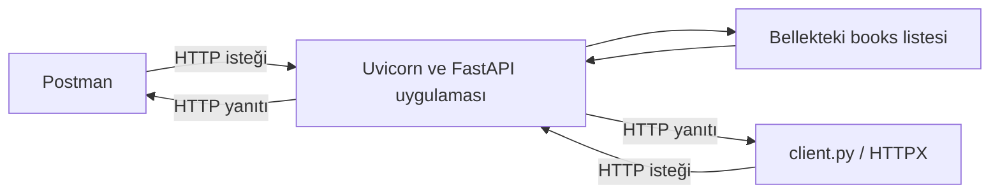

# Hafta 02 — Teorik Ders Notu

## Aynı Kitap Kataloğunda HTTP: İsteği Kurmak, Yanıtı Yorumlamak

**Ders:** Uygulama Programı Arayüzü (API)  
**Ön koşul:** Birinci haftanın üç kitaplı sunucusu ve çalışan HTTPX istemcisi  
**Sürüm:** 1.1 — 12 Eylül 2026 · Üzerinde çalışılıyor

Birinci hafta isteği gönderdik, sunucunun kitapları seçtiğini ve istemcinin JSON yanıtını ekrana dönüştürdüğünü gördük. Bu hafta şu soruyu yanıtlıyoruz: **İstemci, sunucudan ne istediğini HTTP mesajının hangi parçasıyla anlatır; sunucunun ne yaptığını yanıttan nasıl anlarız?**

Önce bildiğimiz GET isteğini Postman ile kuracağız. Ardından aynı kataloğa bir kitap ekleyerek istek gövdesini, `201` yanıtını ve hata durumlarını inceleyeceğiz. Örnek, adlandırma ve veri yapısı birinci haftadan devam eder. Kodun çalıştırıldığı bütün adımlar [uygulama föyündedir](02_Uygulama_Foyu.md).

### Öğrenme yolu

| Sıra | Teori | Uygulamadaki karşılığı |
|---|---|---|
| 1 | [İstemci değişir, API aynı kalır](#t01) | Hazırlık, Deney 1 |
| 2 | [URL ve istek parçaları](#t02), [yol ve sorgu](#t03) | Deney 2–3 |
| 3 | [Yanıtı okumak](#t04), [başlıklar](#t05) | Deney 3–4 |
| 4 | [Metot ve yol](#t06), [istek gövdesi](#t07) | Deney 5–6 |
| 5 | [Kitap oluşturmak ve adresini bildirmek](#t08) | Deney 7–8 |
| 6 | [İsteği tekrarlamanın etkisi](#t09) | Deney 9 |
| 7 | [JSON, model ve hata ayrımı](#t10) | Deney 10–12 |
| 8 | [İletişimin bütünü ve verinin ömrü](#t11) | Deney 13–15 |
| 9 | [Diğer metot ve kodları tanımak](#t12) | Kavramsal karşılaştırma; uygulaması sonraki haftalarda |

Bu haftanın sonunda bir GET ve bir POST isteğini hem okuyabilmeli hem hazırlayabilmelisin. Bütün HTTP kodlarını ezberlemen veya tam bir CRUD uygulaması yazman beklenmiyor. Çalışmayı anlamayı tamamlayacak hızda ilerlet; föyün tamamını iki ders saatine sığdırmak zorunlu değil.

<a id="t01"></a>

## 1. Aynı isteği başka bir istemciyle göndermek

Birinci haftanın son isteği şuydu:

```http
GET /api/books?search=Python&available=true HTTP/1.1
Host: 127.0.0.1:8000
Accept: application/json
```

Bu, HTTP/1.1 mesajının ders için sadeleştirilmiş gösterimidir. İstemci bazı ek başlıkları kendisi ekler. Bu metni bir Python dosyasına yapıştırmıyoruz.

İsteği `client.py` de Postman da gönderebilir. Bizim sunucumuz bu istemcilerin ekranlarını bilmez; gelen metodu, hedefi ve ilgili girdileri işler. Aynı veriler duruyorsa ve aynı istek gönderiliyorsa iki istemci de aynı kitap sonucunu alır. Ekrana yazma biçimleri farklı olabilir.



**Postman API'yi oluşturmaz.** İstek hazırlayıp yanıtı incelememize yarayan bir istemcidir. Sunucudaki davranışı hâlâ `server.py` içinde biz yazarız. Postman'a POST seçeneğini eklemek için sunucu yazmayız; POST isteğini *işlemesi* için sunucuya uygun kodu ekleriz.

“API'ye istek gönderdim” arayüzü kullanmayı, “sunucuya istek gönderdim” isteğin ulaştığı tarafı anlatır. Bu örnekte ikisi aynı iletişimin farklı yönleridir.

<a id="t02"></a>

## 2. İstek mesajını parçalara ayırmak

Tam URL:

```text
http://127.0.0.1:8000/api/books?search=Python&available=true
```

| Parça | Bu örnekteki değer | Ne anlatır? |
|---|---|---|
| Şema | `http` | Kullanılan iletişim şeması. `https` kullanıldığında HTTP iletişimi TLS ile korunur. |
| Sunucu adresi | `127.0.0.1` | İsteği gönderen bilgisayarın kendisi. Postman da sunucu da aynı bilgisayarda çalışıyor. |
| Port | `8000` | Bu bilgisayarda sunucunun dinlediği bağlantı noktası. |
| Yol | `/api/books` | Bu API'deki kitap koleksiyonunun yolu. |
| Sorgu | `search=Python&available=true` | Bu API'nin tanımladığı iki filtre girdisi. |

`?` sorguyu başlatır; `&` parametreleri ayırır. Parametre sırası burada sonucu değiştirmez: `available=true&search=Python` aynı iki girdiyi taşır. Boşluk gibi karakterleri Postman'ın Params alanı veya HTTPX'in `params` seçeneği URL'ye uygun biçimde kodlar.

HTTP isteğinde ayrıca **metot**, **başlıklar** ve varsa **gövde** bulunur. Metot URL'nin parçası değildir; ayrı seçilir. Aynı URL'ye GET ve POST göndermek farklı işlemler istemektir.

Başlıklar mesaj hakkında bilgi taşır. Gövde, varsa, işleme gönderilen asıl içeriği taşır. Bizim GET isteklerimizin gövdesi yoktur; birazdan POST ile kitap bilgilerini gövdede göndereceğiz. HTTP gövdesi mutlaka JSON olmak zorunda değildir; API'nin kabul ettiği biçim kullanılır.

<a id="t03"></a>

## 3. Yol, sorgu ve dönen alanlar

### 3.1. Yol parametresiyle bir kitabı seçmek

```http
GET /api/books/57 HTTP/1.1
Host: 127.0.0.1:8000
```

Sunucuda `/api/books/{book_id}` yolu tanımlıdır. Buradaki `57`, `book_id` girdisine karşılık gelir. `book_id: int` bildirimi nedeniyle FastAPI bu yol değerini tam sayı olarak doğrular. Sonra bizim fonksiyonumuz `id` değeri 57 olan kitabı arar.

Bu adres kitabın adıyla arama yapmaz. Kimlik ile başlık aynı şey değildir; farklı kitaplar aynı başlığa sahip olabilir.

### 3.2. Sorgu parametreleriyle koleksiyonu süzmek

Birinci haftanın son verileri:

| `id` | `title` | `available` | `tags` |
|---|---|---|---|
| 42 | API Yolculuğu | `true` | `software`, `education` |
| 57 | Veriyle İlk Adımlar | `false` | Boş liste |
| 73 | Python ile Web API | `true` | `python`, `api` |

Bizim sunucumuzda `search`, yalnızca `title` içinde metin arar; `tags` alanına bakmaz. **`search` HTTP'nin hazır arama komutu değildir.** Parametrenin adını ve hangi alanı arayacağını uygulamayı yazan kişi belirler.

| İstek sorgusu | Dönen kimlikler | Gerekçe |
|---|---|---|
| `search=Python&available=true` | 73 | Başlıkta Python var ve kitap uygun. |
| `search=API&available=true` | 42, 73 | İki kitabın da başlığında API var ve ikisi de uygun. |
| `search=API&available=false` | Hiçbiri | API geçen iki kitabın da uygunluk değeri `true`. |
| `search=&available=false` | 57 | Boş arama bütün başlıklarla eşleşir; uygunluk filtresi 57'yi seçer. |
| Parametre yok | 42, 57, 73 | Varsayılan değerler filtreyi daraltmaz. |

Bu sonuçlar tabloda gösterilen **üç kitaplı başlangıç** için geçerlidir. Kataloğa kayıt eklenince sonuçlar değişebilir.

`search=` boş metin gönderir; boşluk karakteri göndermez. Python'da boş metin her metnin içinde bulunur. `available=false` ise filtreyi kapatmaz: `false` olan kitapları seçer. Parametreyi hiç göndermediğimizde sunucudaki `None` varsayılanı uygunluk filtresini kapatır.

### 3.3. İki koşulun sırası ve iki yolun sırası

Bizim filtreleme kodumuz iki koşulu **ve** ile birleştirir. Her iki koşulun da sağlanması gerekir. Bu örnekte koşullar veri değiştirmediği için önce başlığı veya önce uygunluğu kontrol etmek sonucu değiştirmez.

`/api/books` ile `/api/books/{book_id}` yollarının sırası da bu iki yol için sorun oluşturmaz: birinde ek yol parçası yoktur, diğerinde vardır. Ancak ileride `/api/books/search` gibi sabit bir yol eklersen, genel `{book_id}` yolundan önce tanımlanması gerekebilir. Bütün yolların sırası önemsizdir diye genelleyemeyiz. [FastAPI: yol sırası](https://fastapi.tiangolo.com/tutorial/path-params/#order-matters).

### 3.4. Kitabı seçmek, kitabın alanlarını seçmek değildir

`search=Python`, hangi kitapların listeye gireceğini belirler. Dönen kitabın `author`, `tags` ve `rating` alanlarını kaldırmaz. İstemcide yalnızca başlığı yazdırmak da ağdan yalnızca başlığın geldiği anlamına gelmez.

Alan seçimi isteniyorsa API'nin bunu ayrıca desteklemesi gerekir. Bu haftaki API'de böyle bir özellik yoktur.

<a id="t04"></a>

## 4. Yanıtı üç parçayla okumak

57 numaralı kitabı başarıyla istediğimizde sadeleştirilmiş yanıt:

```http
HTTP/1.1 200 OK
Content-Type: application/json

{"id":57,"title":"Veriyle İlk Adımlar","author":{"first_name":"Ece","last_name":"Yılmaz"},"available":false,"tags":[],"rating":0}
```

| Yanıt parçası | Bize verdiği bilgi |
|---|---|
| Durum kodu | İşlemin HTTP düzeyindeki sonucu. Burada `200`. |
| Başlıklar | Gövdenin biçimi gibi yanıtla ilgili bilgiler. |
| Gövde | Kitap verisi veya hata ayrıntısı gibi içerik. |

Önce durum kodunu, ardından ilgili başlıkları ve gövdeyi birlikte oku. `200`, bu okuma isteğinin başarıyla işlendiğini bildirir; verinin gerçek hayatta doğru yazıldığını veya hiç değişmeyeceğini kanıtlamaz.

### Benzer görünen dört farklı sonuç

| Durum | HTTP kodu | Örneğimizde gövde | Ne oldu? |
|---|---|---|---|
| Filtreye uyan kitap yok | `200` | `[]` | Koleksiyon başarıyla tarandı; eşleşme yok. |
| 999 numaralı kitap yok | `404` | `{"detail":"Book not found"}` | İstenen tek kitap bulunamadı. |
| Kimlik yerine `abc` gönderildi | `422` | Doğrulama ayrıntıları | Bu uç noktanın beklediği tam sayı girdisi sağlanamadı. |
| Sunucuya bağlantı kurulamadı | Yok | HTTP yanıtı yok | Bir HTTP durum kodu alınamadı. |

`404`, sunucudan yanıt geldiğini gösterir. `422` de bir HTTP yanıtıdır. Bir hata gövdesi JSON olabilir; JSON'un çözümlenebilmesi işin başarılı olduğunu göstermez. Web sayfasında görülen `404` de aynı HTTP durum kodudur; yanıtın HTML olması onu başka bir kod yapmaz.

<a id="t05"></a>

## 5. Başlıkların yönünü ayırmak

| Başlık | Nerede kullanıyoruz? | Bu örnekte anlamı |
|---|---|---|
| `Accept: application/json` | İstek | “Yanıtı JSON biçiminde almayı tercih ediyorum.” |
| `Content-Type: application/json` | İstek | “Gönderdiğim gövde JSON biçiminde.” |
| `Content-Type: application/json` | Yanıt | “Gelen yanıtın gövdesi JSON biçiminde.” |
| `Allow: GET` | POST desteği eklenmeden önceki `405` yanıtı | Bu hedefte desteklenen metot GET. |
| `Location: /api/books/74` | Oluşturma işlemine ekleyeceğimiz yanıt | Yeni kaynağın adresi. |

`Accept` ile `Content-Type` aynı soruyu cevaplamaz. POST sırasında ikisi birlikte bulunabilir: biri beklenen yanıtı, diğeri gönderilen gövdeyi anlatır. Gövdesiz GET isteğimize istek `Content-Type` başlığı eklemek gerekmez.

**Başlık bir dönüştürme komutu değildir.** Bu sunucuda içerik pazarlığı yazmadık. `Accept: text/plain` gönderdiğimizde uygulama yine JSON döndürür. Başka bir API isteği karşılayamayacağını `406` ile bildirebilir; kendi API'mizin davranışını bütün sunuculara genelleyemeyiz.

Postman'da istek başlıkları üst taraftaki **Headers**, yanıt başlıkları yanıt bölümündeki **Headers** alanındadır. Aynı adlı iki bölümde farklı yönlerdeki mesajları inceliyoruz.

<a id="t06"></a>

## 6. Metot ile yol birlikte bir işlem belirtir

| Metot + yol | Bu haftaki anlamı |
|---|---|
| `GET /api/books` | Kitap koleksiyonunu oku; varsa filtreleri uygula. |
| `GET /api/books/57` | 57 numaralı kitabı oku. |
| `POST /api/books` | Gövdedeki bilgilerle yeni kitap oluştur. |

GET fonksiyonunun bulunması POST desteği sağlamaz. POST'u henüz yazmadığımız sürümde `/api/books` yolu bulunur ama bu metot desteklenmez; sonuç `405 Method Not Allowed` olur. Bu nedenle aynı adrese GET'in çalışıp POST'un çalışmaması çelişki değildir.

`@app.get` ve `@app.post` ilgili fonksiyonların hangi metot ve yolla çağrılacağını bildirir. Fonksiyon adının `create_book` olması tek başına HTTP işlemi tanımlamaz. Sınıf tanımlamak da yol oluşturmaz.

POST genel olarak hedefin tanımladığı işleme veri gönderir. Biz bu API'de onu kitap oluşturmak için kullanıyoruz; her API'deki her POST isteği mutlaka yeni kayıt oluşturur diye bir kural yoktur.

<a id="t07"></a>

## 7. İstek gövdesi: yeni kitap bilgisi hangi yönde gider?

Birinci hafta JSON çoğunlukla **sunucudan istemciye** geliyordu. Şimdi **istemciden sunucuya** da gönderilecek:

```json
{
  "title": "HTTP'yi Anlamak",
  "author": {
    "first_name": "Selin",
    "last_name": "Aras"
  },
  "available": true,
  "tags": ["http", "web"],
  "rating": null
}
```

Bu nesne yeni kitabın verisidir; sorgu filtresi değildir. `available: true`, yeni kaydın uygunluk değerini belirler. GET sorgusundaki `available=true` ise mevcut kayıtları süzer. Alanın adı aynı kalsa da **işlem ve verinin kullanıldığı yer** farklıdır.

Bu API'de kimliği sunucu üretecek. Bu yüzden oluşturma gövdesinde `id` istemiyoruz; yanıtımızda ise bulunacak. Gönderilen temsil ile dönen temsilin birebir aynı olması gerekmez.

### 7.1. Bu veriyi nasıl tarif edeceğiz?

Birinci hafta `book_validation.py` ile “JSON okunabildi” ve “veri beklediğim kurala uydu” ayrımını gördük. İkinci haftada gövdenin beklenen yapısını **Pydantic modeli** ile tarif edeceğiz. FastAPI bu modeli kullanarak HTTP isteğinin verisini doğrulayacak. [FastAPI: istek gövdesi](https://fastapi.tiangolo.com/tutorial/body/).

Uygulamada `AuthorCreate` yazarın, `BookCreate` ise oluşturulacak kitabın alanlarını tanımlayan Python sınıflarıdır. `class`, bu adla bir yapı tanımlar; `(BaseModel)` kısmı Pydantic'in doğrulama özelliklerini kullanmamızı sağlar. Bu sınıflar veritabanı tablosu veya ayrı sunucu değildir.

| Model alanı | Kabul etmek istediğimiz veri | Örnek |
|---|---|---|
| `title` | Metin | `"HTTP'yi Anlamak"` |
| `author` | `first_name` ve `last_name` içeren nesne | Yukarıdaki yazar nesnesi |
| `available` | Mantıksal değer | `true` |
| `tags` | Metinlerden oluşan liste | `["http", "web"]` veya `[]` |
| `rating` | Sayı veya `null` | `4.5`, `0`, `null` |

### 7.2. Alanın bulunması ile değerinin `null` olması

Bizim modelimizde `rating: float | None` yazacak ve varsayılan değer vermeyeceğiz. Bunun anlamı **alan gönderilmeli; değeri sayı veya `null` olabilir**. `null` kabul etmek, alanın hiç gönderilmeyebileceği anlamına gelmez. Varsayılan eklemek ayrı bir tasarım kararıdır. [Pydantic: varsayılan değerler](https://docs.pydantic.dev/latest/concepts/fields/#default-values).

| Gövdede durum | Bizim modelimizin sonucu | Anlam |
|---|---|---|
| `"rating": null` | Kabul edilir | Puan henüz verilmemiş. |
| `"rating": 0` | Kabul edilir | Puanın değeri sıfır. |
| `rating` anahtarı yok | Reddedilir | Gönderilmesi gereken alan eksik. |

Modelin şu an sayının 0–5 aralığında olmasını denetlemediğine dikkat et. Tür bildirimi bütün iş kurallarını kendiliğinden yazmaz. Benzer biçimde başlık benzersizliği kuralı da eklemedik. Ayrıntılı iş kuralları beşinci haftada ele alınacak.

<a id="t08"></a>

## 8. Kitabı oluşturmak ve yeni adresini bildirmek

Artık parçalarını tanıdığımız oluşturma isteğini birlikte okuyabiliriz. Aşağıdaki HTTP/1.1 gösteriminde istemcinin eklediği bazı taşıma başlıkları çıkarılmıştır; JSON okunabilirlik için tek satırdadır:

```http
POST /api/books HTTP/1.1
Host: 127.0.0.1:8000
Accept: application/json
Content-Type: application/json

{"title":"HTTP'yi Anlamak","author":{"first_name":"Selin","last_name":"Aras"},"available":true,"tags":["http","web"],"rating":null}
```

İlk satır işlemi ve hedefi, başlıklar mesaj bilgilerini, boş satırdan sonraki gövde yeni kitabın verisini taşır. Buradaki `Content-Type` istemcinin gönderdiği gövdeye aittir; aşağıdaki yanıtta aynı başlık sunucunun gönderdiği gövdeye ait olacak.

Gövde geçerliyse bizim oluşturma fonksiyonumuz şu işleri yapacak:

1. Mevcut kimliklerin en büyüğünden bir fazlasını bulacak: başlangıçta 74.
2. Doğrulanmış modelden bir Python sözlüğü çıkaracak.
3. Kimliği ekleyip sözlüğü `books` listesine koyacak.
4. Oluşturulan kitabı `201` koduyla döndürecek.

`model_dump()` ikinci adımda kullanılır. İç içe yazar modeli de sözlüğe dönüştüğü için, mevcut GET kodumuz aynı `book["author"]["first_name"]` yapısıyla çalışmaya devam eder. [Pydantic: model verisini sözlüğe dönüştürme](https://docs.pydantic.dev/latest/concepts/serialization/#python-mode).

Bir sonraki küçük değişiklikte yanıta `Location` başlığını ekleyeceğiz:

```http
HTTP/1.1 201 Created
Content-Type: application/json
Location: /api/books/74

{"title":"HTTP'yi Anlamak","author":{"first_name":"Selin","last_name":"Aras"},"available":true,"tags":["http","web"],"rating":null,"id":74}
```

`201`, yeni kaynak oluşturulduğunu bildirir. `Location` burada `/api/books/74` yolunu gösterir; aynı sunucu adresiyle birleştirip GET gönderebiliriz. `Location` başlığını eklemek kitabı kaydetmez ve `201` yanıtını yönlendirme yanıtına dönüştürmez. Kaydı bizim `books.append(...)` kodumuz yapar. [HTTP: 201 ve Location](https://www.rfc-editor.org/rfc/rfc9110.html#section-15.3.2).

`response: Response`, FastAPI'nin yanıt başlıklarını ayarlamamız için fonksiyona sağladığı nesnedir. İstemciden `response` adında JSON alanı istemez. Uygulamada bu satırı eklediğimizde kodun tamamını ve değişen satırları birlikte göreceğiz. [FastAPI: yanıt başlıkları](https://fastapi.tiangolo.com/advanced/response-headers/).

**Bellekte kayıt, dosyaya kayıt değildir.** Kitap diğer isteklere görünür hâle gelir; `server.py` dosyasının metni değişmez. Sunucuyu yeniden başlatınca dosyadaki üç başlangıç kitabı yeniden yüklenir.

<a id="t09"></a>

## 9. Aynı isteği tekrar göndermek neyi değiştirir?

### 9.1. Önce deneyin sonucu

Temiz başlangıçta üç kitap olduğunu düşün:

| Sıra | İstek | Kitap sayısı | Neden? |
|---|---|---|---|
| 1 | `GET /api/books` | 3 | Okuma yeni kitap eklemez. |
| 2 | Aynı GET | 3 | Tekrar okumak ekleme işlemi değildir. |
| 3 | Geçerli kitap gövdesiyle POST | 4 | Sunucu 74 kimlikli yeni kayıt ekler. |
| 4 | Aynı gövdeyle aynı POST | 5 | Sunucu 75 kimlikli başka kayıt ekler. |

Aynı başlığa izin verdiğimiz için son iki kayıt aynı bilgilere, farklı kimliklere sahip olabilir. Bu örnekte tekrar gönderilen POST, var olan kaydı bulup üzerine yazmaz.

### 9.2. Güvenli metot — safe

HTTP'de “güvenli”, isteğin amaçlanan anlamının kaynak durumunu değiştirmek olmamasıdır. GET ile kitabı okumak buna örnektir. Sunucunun istek günlüğü tutması buna aykırı değildir. Buradaki “güvenli”, şifreleme veya yetkili erişim garantisi demek değildir.

### 9.3. Idempotent metot

Aynı isteğin birden çok kez yapılmasının sunucudaki amaçlanan etkisi, bir kez yapılmasıyla aynıysa işlem idempotenttir. Yanıt metninin ve kodunun her seferinde aynı olması şart değildir. GET idempotenttir; POST için böyle genel bir garanti yoktur. Bizim kitap ekleme POST'umuz tekrarlandığında yeni kayıt oluşturduğu için idempotent değildir. [HTTP: metot özellikleri](https://www.rfc-editor.org/rfc/rfc9110.html#section-9.2).

Bu bilgi pratikte tekrar deneme kararını etkiler. POST gönderilirken bağlantı kopup yanıt alınamazsa, işlemin hiç yapılmadığı sonucunu hemen çıkaramayız. Yanıt kaybolmadan önce kitap eklenmiş olabilir. Kontrol etmeden tekrar göndermek ikinci kayıt oluşturabilir.

<a id="t10"></a>

## 10. JSON yazımı, veri modeli ve hata yanıtı

Yeni kitap oluşturma isteğinde üç ayrı soruya bakarız:

| Soru | Hata örneği | Bizim deneyimizde sonuç |
|---|---|---|
| Gövde JSON olarak çözümlenebiliyor mu? | Son alanın ardından fazladan virgül | `422`, JSON çözümleme ayrıntısı |
| Veri beklenen modele uyuyor mu? | `author.last_name` eksik; `available` değeri `"belki"` | `422`, ilgili alanın doğrulama ayrıntısı |
| Uygulamanın iş kuralları sağlanıyor mu? | Örneğin gelecekte 0–5 dışında puan | Bu hafta aralık kuralı yazılmadı; kendiliğinden denetlenmez. |

Bu, hataları anlamak için kavramsal bir ayrımdır; FastAPI'nin bütün iç adımlarının kesin çalışma sırası olarak okunmamalıdır.

### 10.1. `422` gövdesini nasıl okuyacağız?

Eksik yazar soyadında hata içindeki `loc` değeri şöyle olur:

```json
["body", "author", "last_name"]
```

`body`, sorunun istek gövdesinde; `author`, yazar nesnesinde; `last_name`, soyadı alanında olduğunu gösterir. `msg` açıklamayı, `type` hata türünü belirtir. Bütün hata metnini ezberlemeyiz; sorunlu girdiyi buluruz. Ayrıntıların yazımı sürüme göre değişebilir.

FastAPI, burada geçersiz girdiyi oluşturma fonksiyonumuza iletmeden hata yanıtı üretir. Sonuç olarak `books.append(...)` çalışmaz; kitap sayısı artmaz. Varsayılan istek doğrulama davranışı [FastAPI hata yönetimi belgesinde](https://fastapi.tiangolo.com/tutorial/handling-errors/#override-request-validation-exceptions) açıklanır.

### 10.2. Birinci haftanın elle doğrulamasıyla farkı

Birinci hafta yazdığımız `isinstance(...)` kontrolünün kabul ettiği değerlerle Pydantic'in varsayılan dönüşümleri aynı olmak zorunda değildir. Örneğin Pydantic bazı tanınan metinleri mantıksal değere çevirebilir. Bu nedenle `"true"` gönderip “yanlış tür kesin reddedilir” diye beklemeyiz; hata deneyinde dönüştürülemeyen `"belki"` kullanırız. Normal JSON gövdemizde tırnaksız `true` ve `false` göndeririz. [Pydantic: bool doğrulaması](https://docs.pydantic.dev/latest/api/standard_library_types/#booleans).

URL sorgusunda `available=true` metinsel URL verisidir; FastAPI onu Python'da `True` değerine çevirir. JSON gövdesinde ise `true` zaten JSON'un mantıksal değeridir. İki yazımın taşındığı yer farklıdır.

### 10.3. Her API aynı hataya aynı kodu mu verir?

Hayır. HTTP'de `400` genel istemci isteği hatasını, `415` desteklenmeyen içerik biçimini, `422` ise biçimi anlaşılmış içeriğin işlenememesini anlatır. Ancak bu föydeki FastAPI varsayılanı **bozuk JSON yazımını da `422` ile bildirir**. Deneydeki kod ile standardın kavramsal ayrımını ayrı okuyacağız; “bozuk JSON her zaman 400 döner” veya “422 geldiyse JSON kesin geçerliydi” demeyeceğiz.

<a id="t11"></a>

## 11. İletişimin bütünü ve verinin ömrü

Postman'da başarılı POST gönderdikten sonra Python istemcisinin o kitabı okuyabilmesi neyi gösterir? İki istemci aynı sunucunun tuttuğu veriyi kullanır. Postman'a özel ayrı bir katalog oluşmaz.

HTTPX ile yazacağımız `create_book.py`, bir Python sözlüğünü `json=` seçeneğiyle gönderir. HTTPX JSON gövdesini ve uygun istek `Content-Type` başlığını hazırlar. Yanıttaki `response.json()` ise ters yönde, alınan JSON'u Python verisine dönüştürür. [HTTPX: JSON gönderme ve yanıt okuma](https://www.python-httpx.org/quickstart/#sending-json-encoded-data).

| Dosya | Sorumluluğu |
|---|---|
| `server.py` | Veriyi tutmak, istekleri doğrulamak, okuma ve oluşturma işlemlerini yürütmek. |
| `client.py` | GET göndermek ve kitapları kullanıcıya göstermek. |
| `create_book.py` | POST göndermek ve oluşturma sonucunu göstermek. |

Her istek, işlenecek hedefi ve gerekli girdileri taşır. Sunucu, önce Postman'da hangi sekmeye tıkladığını bilmek zorunda değildir. HTTP'nin durumsuz olması sunucunun kitap verisi saklayamayacağı anlamına gelmez; kaynak verisini tutmakla önceki istemci adımlarına bağımlı olmak farklı konulardır.

Bellekteki liste şu an tek sunucu sürecinin içindedir. Yeniden başlatma listeyi başlangıca döndürür. SQL ve PostgreSQL ile kalıcı kayıt altıncı haftada; Redis ile seçilmiş yanıtların geçici önbelleği on ikinci haftada ele alınır. Bu hafta kitapların kaybolmasını HTTP hatası sanmadan açıklayabilmek yeterlidir.

<a id="t12"></a>

## 12. Diğer HTTP metotları ve kodları: karşılaştırma

Bu bölüm anlamları tanımak içindir. Föyde GET ve POST'u uyguluyoruz. PUT, PATCH ve DELETE desteğini dördüncü haftada yazacağız; bu metotlarla yalnızca `405` almak güncelleme ve silme davranışını öğretmez.

### 12.1. PUT ile PATCH arasındaki gerçek fark

57 numaralı kitabı düzenlemek istediğimizi düşün:

| İstek | İfade edilen amaç |
|---|---|
| `PUT /api/books/57` | Hedef kaynağın durumunu, API'nin kabul ettiği tam yeni temsille oluştur veya değiştir. |
| `PATCH /api/books/57` | Hedef kaynağa belirtilen değişiklikleri uygula. |
| `DELETE /api/books/57` | Hedef kaynağı kaldır. |

PUT ile yalnızca yeni başlığı yollayıp “diğer alanlar mutlaka korunur” diye varsayamayız; temsilin gerekliliklerini API tanımlar. PATCH için ise örneğin “yalnızca `available` değerini `true` yap” değişikliği tanımlanabilir. PATCH gövdesinin biçimi de API'nin desteklediği yama biçimine bağlıdır; tek bir evrensel PATCH JSON'u yoktur. [PATCH standardı](https://www.rfc-editor.org/rfc/rfc5789.html#section-2).

**Kitap örneğinde düşünelim:** Gelecekteki API'miz PUT için bütün düzenlenebilir alanları istesin; PATCH ise gönderilen alanların değerini değiştirmeyi desteklesin. 57'nin yalnızca uygunluğunu değiştirmek için karşılaştırma şöyle olur:

| | PUT için gönderilecek bilgi | Bu varsayımsal PATCH için gönderilecek bilgi |
|---|---|---|
| `title` | Veriyle İlk Adımlar | Gönderilmez; mevcut başlık korunur. |
| `author` | Ece Yılmaz'ın ad ve soyad nesnesi | Gönderilmez; mevcut yazar korunur. |
| `available` | `true` | `true` |
| `tags` | `[]` | Gönderilmez; mevcut etiketler korunur. |
| `rating` | `0` | Gönderilmez; mevcut puan korunur. |

Her iki istek de bu tasarımda aynı son duruma ulaşabilir, fakat farklı talimat verir. Bu tablo **henüz yazmadığımız bir sözleşmenin karşılaştırmasıdır**; mevcut sunucumuz bu metotları desteklemez.

PUT ve DELETE idempotent metotlardır. İki DELETE isteğinin ilki başarılı, ikincisi `404` olabilir; hedefin kaldırılmış olması bakımından sonuç aynıdır. PATCH idempotentlik garantisi vermez: “değeri true yap” ile “değeri tersine çevir” tekrarlandığında aynı etkiyi üretmez. POST'un oluşturma dışında başka işlemler için de kullanılabildiğini hatırla.

`HEAD`, GET'e benzer biçimde başlıkları almayı, gövdeyi almamayı sağlar. `OPTIONS`, hedefin iletişim seçeneklerini sorgular. Bunları bu haftaki sunucuya ayrıca eklemiyoruz.

### 12.2. Durum kodu ailesi ve çalışma kapsamı

| Aile | Genel anlam |
|---|---|
| `1xx` | Ara bilgilendirme |
| `2xx` | Başarı |
| `3xx` | Yönlendirme veya isteğin tamamlanması için ilgili ek işlem |
| `4xx` | İstemci isteğinin karşılanamamasıyla ilgili durum |
| `5xx` | Sunucunun isteği yerine getirirken karşılaştığı hata |

`4xx`, mutlaka Python istemcisinde yazım hatası var demek değildir. Olmayan kitabı düzgün yazılmış bir istekle aramak da `404` üretebilir.

| Bu hafta çalıştırıp okuyacağız | Sonraki çalışmalarda ayrıntılandıracağız |
|---|---|
| `200`: başarılı okuma | `204`: başarılı işlem, yanıt gövdesi yok |
| `201`: yeni kitap oluşturuldu | `400`: hatalı istek; `415`: desteklenmeyen içerik biçimi |
| `404`: istenen tek kitap yok | `401`: geçerli kimlik bilgisi gerekli; `403`: erişim reddedildi |
| `405`: bu hedefte metot desteklenmiyor | `409`: kaynak durumuyla çakışma |
| `422`: bu FastAPI örneğinde istek doğrulama hatası | `500`: sunucuda beklenmeyen hata |

`204` yanıtında gövde bulunmadığından `response.json()` ile JSON çözümlemeye çalışmayız. Bütün başarılı işlemleri yalnızca `200` bekleyen tek koşulla değerlendirmek de doğru değildir; bu haftaki okuma istemcisi `200`, oluşturma istemcisi `201` bekleyecek. Kod adları için [IANA durum kodu kaydı](https://www.iana.org/assignments/http-status-codes/http-status-codes.xhtml) kullanılabilir.

<a id="t13"></a>

## 13. Sık karıştırılan noktalar

| Yanılgı | Açık karşılığı |
|---|---|
| “Postman'a geçince yeni API kurduk.” | Aynı sunucuya farklı istemciden istek gönderdik. |
| “`search`, bütün kitap alanlarını arar.” | Bizim fonksiyonumuz yalnızca `title` alanını arar. `tags` araması yazılmadı. |
| “`available=false` filtreyi kapatır.” | Yalnızca uygunluk değeri `false` olan kitapları seçer. Filtreyi kapatmak için parametreyi göndermeyiz. |
| “Aynı URL aynı işlemdir.” | İşlemi belirlerken HTTP metodu da gerekir. GET ve POST farklıdır. |
| “`Accept` gönderdiğim verinin türüdür.” | Beklediğim yanıt biçimini bildirir. Gönderdiğim gövdenin biçimi istek `Content-Type` başlığındadır. |
| “Model yazınca veri kaydedildi.” | Model yapıyı tarif eder; bizim uygulamamızda kayıt `books.append(...)` ile yapılır. |
| “`rating` null olabiliyorsa göndermesem de olur.” | Bu modelde alan zorunludur; değeri `null` olabilir. |
| “`201`, verinin diske yazıldığını kanıtlar.” | Kaynağın oluşturulduğunu bildirir. Kalıcılık kullanılan saklama düzenine bağlıdır. |
| “İki aynı POST aynı kitaba gider.” | Bizim POST'umuz her seferinde yeni kimlikle yeni kitap oluşturur. |
| “İdempotent isteğin yanıtı hep aynıdır.” | Tanım, tekrarlamanın sunucuda amaçlanan etkisiyle ilgilidir. |

<a id="t14"></a>

## 14. Haftayı tamamlama soruları

1. `GET /api/books?search=API&available=true` başlangıç verisinde neden iki kitap döndürür? Başlıktaki API metnini kaldırıp yalnızca etikette bıraksak ilgili kitap yine gelir mi?
2. `Accept` ve istek `Content-Type` başlıklarını POST örneğimiz üzerinde açıkla.
3. Yol aynı kaldığı hâlde GET `200`, POST `405` verebilir mi? Sunucuda ne eksiktir?
4. Geçerli POST `201` ve `Location: /api/books/74` döndürdü. Kaydın okunabildiğini hangi yeni istekle doğrularsın?
5. `rating` alanını göndermemek, `null` göndermek ve `0` göndermek bu modelde nasıl ayrılır?
6. Aynı POST'u iki kez gönderince ne olur? Sunucuyu yeniden başlatınca oluşturulan kitaplar neden kaybolur?

<details>
<summary>Gerekçeli cevaplar</summary>

1. 42 ve 73'ün başlığında API vardır ve ikisi de uygundur. Arama yalnızca başlığa baktığı için metnin yalnızca etikette olması yeterli olmaz.
2. `Accept`, yanıtı hangi biçimde istediğimizi; istek `Content-Type`, gönderdiğimiz kitap gövdesinin biçimini bildirir.
3. Evet. GET yolu yazılmış, aynı yolda POST işlemi tanımlanmamış olabilir. Metot desteği eklemek gerekir.
4. `GET http://127.0.0.1:8000/api/books/74`. `201` oluşturmayı, ardından gelen `200` ve kitap gövdesi okumayı gösterir.
5. Alan eksikse `422`; `null` ise henüz puan yok; `0` ise puan sıfırdır. Son ikisi kabul edilir. İstemci `is None` ile bu anlamları ayırır.
6. Bu uygulama farklı kimliklerle iki kayıt oluşturur. Veriler yalnızca çalışan sürecin belleğinde tutulduğu için yeniden başlatıldığında dosyadaki başlangıç listesi yüklenir.

</details>

**Devam:** [Uygulama föyünü aç](02_Uygulama_Foyu.md). Önce başlangıç verisini doğrula; her deneyde tahminini yazıp tek adımı çalıştır ve gözlemle karşılaştır.
