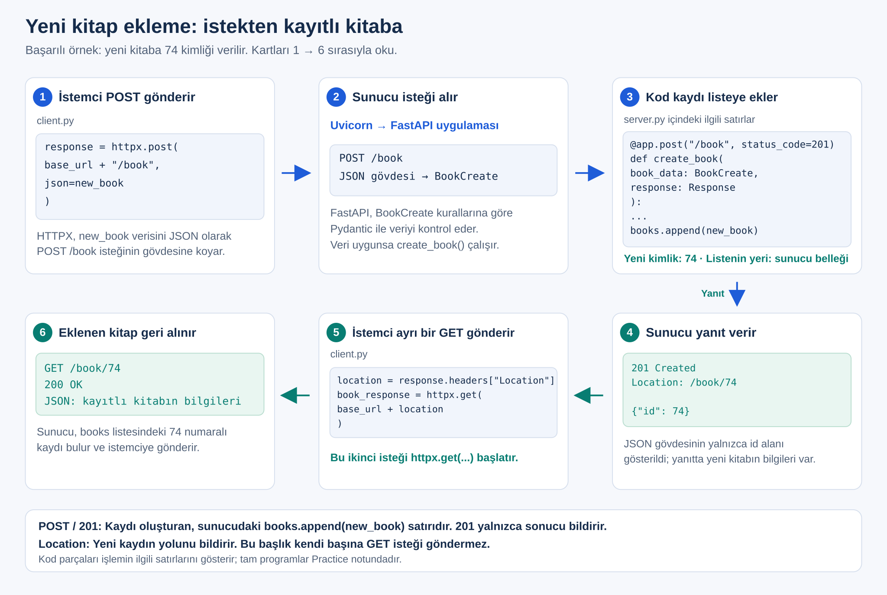
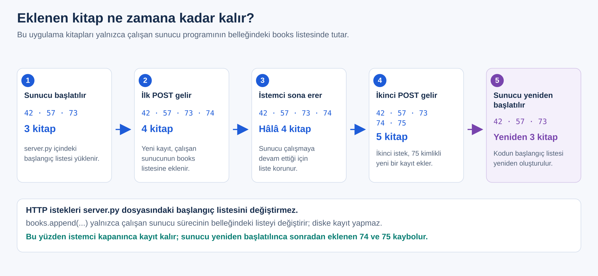

# Hafta 02 — Practice

## İstemciden yeni kitap eklemek: POST ve istek gövdesi

Birinci haftanın sonunda kataloğumuzda üç kitap vardı. Üçüncü kitabı eklemek için `server.py` dosyasını açıp `books` listesine yeni bir sözlük yazmıştık.

**Bu hafta aynı işi istemciden yapacağız:** `client.py`, yeni kitabın bilgilerini HTTP isteğiyle gönderecek. Sunucudaki fonksiyon bu bilgileri listeye ekleyecek. Ardından eklediğimiz kitabı GET isteğiyle okuyacağız.

İlk üç deneyde bilgiyi gönderme, alma ve kaydetme adımlarını kuruyoruz. Deney 4–6'da yeni kitabı geri okuyor, hatalı ve tekrarlanan istekleri inceliyoruz. Sondaki Postman ve desteklenmeyen metot çalışmaları ek denemelerdir.

## Başlamadan önce

Birinci haftada kullandığın **`book-catalog-api` proje klasöründe** devam et. Programlarımız yine `server.py` ve `client.py`. Bu `.md` dosyası çalışma yönergesidir; Python kodlarını aşağıda adı verilen `.py` dosyalarına yazacağız.

- VS Code'da aynı proje klasörünü aç. Python ortamını yeniden kurma.
- WSL/Ubuntu'daki iki terminalde de proje klasöründeyken `source api-env/bin/activate` çalıştır. Komut satırında `(api-env)` görmelisin.
- Bir terminalde Uvicorn çalışacak; ikinci terminalde `python client.py` çalıştıracağız.
- `server.py` değiştiğinde **Ctrl+S** ile kaydet; sunucu terminalinde **Ctrl+C** yapıp `python -m uvicorn server:app` komutunu yeniden çalıştır. Sadece istemciyi değiştirdiğinde sunucuyu yeniden başlatman gerekmez.

Bu hafta `BaseModel` adında yeni bir sınıf kullanacağız. Bu sınıfın bulunduğu **Pydantic**, FastAPI kurulurken gelen bir Python paketidir. Modeli kullandığımız yerde açıklayacağız. İkinci terminalde sürümü kontrol et:

```bash
python -c "import pydantic; print(pydantic.__version__)"
```

Çıktı `2.` ile başlamalı; örneğin `2.13.5`. Aşağıdaki `model_dump()` kullanımı Pydantic 2 içindir. Sürüm `1.` ile başlıyorsa etkin ortamda `uv pip install --upgrade fastapi "pydantic>=2,<3"` çalıştır, sonra sunucuyu yeniden başlat.

**Deneylerin başlangıç durumu:** Sunucuyu her yeniden başlattığımızda liste, dosyada yazılı üç kitaptan oluşur: `42`, `57`, `73`. Yeni kayıtlar henüz dosyaya veya veritabanına yazılmayacak. Bu yüzden aşağıdaki yeniden başlatma adımları, beklenen kitap sayılarını da belirler.

## Deney 1 — Bildiğimiz kataloğu aç

Başlangıç sunucusu, birinci haftanın son sunucusuyla aynıdır. `/book` kitapları listeler; `/book/{book_id}` bir kitabı getirir. Arama ve `available` filtresi yerinde duruyor. Bu deneyde filtre göndermeyip üç kitabın tamamını göreceğiz.

### `server.py` dosyasının tamamı

```python
from fastapi import FastAPI, HTTPException

app = FastAPI()

books = [
    {
        "id": 42,
        "title": "API Yolculuğu",
        "author": {
            "first_name": "Deniz",
            "last_name": "Kaya"
        },
        "available": True,
        "tags": ["software", "education"],
        "rating": None
    },
    {
        "id": 57,
        "title": "Veriyle İlk Adımlar",
        "author": {
            "first_name": "Ece",
            "last_name": "Yılmaz"
        },
        "available": False,
        "tags": [],
        "rating": 0
    },
    {
        "id": 73,
        "title": "Python ile Web API",
        "author": {
            "first_name": "Can",
            "last_name": "Demir"
        },
        "available": True,
        "tags": ["python", "api"],
        "rating": 4.5
    }
]


@app.get("/book")
def get_books(search: str = "", available: bool | None = None):
    results = []

    for book in books:
        title_matches = search.casefold() in book["title"].casefold()
        availability_matches = (
            available is None or book["available"] == available
        )

        if title_matches and availability_matches:
            results.append(book)

    return results


@app.get("/book/{book_id}")
def get_book(book_id: int):
    for book in books:
        if book["id"] == book_id:
            return book

    raise HTTPException(status_code=404, detail="Book not found")
```

İstemcinin çıktısını bu hafta yapacağımız değişiklikleri izlemek için kısaltıyoruz: durum kodunu, kitap sayısını, kimlik ve başlıkları yazdırması yeterli. Sunucudaki diğer kitap alanları silinmiyor.

### `client.py` dosyasının tamamı

```python
import httpx

try:
    response = httpx.get("http://127.0.0.1:8000/book")
except httpx.ConnectError:
    print("Connection failed: Check that the server is running.")
else:
    print("Status code:", response.status_code)
    if response.status_code == 200:
        books = response.json()
        print("Book count:", len(books))
        for book in books:
            print(book["id"], "-", book["title"])
    else:
        print("Response body:", response.text)
```

İki dosyayı kaydet. Sunucuyu başlat veya yukarıdaki yöntemle yeniden başlat. İkinci terminalde `python client.py` çalıştır.

Beklenen çıktı:

```text
Status code: 200
Book count: 3
42 - API Yolculuğu
57 - Veriyle İlk Adımlar
73 - Python ile Web API
```

İstek `GET /book`. Şimdi aynı adrese farklı bir işlem isteyeceğiz.

## Deney 2 — Yeni kitabın bilgilerini gönder ve geri al

Yeni kitabın başlığı **HTTP ile Yeni Bir Kitap**, yazarı **Ada Yıldız** olsun. İstemci bu bilgileri `POST /book` isteğinin **gövdesinde** gönderecek. Gövde, HTTP mesajının kitap bilgilerini taşıyan bölümüdür. Birinci hafta yanıt gövdesinden kitap okuyorduk; burada istemcinin gönderdiği **isteğin de gövdesi** var.

Bu ilk adımda sunucu bilgileri alıp geri gönderecek. Henüz listeye eklemeyeceğiz. Böylece **bilginin sunucuya ulaşmasıyla kaydın oluşturulmasını** ayrı ayrı görebiliriz.

### Sunucu hangi bilgilerin geleceğini nasıl bilecek?

Gönderilecek kitapta hangi alanların bulunduğunu Python kodunda tanımlayacağız. Pydantic ile yazdığımız bu tanıma **veri modeli** diyoruz. Burada model, gönderilecek kitabın alanlarını ve beklenen türlerini belirtir.

```python
from pydantic import BaseModel


class Author(BaseModel):
    first_name: str
    last_name: str


class BookCreate(BaseModel):
    title: str
    author: Author
    available: bool
    tags: list[str]
    rating: float | None = None
```

| Yeni satır | Buradaki anlamı |
|---|---|
| `from pydantic import BaseModel` | Pydantic'in model tanımlamak için sunduğu sınıfı alırız. |
| `class Author(BaseModel):` | `Author` adlı kendi sınıfımızı tanımlarız. Parantezdeki `BaseModel`, alan kontrolü gibi Pydantic özelliklerini bu sınıfa kazandırır. |
| `first_name: str`, `last_name: str` | Yazar bilgisinin iki metin alanı olacağını belirtiriz. |
| `class BookCreate(BaseModel):` | Yeni kitap gönderirken kullanılacak alanları tanımlarız. `BookCreate` adını biz seçtik; bu ad kitabı kendiliğinden oluşturmaz. |
| `title: str` | Kitap başlığı metin olmalı ve gönderilmelidir. |
| `author: Author` | `author` alanının içinde yukarıdaki iki alanı taşıyan bir yazar nesnesi bekleriz. |
| `available: bool` | Kitabın verilebilirlik bilgisini `true` veya `false` olarak alırız. |
| `tags: list[str]` | Etiketler, metinlerden oluşan bir liste olmalı. Boş liste `[]` de kullanılabilir. |
| `rating: float \| None = None` | Puan sayı veya `null` olabilir. `= None` yazdığımız için puan hiç gönderilmezse de `None` kullanılır. |

`Author` ve `BookCreate` **sınıf tanımlarıdır**; kendileri bir kitap kaydı değildir. FastAPI gelen bilgileri bu tanımlara göre kontrol ettirip fonksiyona o isteğe ait bir model nesnesi verir. `author` içindeki iki alan ve `title`, `available`, `tags` bu modelde zorunludur; puanı göndermemeyi ise kabul ettik. Bu kuralları modelde biz belirliyoruz.

`id` alanını modele koymadık. Yeni kitabın kimliğini bir sonraki deneyde sunucu belirleyecek.

### POST isteğini karşılayan fonksiyon

```python
@app.post("/book")
def create_book(book_data: BookCreate):
    return book_data.model_dump()
```

| Satır | Ne yapıyor? |
|---|---|
| `@app.post("/book")` | `/book` adresine gelen **POST** isteklerini altındaki fonksiyonla eşleştirir. |
| `def create_book(book_data: BookCreate):` | FastAPI, istek gövdesini `BookCreate` modeline göre kontrol eder; uygun bilgileri `book_data` parametresiyle fonksiyona verir. |
| `return book_data.model_dump()` | Model nesnesini Python sözlüğüne çevirip döndürür. FastAPI bu sözlüğü JSON yanıt gövdesi olarak gönderir. |

`model_dump()` bir JSON metni üretmez; `author` dahil iç içe alanları bulunan bir **Python sözlüğü** üretir. Listeye eklerken de bu sözlüğü kullanacağız.

Birinci haftada `search: str` gibi tek bir değer sorgudan geliyordu. Burada `book_data: BookCreate` bir **Pydantic modeli** olduğu için FastAPI bilgileri JSON gövdesinden alır. `book_data` adında bir sorgu parametresi göndermiyoruz. [FastAPI: istek gövdesi](https://fastapi.tiangolo.com/tutorial/body/)

Aşağıdaki tam dosyada GET fonksiyonları da bulunuyor. **Metot ve yol birlikte** hangi fonksiyonun çalışacağını belirler:

| İstek | Çalışan fonksiyon |
|---|---|
| `GET /book` | `get_books(...)` |
| `POST /book` | `create_book(...)` |
| `GET /book/42` | `get_book(book_id=42)` |

### `server.py` dosyasının tamamı

```python
from fastapi import FastAPI, HTTPException
from pydantic import BaseModel


class Author(BaseModel):
    first_name: str
    last_name: str


class BookCreate(BaseModel):
    title: str
    author: Author
    available: bool
    tags: list[str]
    rating: float | None = None

app = FastAPI()

books = [
    {
        "id": 42,
        "title": "API Yolculuğu",
        "author": {
            "first_name": "Deniz",
            "last_name": "Kaya"
        },
        "available": True,
        "tags": ["software", "education"],
        "rating": None
    },
    {
        "id": 57,
        "title": "Veriyle İlk Adımlar",
        "author": {
            "first_name": "Ece",
            "last_name": "Yılmaz"
        },
        "available": False,
        "tags": [],
        "rating": 0
    },
    {
        "id": 73,
        "title": "Python ile Web API",
        "author": {
            "first_name": "Can",
            "last_name": "Demir"
        },
        "available": True,
        "tags": ["python", "api"],
        "rating": 4.5
    }
]


@app.get("/book")
def get_books(search: str = "", available: bool | None = None):
    results = []

    for book in books:
        title_matches = search.casefold() in book["title"].casefold()
        availability_matches = (
            available is None or book["available"] == available
        )

        if title_matches and availability_matches:
            results.append(book)

    return results


@app.get("/book/{book_id}")
def get_book(book_id: int):
    for book in books:
        if book["id"] == book_id:
            return book

    raise HTTPException(status_code=404, detail="Book not found")


@app.post("/book")
def create_book(book_data: BookCreate):
    return book_data.model_dump()
```

### İstemci bilgileri nasıl gönderiyor?

`new_book`, istemcide oluşturduğumuz bir Python sözlüğüdür. `httpx.post(..., json=new_book)` bu sözlüğü JSON biçiminde istek gövdesine yerleştirir. HTTPX, bu gövdenin biçimini belirtmek için `Content-Type: application/json` başlığını da ekler. [HTTPX: JSON gönderme](https://www.python-httpx.org/quickstart/#sending-json-encoded-data)

Bu nedenle Python kodunda `True` ve `None` yazıyoruz. HTTP isteğinde bunlar JSON karşılıkları olan `true` ve `null` olarak taşınır.

### `client.py` dosyasının tamamı

```python
import httpx

new_book = {
    "title": "HTTP ile Yeni Bir Kitap",
    "author": {
        "first_name": "Ada",
        "last_name": "Yıldız"
    },
    "available": True,
    "tags": ["http", "python"],
    "rating": None
}

try:
    response = httpx.post(
        "http://127.0.0.1:8000/book",
        json=new_book
    )
    list_response = httpx.get("http://127.0.0.1:8000/book")
except httpx.ConnectError:
    print("Connection failed: Check that the server is running.")
else:
    print("Request method:", response.request.method)
    print("Request Content-Type:", response.request.headers.get("Content-Type"))
    print("Status code:", response.status_code)
    print("Response body:", response.text)
    if list_response.status_code == 200:
        print("Book count:", len(list_response.json()))
    else:
        print("List status:", list_response.status_code)
```

İstemcide iki istek var: `response` değişkeni POST yanıtını, `list_response` ise ardından gönderdiğimiz GET yanıtını tutuyor. GET'i, katalogdaki kitap sayısının değişip değişmediğini görmek için gönderiyoruz.

| Kullandığımız ifade | Bilginin gittiği yer |
|---|---|
| `params={"search": "Python"}` | Birinci haftadaki gibi adresin sorgu bölümü: `/book?search=Python`. |
| `json=new_book` | Bu deneydeki gibi isteğin gövdesi. Kitabın bilgileri adresin sonuna eklenmez. |

İki dosyayı kaydet, sunucuyu yeniden başlat ve istemciyi **bir kez** çalıştır.

Beklenen çıktı:

```text
Request method: POST
Request Content-Type: application/json
Status code: 200
Response body: {"title":"HTTP ile Yeni Bir Kitap","author":{"first_name":"Ada","last_name":"Yıldız"},"available":true,"tags":["http","python"],"rating":null}
Book count: 3
```

Kitabın bilgileri yanıtta geldi; fakat sayı hâlâ **3**. Çünkü fonksiyonumuz yalnızca aldığı bilgileri döndürdü. Kodda henüz `books.append(...)` yok. `POST` kelimesi tek başına kayıt eklemez; yapılacak işi sunucudaki fonksiyonda yazarız.

## Deney 3 — Gelen kitabı listeye ekle

Şimdi bilgiyi almakla yetinmeyip sunucunun `books` listesine ekleyeceğiz. GET istekleri de aynı listeyi okuduğu için yeni kitap sonraki okumalarda bulunacak.

### Değişen bölüm

```diff
-@app.post("/book")
-def create_book(book_data: BookCreate):
-    return book_data.model_dump()
+@app.post("/book", status_code=201)
+def create_book(book_data: BookCreate):
+    new_id = 1
+    for book in books:
+        if book["id"] >= new_id:
+            new_id = book["id"] + 1
+
+    new_book = book_data.model_dump()
+    new_book["id"] = new_id
+    books.append(new_book)
+    return new_book
```

| Satır veya bölüm | Ne yapıyor? |
|---|---|
| `status_code=201` | Fonksiyon başarıyla döndüğünde yanıta **201 Created** durum kodunu koyar. Bu kod, isteğin sonucunda yeni kayıt oluşturduğumuzu bildirir. |
| `new_id = 1` ve `for` döngüsü | Listedeki kimlikleri tarayıp en büyük kimliğin bir fazlasını bulur. `42`, `57`, `73` için sonuç `74` olur. |
| `new_book = book_data.model_dump()` | Gelen model nesnesinden bir kitap sözlüğü oluşturur. |
| `new_book["id"] = new_id` | Sunucunun belirlediği kimliği bu sözlüğe ekler. |
| `books.append(new_book)` | Yeni sözlüğü sunucunun çalışan programındaki listeye ekler. **Kaydı ekleyen satır budur.** |
| `return new_book` | Eklenen kitabı, kimliğiyle birlikte yanıt olarak döndürür. |

`books` modül düzeyinde tanımlanmış listemizdir; fonksiyon bu listeye erişip içeriğini değiştirir. `books = ...` ile değişkene başka bir liste atamadığımız için burada `global books` yazmamız gerekmez.

İstemcideki `new_book` ve sunucudaki `new_book` ayrı programların değişkenleridir. İsimlerinin aynı olması onları ortak değişken yapmaz; kitap bilgileri HTTP mesajında taşınır.

Bu kimlik hesabı, ders boyunca istekleri sırayla gönderdiğimiz küçük örnek içindir. Çok sayıda eşzamanlı istekte kimlik üretimini veritabanına bırakacağız.

### `server.py` dosyasının tamamı

```python
from fastapi import FastAPI, HTTPException
from pydantic import BaseModel


class Author(BaseModel):
    first_name: str
    last_name: str


class BookCreate(BaseModel):
    title: str
    author: Author
    available: bool
    tags: list[str]
    rating: float | None = None

app = FastAPI()

books = [
    {
        "id": 42,
        "title": "API Yolculuğu",
        "author": {
            "first_name": "Deniz",
            "last_name": "Kaya"
        },
        "available": True,
        "tags": ["software", "education"],
        "rating": None
    },
    {
        "id": 57,
        "title": "Veriyle İlk Adımlar",
        "author": {
            "first_name": "Ece",
            "last_name": "Yılmaz"
        },
        "available": False,
        "tags": [],
        "rating": 0
    },
    {
        "id": 73,
        "title": "Python ile Web API",
        "author": {
            "first_name": "Can",
            "last_name": "Demir"
        },
        "available": True,
        "tags": ["python", "api"],
        "rating": 4.5
    }
]


@app.get("/book")
def get_books(search: str = "", available: bool | None = None):
    results = []

    for book in books:
        title_matches = search.casefold() in book["title"].casefold()
        availability_matches = (
            available is None or book["available"] == available
        )

        if title_matches and availability_matches:
            results.append(book)

    return results


@app.get("/book/{book_id}")
def get_book(book_id: int):
    for book in books:
        if book["id"] == book_id:
            return book

    raise HTTPException(status_code=404, detail="Book not found")


@app.post("/book", status_code=201)
def create_book(book_data: BookCreate):
    new_id = 1
    for book in books:
        if book["id"] >= new_id:
            new_id = book["id"] + 1

    new_book = book_data.model_dump()
    new_book["id"] = new_id
    books.append(new_book)
    return new_book
```

`client.py` Deney 2'deki haliyle kalıyor. Sunucuyu kaydedip yeniden başlat; ardından istemciyi **bir kez** çalıştır.

Beklenen çıktı:

```text
Request method: POST
Request Content-Type: application/json
Status code: 201
Response body: {"title":"HTTP ile Yeni Bir Kitap","author":{"first_name":"Ada","last_name":"Yıldız"},"available":true,"tags":["http","python"],"rating":null,"id":74}
Book count: 4
```

Önceki deneyden iki fark var: yanıt **201** oldu ve katalog **4** kitap içeriyor. `201` yazmak listeyi değiştirmez; listeyi `append` değiştirir. Durum kodu, yaptığımız işlemin sonucunu istemciye bildirir. [FastAPI: yanıt durum kodu](https://fastapi.tiangolo.com/tutorial/response-status-code/)

## Deney 4 — Yeni kitabın adresini bildir ve kitabı geri oku

İstemci, sunucunun verdiği `74` kimlikli kitabı daha sonra hangi adresten okuyacağını bilsin. Sunucu bu bilgiyi **`Location` yanıt başlığında** gönderecek: `/book/74`.

`Location`, kitap alanı değildir; HTTP yanıtının başlıklarından biridir. Bu örnekte yeni oluşturulan kitabın yolunu bildirir. Yanıtın JSON gövdesinde ise kitabın bilgileri bulunmaya devam eder.

### Sunucudaki değişiklik

```diff
-from fastapi import FastAPI, HTTPException
+from fastapi import FastAPI, HTTPException, Response

 @app.post("/book", status_code=201)
-def create_book(book_data: BookCreate):
+def create_book(book_data: BookCreate, response: Response):
     ...
     books.append(new_book)
+    response.headers["Location"] = f"/book/{new_id}"
     return new_book
```

`Response`, FastAPI'nin sunduğu bir sınıftır. Fonksiyondaki `response: Response` parametresiyle FastAPI bize **göndereceği yanıtın başlıklarını ayarlayabileceğimiz bir nesne** verir. Bu parametreyi istemci göndermez; sorguda `response=...` yazılmaz.

`f"/book/{new_id}"` ifadesindeki `f`, süslü parantez içindeki değişkenin değerini metne yerleştirir. `new_id` değeri `74` ise sonuç `"/book/74"` olur. Bu Python metin oluşturma işlemi, `@app.get("/book/{book_id}")` içindeki yol tanımından farklıdır.

`response.headers["Location"] = ...` ile yanıt başlığını ayarlıyoruz; JSON gövdesini yine `return new_book` belirliyor. [FastAPI: yanıt başlıkları](https://fastapi.tiangolo.com/advanced/response-headers/)

<a id="final-server"></a>

### `server.py` dosyasının tamamı

```python
from fastapi import FastAPI, HTTPException, Response
from pydantic import BaseModel


class Author(BaseModel):
    first_name: str
    last_name: str


class BookCreate(BaseModel):
    title: str
    author: Author
    available: bool
    tags: list[str]
    rating: float | None = None

app = FastAPI()

books = [
    {
        "id": 42,
        "title": "API Yolculuğu",
        "author": {
            "first_name": "Deniz",
            "last_name": "Kaya"
        },
        "available": True,
        "tags": ["software", "education"],
        "rating": None
    },
    {
        "id": 57,
        "title": "Veriyle İlk Adımlar",
        "author": {
            "first_name": "Ece",
            "last_name": "Yılmaz"
        },
        "available": False,
        "tags": [],
        "rating": 0
    },
    {
        "id": 73,
        "title": "Python ile Web API",
        "author": {
            "first_name": "Can",
            "last_name": "Demir"
        },
        "available": True,
        "tags": ["python", "api"],
        "rating": 4.5
    }
]


@app.get("/book")
def get_books(search: str = "", available: bool | None = None):
    results = []

    for book in books:
        title_matches = search.casefold() in book["title"].casefold()
        availability_matches = (
            available is None or book["available"] == available
        )

        if title_matches and availability_matches:
            results.append(book)

    return results


@app.get("/book/{book_id}")
def get_book(book_id: int):
    for book in books:
        if book["id"] == book_id:
            return book

    raise HTTPException(status_code=404, detail="Book not found")


@app.post("/book", status_code=201)
def create_book(book_data: BookCreate, response: Response):
    new_id = 1
    for book in books:
        if book["id"] >= new_id:
            new_id = book["id"] + 1

    new_book = book_data.model_dump()
    new_book["id"] = new_id
    books.append(new_book)
    response.headers["Location"] = f"/book/{new_id}"
    return new_book
```

### İstemcideki yeni adımlar

1. Kitabı POST ile gönder.
2. Yanıt `201` ise `Location` başlığını oku.
3. Bu yolu sunucu adresiyle birleştirip **ayrı bir GET isteği** gönder.
4. GET yanıtındaki kitabın başlığını göster.

`Location` başlığının gelmesi GET isteğini kendiliğinden göndermez. Bunu aşağıdaki `httpx.get(base_url + location)` satırı yapar. `base_url` sunucunun `http://127.0.0.1:8000` adresi, `location` ise `/book/74` yoludur; birleşimleri kitabın tam adresidir.

<a id="final-client"></a>

### `client.py` dosyasının tamamı

```python
import httpx

base_url = "http://127.0.0.1:8000"

new_book = {
    "title": "HTTP ile Yeni Bir Kitap",
    "author": {
        "first_name": "Ada",
        "last_name": "Yıldız"
    },
    "available": True,
    "tags": ["http", "python"],
    "rating": None
}

try:
    response = httpx.post(base_url + "/book", json=new_book)
    print("Status code:", response.status_code)

    if response.status_code == 201:
        location = response.headers["Location"]
        print("Location:", location)

        read_response = httpx.get(base_url + location)
        print("Read status:", read_response.status_code)
        if read_response.status_code == 200:
            book = read_response.json()
            print("Book id:", book["id"])
            print("Book title:", book["title"])
        else:
            print("Response body:", read_response.text)
    else:
        print("Response body:", response.text)

    list_response = httpx.get(base_url + "/book")
    if list_response.status_code == 200:
        print("Book count:", len(list_response.json()))
    else:
        print("List status:", list_response.status_code)
except httpx.ConnectError:
    print("Connection failed: Check that the server is running.")
```

Sunucudaki `response` ile istemcideki `response` aynı nesne değildir. Sunucuda gönderilecek yanıtın başlığını ayarlıyoruz; istemcide HTTPX'in **aldığı yanıtı** okuyoruz.

İki dosyayı kaydet, sunucuyu yeniden başlat, istemciyi bir kez çalıştır. Başlangıç yeniden üç kitap olduğu için beklenen çıktı:

```text
Status code: 201
Location: /book/74
Read status: 200
Book id: 74
Book title: HTTP ile Yeni Bir Kitap
Book count: 4
```

Bu istemci toplam üç istek gönderdi: **POST** kitabı ekledi, ilk **GET** eklenen kitabı okudu, son **GET** bütün listeyi alıp kitap sayısını gösterdi.



## Deney 5 — Başlık gönderilmezse ne olur?

Modelde `title: str` yazdık ve bu alan için varsayılan değer tanımlamadık. Şimdi yalnızca `title` alanını göndermeyerek bu kuralı deneyelim. JSON'un yazımı geçerli olacak; eksik olan, sunucunun istediği kitap başlığıdır.

**Başlangıç:** Sunucu Deney 4'teki tam sürüm olsun. Sunucuyu yeniden başlat; katalogda üç kitap bulunsun. Aşağıdaki istemci eksik bilgili bir POST gönderecek, ardından GET ile kitap sayısını okuyacak.

### `client.py` dosyasının tamamı

```python
import httpx

new_book = {
    "author": {
        "first_name": "Ada",
        "last_name": "Yıldız"
    },
    "available": True,
    "tags": ["http", "python"],
    "rating": None
}

try:
    response = httpx.post(
        "http://127.0.0.1:8000/book",
        json=new_book
    )
    list_response = httpx.get("http://127.0.0.1:8000/book")
except httpx.ConnectError:
    print("Connection failed: Check that the server is running.")
else:
    print("Request method:", response.request.method)
    print("Request Content-Type:", response.request.headers.get("Content-Type"))
    print("Status code:", response.status_code)
    print("Response body:", response.text)
    if list_response.status_code == 200:
        print("Book count:", len(list_response.json()))
    else:
        print("List status:", list_response.status_code)
```

Kaydet ve `python client.py` çalıştır. Çıktının durum kodu **422** olur. **422, sunucunun isteği aldığı ancak gönderilen bilgiler beklenen koşulları karşılamadığı için işleyemediği anlamına gelen HTTP durum kodudur.** Kitap sayısı **3** kalır.

Uzun `Response body` satırında buna benzer bir hata nesnesi görürsün; aşağıda ilgili alanları ayırarak gösteriyoruz:

```json
{
  "type": "missing",
  "loc": ["body", "title"],
  "msg": "Field required"
}
```

Bu nesne, yanıt gövdesindeki `detail` listesinin içindedir. Yanıtta gönderdiğin veriyi gösteren `input` gibi başka alanlar da bulunabilir.

| Hata bilgisindeki bölüm | Anlamı |
|---|---|
| `loc: ["body", "title"]` | Sorun, isteğin gövdesindeki `title` alanında. |
| `msg: "Field required"` | Bu alanın gönderilmesi gerekiyor. |
| `type: "missing"` | Alan eksik. |

FastAPI, fonksiyonu çağırmadan önce Pydantic ile model kontrolünü yapar. Bu istek modelden geçemediği için **`create_book` fonksiyonunun içine girilmez**; kimlik hesaplanmaz, `books.append(...)` çalışmaz. `422` yanıtını fonksiyonda ayrıca yazmadık.

Kontrol yalnızca alanın varlığıyla sınırlı değildir; alanın değeri de beklenen türe uygun olmalıdır veya o türe dönüştürülebilmelidir. Örneğin `available` için `"belki"` gönderilmesi kabul edilmez. Pydantic bazı uygun metinleri sayıya veya mantıksal değere çevirebildiğinden her farklı yazımın hata olduğunu varsaymıyoruz.

Bu hafta modelin temel kontrolünü kullanıyoruz. Başlığın boş olmaması veya puanın belirli aralıkta olması gibi ek kuralları beşinci haftada yazacağız.

## Deney 6 — Aynı isteği tekrar gönder ve sunucuyu yeniden başlat

Başarılı bir POST'tan sonra istemciyi yeniden çalıştırmak ne yapar? Eklenen kitap, istemci kapanınca mı yoksa sunucu kapanınca mı kaybolur? Bunları aynı programlarla gözlemleyeceğiz.

Sunucu Deney 4'teki sürüm olarak kalsın. Eksik başlıklı istemci yerine aşağıdaki **geçerli kitap gönderen son istemciyi** geri koy.

### `client.py` dosyasının tamamı

```python
import httpx

base_url = "http://127.0.0.1:8000"

new_book = {
    "title": "HTTP ile Yeni Bir Kitap",
    "author": {
        "first_name": "Ada",
        "last_name": "Yıldız"
    },
    "available": True,
    "tags": ["http", "python"],
    "rating": None
}

try:
    response = httpx.post(base_url + "/book", json=new_book)
    print("Status code:", response.status_code)

    if response.status_code == 201:
        location = response.headers["Location"]
        print("Location:", location)

        read_response = httpx.get(base_url + location)
        print("Read status:", read_response.status_code)
        if read_response.status_code == 200:
            book = read_response.json()
            print("Book id:", book["id"])
            print("Book title:", book["title"])
        else:
            print("Response body:", read_response.text)
    else:
        print("Response body:", response.text)

    list_response = httpx.get(base_url + "/book")
    if list_response.status_code == 200:
        print("Book count:", len(list_response.json()))
    else:
        print("List status:", list_response.status_code)
except httpx.ConnectError:
    print("Connection failed: Check that the server is running.")
```

### İstemciyi iki kez çalıştır

1. İstemciyi kaydet. Sunucuyu yeniden başlatarak üç kitapla başla.
2. İkinci terminalde `python client.py` çalıştır: `id` **74**, kitap sayısı **4** olur.
3. Sunucuya dokunmadan aynı komutu tekrar çalıştır: `id` **75**, kitap sayısı **5** olur.

İkinci çalıştırmanın çıktısı:

```text
Status code: 201
Location: /book/75
Read status: 200
Book id: 75
Book title: HTTP ile Yeni Bir Kitap
Book count: 5
```

İstemci programının ilk çalışması bitmişti; buna rağmen sunucu yeni kitabı hatırladı. İki programın belleği ayrıdır. Sunucu çalışmaya devam ettiği için `books` listesi de yaşamaya devam etti.

Aynı başlıkla neden iki kitap oluştu? Bu örnekte `create_book` her geçerli POST'ta yeni kimlik hesaplayıp listeye ekliyor. Aynı başlık ve yazarı görünce birleştiren bir kural yazmadık. **Aynı POST'u yeniden göndermek, bu uygulamada yeni bir kayıt daha oluşturur.** GET fonksiyonlarımız ise listeye kayıt eklemez.

### Sunucuyu yeniden başlat

Şimdi istemciyi sadece okuma yapan hale getir. Böylece yeniden başlatmanın sonucunu, arada yeni bir kitap eklemeden görebiliriz.

### `client.py` dosyasının tamamı

```python
import httpx

try:
    response = httpx.get("http://127.0.0.1:8000/book")
except httpx.ConnectError:
    print("Connection failed: Check that the server is running.")
else:
    print("Status code:", response.status_code)
    if response.status_code == 200:
        books = response.json()
        print("Book count:", len(books))
        for book in books:
            print(book["id"], "-", book["title"])
    else:
        print("Response body:", response.text)
```

1. İstemciyi kaydet, sunucu hâlâ çalışırken `python client.py` çalıştır: **5** kitap görürsün.
2. Sunucu terminalinde **Ctrl+C** yap; ardından `python -m uvicorn server:app` ile yeniden başlat.
3. Okuma yapan aynı istemciyi tekrar çalıştır: yalnızca başlangıçtaki **3** kitap vardır.

Son çıktı:

```text
Status code: 200
Book count: 3
42 - API Yolculuğu
57 - Veriyle İlk Adımlar
73 - Python ile Web API
```



`books.append(...)`, diskteki `server.py` dosyasının yazısını değiştirmedi. Çalışan sunucu programının belleğindeki listeyi değiştirdi. Yeniden başlatınca Python dosyayı tekrar çalıştırdı ve dosyada yazılı üç kitapla yeni bir liste oluşturdu. Kayıtları yeniden başlatmalar arasında korumayı veritabanı kullanırken öğreneceğiz.

**Burada bırakılan dosyalar:** `server.py`, Deney 4'teki kitap ekleyebilen sunucudur. `client.py`, bu son adımda yalnızca listeyi okur. Yeniden kitap eklemek için [Deney 4'teki tam POST istemcisini](#final-client) kullanabilirsin. Deney 4'teki [tam sunucuya](#final-server) da aynı bölümden ulaşabilirsin.

## Ek çalışma — Aynı kitabı Postman ile gönder

Postman, HTTP isteğini Python kodu yazmadan hazırlayıp gönderebildiğimiz bir uygulamadır. Burada `client.py` ile yaptığımız POST'u Postman'da hazırlayacağız. Sunucudaki kod değişmeyecek.

Postman'ın **masaüstü uygulamasını** aç; kurulu değilse [resmî indirme sayfasından](https://www.postman.com/downloads/) kur. Yerel sunucuya istek göndermek için bu çalışmada masaüstü uygulamasını kullanıyoruz. [Postman'ın başlangıç yönergesi](https://learning.postman.com/docs/getting-started/quick-start/) arayüzde ilk isteğin nasıl açıldığını gösterir.

Sunucuyu yeniden başlatarak üç kitapla başla:

1. Postman'da yeni bir **HTTP isteği** aç.
2. Metot seçimini **POST** yap; adresi `http://127.0.0.1:8000/book` yaz.
3. **Body → raw → JSON** seç. Aşağıdaki JSON'u gövde alanına yapıştır.

```json
{
  "title": "HTTP ile Yeni Bir Kitap",
  "author": {
    "first_name": "Ada",
    "last_name": "Yıldız"
  },
  "available": true,
  "tags": [
    "http",
    "python"
  ],
  "rating": null
}
```

4. İstek başlıklarında `Content-Type: application/json` olduğunu kontrol et. JSON gövde seçimi bunu ekler.
5. **Send** düğmesine **bir kez** bas. Durum kodu `201`, yanıt gövdesindeki `id` değeri `74`, yanıtın `Headers` bölümündeki `Location` değeri `/book/74` olmalı.
6. Yeni bir istek aç. **GET** metoduyla `http://127.0.0.1:8000/book/74` adresine gönder; eklenen kitabı `200` yanıtıyla oku.

Buraya JSON yapıştırdığımız için `true` ve `null` yazdık. Python istemcisindeki sözlükte ise `True` ve `None` yazıyorduk. İki istemci de sunucuya aynı kitap bilgilerini gönderiyor.

POST için **Send** düğmesine yeniden basarsan yeni bir kitap daha eklersin. Bu, Deney 6'da gördüğümüz tekrar davranışıdır. Uvicorn sunucu terminalinde çalışmaya devam etmelidir; Postman sunucunun yerine geçmez.

## Ek çalışma — Yol var ama metot desteklenmiyorsa

Sunucumuz `/book/42` için GET kabul ediyor. Bu yolda henüz bir silme işlemi tanımlamadık. Sunucu çalışırken aşağıdaki kısa `client.py` ile **DELETE** isteği gönderelim. DELETE, bir kaynağı silmek için kullanılan HTTP metodudur; silme kodunu dördüncü haftada yazacağız.

### `client.py` dosyasının tamamı

```python
import httpx

response = httpx.delete("http://127.0.0.1:8000/book/42")
print("Status code:", response.status_code)
print("Response body:", response.text)
```

Kaydet ve `python client.py` çalıştır. Beklenen çıktı:

```text
Status code: 405
Response body: {"detail":"Method Not Allowed"}
```

**405**, bu adreste istediğimiz HTTP metodunun desteklenmediğini bildirir. `get_book` fonksiyonu DELETE isteğiyle çalışmaz ve kitap silinmez. Aynı adrese GET gönderdiğimizde kitabı okuyabiliriz. Bu durum, olmayan bir kitabı GET ile isterken aldığımız `404` yanıtından farklıdır.

Bu ek çalışmadan sonra yeniden kitap listesi görmek istersen Deney 6'nın sonundaki tam GET istemcisini geri koy.

## Kendini kontrol et

1. Deney 2'de kitap bilgileri yanıtta geldiği halde kitap sayısı neden artmadı?
2. Kaydı gerçekten ekleyen satır hangisi? `201` hangi bilgiyi bildiriyor?
3. `title` eksikse `create_book` neden çalışmıyor?
4. İstemci aynı POST'u iki kez gönderirse ne olur? Sunucu yeniden başlatılırsa ne olur?

**Cevapların temel noktaları:** Bilgiyi geri döndürmek listeye eklemek değildir. Kaydı `books.append(new_book)` ekler; `201` yeni kayıt oluşturulduğunu bildirir. Zorunlu alan kontrolü fonksiyon çağrılmadan önce yapılır. Bu uygulamada her geçerli POST yeni kayıt ekler; sunucu yeniden başlayınca bellekteki sonradan eklenen kayıtlar kaybolur.

Bu haftanın sonunda istemciden bilgi gönderip sunucuda yeni bir kayıt oluşturabiliyor ve onu GET ile geri okuyabiliyoruz. Güncelleme ve silme kodlarını dördüncü, daha ayrıntılı doğrulama kurallarını beşinci haftada ekleyeceğiz.
