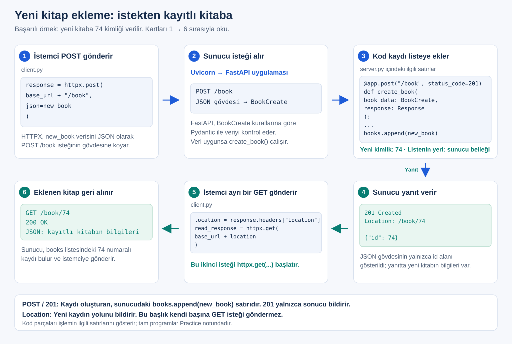
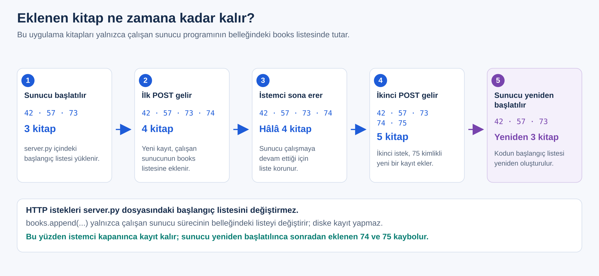
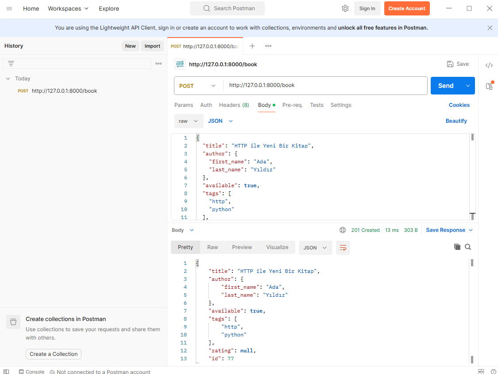

# Hafta 02 — Uygulama Föyü

## 0. Bu hafta ne yapacağız: İstemciden sunucuya yeni kitap göndermek

Birinci haftada kitapları yalnızca okuduk; üçüncü kitabı eklemek için `server.py` içindeki `books` listesini elle değiştirdik. Bu hafta kitabın bilgilerini istemciden göndereceğiz; sunucuda yazacağımız kod da kitabı listeye ekleyecek.

Bu haftanın ek notları:

- [İstemcinin ve sunucunun adresi](03_Supplement_Addresses.md)
- [JSON'dan başka veri biçimleri](04_Supplement_Data_Formats.md)
- [`Location` başlığı ne işe yarar?](05_Supplement_Location.md)
- [Sunucunun sakladığı kayıt, gönderdiğimizden farklı olabilir](06_Supplement_Stored_Record.md)
- [Durum kodunu kendimiz belirleyebilir miyiz?](07_Supplement_Status_Codes.md)

### 0.1 Bu haftanın sonunda neler yapabileceksin?

- POST isteğiyle, istek gövdesinde JSON gönderebileceksin.
- Pydantic ile sunucunun kabul edeceği veri modelini tanımlayabileceksin.
- Kayıt oluşturan bir işlemde `201` durum kodunu ve `Location` başlığını kullanabileceksin.
- Eksik bilgi gönderildiğinde `422` yanıtını kimin ürettiğini açıklayabileceksin.
- Aynı POST isteğini tekrarlamanın ve sunucuyu yeniden başlatmanın sonucunu açıklayabileceksin.

### 0.2 Bu föy nasıl okunur?

Her deney aynı sırayla ilerler: **Amaç → Kod → Çalıştır → Çıktı → Ana fikir.**

Kod değiştiğinde ya dosyanın tamamı ya da yalnızca değişen kısım verilir. Hangisi olduğu kodun hemen üstünde yazar.

> **Kitap sayılarını izlemek için:** Sunucu her başlatıldığında dosyada yazılı üç kitapla (`42`, `57`, `73`) başlar. İstekle eklenen kitaplar yalnızca sunucu çalıştığı sürece bellekte durur. Deneylerdeki "sunucuyu yeniden başlat" ve "bir kez çalıştır" adımlarını izlersen çıktıların föydekilerle aynı olur.

### 0.3 Başlamadan önce: Pydantic 2 kurulu mu?

Bu hafta sunucuya gelen kitap bilgilerini **Pydantic** ile kontrol edeceğiz. Pydantic, FastAPI ile birlikte kurulur. Ortam etkinken sürümünü kontrol et:

```bash
python -c "import pydantic; print(pydantic.__version__)"
```

Çıktı `2.` ile başlamalı, örneğin `2.13.5`. `1.` ile başlıyorsa şu komutu çalıştır ve sunucuyu yeniden başlat:

```bash
uv pip install --upgrade fastapi "pydantic>=2,<3"
```

---

## Deney 1 — Sunucu çalışıyor mu, katalogda kaç kitap var?

**Amaç:** Birinci haftanın son sunucusunun çalıştığını ve katalogda üç kitap olduğunu görmek.

`server.py`, birinci haftanın son hâlidir:

```python
from fastapi import FastAPI, HTTPException

app = FastAPI()

books = [
    {
        "id": 42,
        "title": "API Yolculuğu",
        "author": {
            "first_name": "Deniz",
            "last_name": "Kaya"
        },
        "available": True,
        "tags": ["software", "education"],
        "rating": None
    },
    {
        "id": 57,
        "title": "Veriyle İlk Adımlar",
        "author": {
            "first_name": "Ece",
            "last_name": "Yılmaz"
        },
        "available": False,
        "tags": [],
        "rating": 0
    },
    {
        "id": 73,
        "title": "Python ile Web API",
        "author": {
            "first_name": "Can",
            "last_name": "Demir"
        },
        "available": True,
        "tags": ["python", "api"],
        "rating": 4.5
    }
]


@app.get("/book")
def get_books(search: str = "", available: bool | None = None):
    results = []

    for book in books:
        title_matches = search.casefold() in book["title"].casefold()
        availability_matches = (
            available is None or book["available"] == available
        )

        if title_matches and availability_matches:
            results.append(book)

    return results


@app.get("/book/{book_id}")
def get_book(book_id: int):
    for book in books:
        if book["id"] == book_id:
            return book

    raise HTTPException(status_code=404, detail="Book not found")
```

Bu hafta istemcinin çıktısını kısaltıyoruz: durum kodu, kitap sayısı ve her kitabın kimliğiyle adı yeterli. `client.py`:

```python
import httpx

try:
    response = httpx.get("http://127.0.0.1:8000/book")
except httpx.ConnectError:
    print("Connection failed: Check that the server is running.")
else:
    print("Status code:", response.status_code)
    if response.status_code == 200:
        books = response.json()
        print("Book count:", len(books))
        for book in books:
            print(book["id"], "-", book["title"])
    else:
        print("Response body:", response.text)
```

Sunucuyu başlat ve istemciyi çalıştır:

```text
Status code: 200
Book count: 3
42 - API Yolculuğu
57 - Veriyle İlk Adımlar
73 - Python ile Web API
```

Bu istemciyi Deney 6'da yeniden kullanacağız.

---

## Deney 2 — Yeni kitabı POST ile gönder ve sunucuya ulaştığını gör

**Amaç:** Yeni bir kitabın bilgilerini istek gövdesinde göndermek ve bilgilerin sunucuya ulaştığını görmek.

### 2.1 Yeni kitabın bilgileri isteğin neresinde gönderilir?

Birinci haftada `GET /book/42` isteğinde **hangi kitabı istediğimizi** yolda belirtiyorduk. Şimdi sunucuya yeni bir kitabın bilgilerini göndereceğiz:

| İsteğin parçası | Bu deneyde |
|---|---|
| Metot | `POST`: Sunucuya işlemesi için veri gönderen metot. Bu derste yeni kitap ekleme isteği için kullanacağız. |
| Adres | `http://127.0.0.1:8000/book`: değişmedi |
| Kitap bilgileri | İsteğin **gövdesinde (body)**, JSON biçiminde |

İstek ile yanıt ayrı mesajlardır. **İstek gövdesi** istemciden sunucuya, **yanıt gövdesi** sunucudan istemciye veri taşır.

### 2.2 İstemci kitabı nasıl hazırlar ve POST ile gönderir?

`client.py`:

```python
import httpx

new_book = {
    "title": "HTTP ile Yeni Bir Kitap",
    "author": {
        "first_name": "Ada",
        "last_name": "Yıldız"
    },
    "available": True,
    "tags": ["http", "python"],
    "rating": None
}

try:
    response = httpx.post(
        "http://127.0.0.1:8000/book",
        json=new_book
    )
    list_response = httpx.get("http://127.0.0.1:8000/book")
except httpx.ConnectError:
    print("Connection failed: Check that the server is running.")
else:
    print("Request method:", response.request.method)
    print("Request Content-Type:", response.request.headers.get("Content-Type"))
    print("Status code:", response.status_code)
    print("Response body:", response.text)
    if list_response.status_code == 200:
        print("Book count:", len(list_response.json()))
    else:
        print("List status:", list_response.status_code)
```

| Kod | Ne yapar? |
|---|---|
| `new_book = {...}` | Göndereceğimiz kitabı Python sözlüğü olarak hazırlar. `id` yok; kimliği sunucu verecek. |
| `json=new_book` | HTTPX sözlüğü JSON'a çevirip isteğin gövdesine koyar. `True` → `true`, `None` → `null` olur. |
| `response` | POST isteğinin yanıtı. |
| `list_response` | Ardından gönderilen `GET /book` isteğinin yanıtı. Kitap sayısı değişti mi diye buna bakarız. |
| `response.request` | Sunucuya **bizim gönderdiğimiz** isteğin kendisi. İsteğin metodunu ve `Content-Type` başlığını buradan okuruz. |

`json=` kullandığımızda HTTPX isteğe `Content-Type: application/json` başlığını **kendisi ekler**. Bu başlık, gövdenin JSON biçiminde olduğunu sunucuya bildirir. Kodda bu başlığı biz yazmadık; `print` satırı yalnızca gönderilen başlığı okuyup ekrana yazar.

Birinci haftadaki `params=` ile bu haftaki `json=` bilgiyi farklı yerlerde taşır:

| İfade | Bilginin gittiği yer |
|---|---|
| `params={"search": "Python"}` | Adresin sorgu bölümü: `/book?search=Python` |
| `json=new_book` | İsteğin gövdesi; adreste görünmez |

### 2.3 Sunucuda POST fonksiyonu yokken istek gönderilirse ne olur?

`server.py` dosyasında henüz hiçbir şeyi değiştirme. Birinci haftanın sunucusu çalışırken istemciyi çalıştır:

```text
Request method: POST
Request Content-Type: application/json
Status code: 405
Response body: {"detail":"Method Not Allowed"}
Book count: 3
```

**405 Method Not Allowed:** Sunucuda `/book` yolu var, ama yalnızca GET için. POST isteğini karşılayacak bir fonksiyon yazmadığımız için sunucu isteği kabul etmedi. Ardından gönderilen GET isteği normal çalıştı; kitap sayısı 3 kaldı.

FastAPI isteği karşılayacak fonksiyonu ararken her zaman hem yola hem metoda bakar. Birinci haftada bütün işlemlerimiz GET olduğu için bu fark görünmüyordu:

| İstek | Yol var mı? | Bu metot için fonksiyon var mı? | Sonuç |
|---|---|---|---|
| `GET /book` | Evet | Evet | `200` |
| `POST /book` | Evet | **Hayır** | `405 Method Not Allowed` |
| `POST /books` | **Hayır** | — | `404 Not Found` |

`404` "böyle bir yol yok", `405` ise "yol var ama bu metotla olmaz" demektir. İsteğin karşılanması için sunucuda `@app.post("/book")` ile bir fonksiyon yazmamız gerekiyor.

### 2.4 Sunucuda veri modelini ve POST fonksiyonunu yaz

Sunucunun hangi alanları ve hangi türde değerleri kabul edeceğini **biz** yazarız. Bu tanıma **veri modeli** denir ve Pydantic'in `BaseModel` sınıfıyla yazılır.

`server.py` dosyasının en üstündeki `from fastapi import ...` ve `app = FastAPI()` satırlarını aşağıdaki kodla değiştir. `books` listesi ve GET fonksiyonları aynı kalıyor:

```python
from fastapi import FastAPI, HTTPException
from pydantic import BaseModel


class Author(BaseModel):
    first_name: str
    last_name: str


class BookCreate(BaseModel):
    title: str
    author: Author
    available: bool
    tags: list[str]
    rating: float | None = None


app = FastAPI()
```

| Satır | Anlamı |
|---|---|
| `class Author(BaseModel)` | Yazar bilgisinin modeli: `first_name` ve `last_name` metin olmalı. |
| `class BookCreate(BaseModel)` | Yeni kitap gönderilirken beklenen alanlar. `BookCreate` adını biz seçtik. |
| `title: str` | `"title"` alanında metin bekleriz. Bu satır bir değer atamaz, yalnızca beklentiyi tanımlar. |
| `author: Author` | `author` içinde `Author` modeline uygun bir nesne bekleriz. |
| `available: bool` | `true` veya `false` bekleriz. |
| `tags: list[str]` | Metinlerden oluşan bir liste bekleriz; `[]` da olur. |
| `rating: float \| None = None` | Sayı ya da `null` olabilir. `= None`: Alan hiç gönderilmezse değeri `None` olur. |

`rating` dışındaki alanlara varsayılan değer vermedik; bu yüzden istemcinin onları göndermesi **zorunludur**.

Dosyanın sonuna POST isteğini karşılayacak fonksiyonu ekle:

```python
@app.post("/book")
def create_book(book_data: BookCreate):
    return book_data.model_dump()
```

| Kod | Ne yapar? |
|---|---|
| `@app.post("/book")` | FastAPI'ye şunu bildirir: "`POST /book` isteği gelirse `create_book` fonksiyonunu çalıştır." |
| `book_data: BookCreate` | Gelen gövdenin `BookCreate` modeline uyması gerektiğini belirtir. Gövde uygunsa Pydantic bir model nesnesi oluşturur; FastAPI onu `book_data` parametresine koyar ve fonksiyonu çağırır. |
| `return book_data.model_dump()` | Model nesnesinden bir Python sözlüğü oluşturup döndürür. FastAPI bu sözlüğü JSON'a çevirip yanıtın gövdesine koyar. |

**Gövdeyi kim, nasıl kontrol ediyor?** Bu işi FastAPI ile Pydantic birlikte yapar:

| Kim? | Ne yapar? |
|---|---|
| FastAPI | İsteğin gövdesini okur. Fonksiyonda `book_data: BookCreate` yazdığı için gövdeyi bu modele göre kontrol ettirmesi gerektiğini anlar ve gövdeyi Pydantic'e verir. |
| Pydantic | Gelen bilgileri `BookCreate` modelinin kurallarıyla karşılaştırır: Zorunlu alanların hepsi var mı? Değerler beklenen türde mi? Uygunsa bir `BookCreate` nesnesi oluşturur; uygun değilse hataları bildirir. |
| FastAPI | Nesne oluştuysa onu `book_data` parametresine koyup `create_book` fonksiyonunu çağırır. Pydantic hata bildirdiyse fonksiyonu hiç çağırmadan `422` yanıtı gönderir. |

Bir değer beklenen türde gelmezse Pydantic onu hemen reddetmez. Önce değeri modelde yazan türe çevirmeyi dener. Çevirebilirse kabul eder, çeviremezse `422` verir:

| Gelen değer | Modelde beklenen tür | Sonuç |
|---|---|---|
| `"rating": "4.5"` | Sayı (`float`) | `"4.5"` tırnak içinde olduğu için bir metindir. Ama içinde bir sayı yazdığı için `4.5` sayısına çevrilir ve **kabul edilir**. |
| `"available": "belki"` | Mantıksal değer (`bool`) | `"belki"` metni `true` ya da `false` olarak okunamaz. Çevrilemediği için **`422`** verilir. |

İkinci durumda Pydantic hata bildirir, FastAPI de `create_book` fonksiyonunu çağırmadan `422` yanıtı gönderir. Yanıtın gövdesi şudur:

```json
{"detail":[{"type":"bool_parsing","loc":["body","available"],"msg":"Input should be a valid boolean, unable to interpret input","input":"belki"}]}
```

`"loc":["body","available"]`, sorunun gövdedeki `available` alanında olduğunu; `"input":"belki"` ise gelen değeri gösterir. Zorunlu bir alanın hiç gönderilmediği durumu Deney 5'te göreceğiz.

`book_data`, `BookCreate` sınıfından oluşturulmuş bir **model nesnesidir**. `model_dump()` ise aynı bilgilerden sıradan bir **Python sözlüğü** (`dict`) oluşturur; birinci haftadaki `books` listesinin içindeki sözlüklerle aynı türdendir. İçindeki `author` da bir sözlük olur. Bilgiler aynıdır, ama okuma biçimi farklıdır. Deney 3'te bu sözlüğü `created_book` değişkenine atayacağız:

| Bilgi | Model nesnesinden okuma | Sözlükten okuma |
|---|---|---|
| Kitabın adı | `book_data.title` | `created_book["title"]` |
| Yazarın adı | `book_data.author.first_name` | `created_book["author"]["first_name"]` |

Model nesnesinde alanlara nokta (`.`) ile, sözlükte köşeli parantez (`[...]`) ile ulaşılır.

`return book_data.model_dump()` satırında üç iş sırayla yapılır:

1. `model_dump()`, model nesnesinden bir Python sözlüğü oluşturur.
2. `return`, bu sözlüğü FastAPI'ye verir.
3. FastAPI, sözlüğü JSON'a çevirip istemciye yanıt olarak gönderir.

Fonksiyonda kitabı `books` listesine ekleyen bir satır yok. Yani gelen kitap listeye **eklenmiyor**; yalnızca yanıt olarak istemciye geri gönderiliyor. Böylece önce bilgilerin sunucuya doğru ulaştığını göreceğiz. Listeye eklemeyi Deney 3'te yapacağız.

POST fonksiyonunu ekledikten sonra aynı `/book` yolunda iki işlem olur. 2.3'te gördüğümüz gibi FastAPI bunları metoda göre ayırır:

| İstek | Çalışan fonksiyon |
|---|---|
| `GET /book` | `get_books` |
| `POST /book` | `create_book` |
| `GET /book/42` | `get_book` |

### 2.5 Kitap sunucuya ulaştı, peki listeye eklendi mi?

Sunucuyu yeniden başlat ve istemciyi **bir kez** çalıştır:

```text
Request method: POST
Request Content-Type: application/json
Status code: 200
Response body: {"title":"HTTP ile Yeni Bir Kitap","author":{"first_name":"Ada","last_name":"Yıldız"},"available":true,"tags":["http","python"],"rating":null}
Book count: 3
```

| Satır | Anlamı |
|---|---|
| `Request method`, `Request Content-Type` | Gönderdiğimiz isteğin metodu ve gövde biçimi. |
| `Status code: 200` | Başarı kodu belirtmediğimiz için FastAPI varsayılan `200` kodunu gönderdi. |
| `Response body` | Gönderdiğimiz kitap sunucudan geri geldi. |
| `Book count: 3` | Kitap listeye eklenmedi; fonksiyonda ekleme yapan bir satır yok. |

> **Ana fikir:** Deney 2'deki POST isteği sırayla şu adımlardan geçti. Kitap bu adımların hiçbirinde listeye eklenmedi.

| Adım | Kim? | Ne oldu? |
|---|---|---|
| 1 | İstemci (HTTPX) | Kitabın bilgilerini JSON'a çevirip isteğin gövdesinde gönderdi. |
| 2 | FastAPI | Gövdeyi okudu ve `BookCreate` modeline göre kontrol edilmesi için Pydantic'e verdi. |
| 3 | Pydantic | Bilgileri modelin kurallarıyla karşılaştırdı ve bir `BookCreate` nesnesi oluşturdu. |
| 4 | FastAPI | Nesneyi `book_data` parametresine koyup `create_book` fonksiyonunu çağırdı. |
| 5 | `create_book` | `model_dump()` ile bir Python sözlüğü oluşturup döndürdü. Listeye ekleyen bir satır yok. |
| 6 | FastAPI | Sözlüğü JSON'a çevirip `200` durum koduyla istemciye gönderdi. |

---

## Deney 3 — Gelen kitaba kimlik ver ve listeye ekle (201 Created)

**Amaç:** Gelen kitaba bir kimlik verip sunucudaki listeye eklemek.

Bu deneyde yalnızca `server.py` değişiyor. `create_book` fonksiyonunu şununla değiştir:

```python
@app.post("/book", status_code=201)
def create_book(book_data: BookCreate):
    new_id = 1
    for book in books:
        if book["id"] >= new_id:
            new_id = book["id"] + 1

    created_book = book_data.model_dump()
    created_book["id"] = new_id
    books.append(created_book)
    return created_book
```

| Kod | Ne yapar? |
|---|---|
| `status_code=201` | Fonksiyon hatasız biterse yanıtın durum kodu **201 Created** ("yeni kayıt oluşturuldu") olur. Bu ayar kaydı oluşturmaz; yalnızca durum kodunu belirler. |
| `new_id` döngüsü | En büyük kimliğin bir fazlasını bulur: `42`, `57`, `73` → `74`. |
| `created_book = book_data.model_dump()` | Gelen bilgilerden bir sözlük oluşturur. Bu sözlükte henüz `id` yok. |
| `created_book["id"] = new_id` | Sunucunun belirlediği kimliği sözlüğe ekler. |
| `books.append(created_book)` | **Kitabı listeye ekleyen satır budur.** |
| `return created_book` | Eklenen kitabı, kimliğiyle birlikte yanıt olarak gönderir. |

`books` fonksiyonların dışında tanımlı bir listedir. `append` listenin içeriğini değiştirdiği için `global books` yazmak gerekmez.

Kimliği kitap sayısından değil en büyük kimlikten hesapladığımız için dördüncü kitabın kimliği `4` değil `74` olur.

Sunucuyu yeniden başlat. İstemciyi değiştirmeden **bir kez** çalıştır:

```text
Request method: POST
Request Content-Type: application/json
Status code: 201
Response body: {"title":"HTTP ile Yeni Bir Kitap","author":{"first_name":"Ada","last_name":"Yıldız"},"available":true,"tags":["http","python"],"rating":null,"id":74}
Book count: 4
```

> **Ana fikir:** Kaydı `books.append(...)` ekler; `201` ise bu sonucu istemciye bildirir. İstemci yeni kitabın kimliğini (`74`) yanıtın gövdesinden öğrenir.

---

## Deney 4 — Eklenen kitabın yolunu Location başlığıyla bildir ve kitabı geri oku

**Amaç:** Yanıta bir başlık eklemek, bu başlığı istemcide okumak ve eklenen kitabı ayrı bir istekle geri okumak.

### 4.1 Sunucunun gönderdiği yanıt hangi parçalardan oluşur?

Bu deneyden sonra kitap eklendiğinde sunucunun gönderdiği yanıtın tamamı şöyle görünecek (tarih sende farklı olur):

```http
HTTP/1.1 201 Created
date: Wed, 14 Oct 2026 06:19:10 GMT
server: uvicorn
content-length: 152
content-type: application/json
location: /book/74

{"title":"HTTP ile Yeni Bir Kitap","author":{"first_name":"Ada","last_name":"Yıldız"},"available":true,"tags":["http","python"],"rating":null,"id":74}
```

| Bölüm | Bu örnekte |
|---|---|
| Durum satırı | `HTTP/1.1 201 Created` |
| Başlıklar | `date`, `server`, `content-length`, `content-type`, `location` |
| Boş satır | Başlıkları gövdeden ayırır |
| Gövde | Eklenen kitabın JSON bilgileri |

Bu beş başlığı üç farklı yer ekler:

| Başlık | Kim ekler? | Neden orası? |
|---|---|---|
| `date`, `server` | Uvicorn | Her yanıtta aynı türden bilgiler: yanıtın gönderildiği zaman ve sunucu programının adı. Bunları yanıtı ağa gönderen Uvicorn ekler. |
| `content-length`, `content-type` | FastAPI | `return` ile döndürdüğümüz sözlüğü JSON'a FastAPI çevirir. Bu yüzden gövdenin JSON olduğunu ve kaç bayt tuttuğunu da o bilir ve yazar. |
| `location` | Bizim kodumuz | Yeni kitabın hangi kimliği aldığını yalnızca bizim kodumuz bilir. FastAPI kitabın hangi yolda bulunacağını tahmin edemez; bu başlığı biz eklemeliyiz. |

Bu yanıtı 7.1'deki curl komutuyla kendin de görebilirsin.

İstek başlığı ile yanıt başlığını karıştırmayalım:

| Başlık | Kim gönderir? | Ne bildirir? |
|---|---|---|
| `Content-Type: application/json` | İstemci, POST **isteğinde** | "Gönderdiğim gövde JSON biçiminde." |
| `Location: /book/74` | Sunucu, POST **yanıtında** | "Oluşturduğum kitaba bu yoldan ulaşabilirsin." |

### 4.2 Sunucu yanıta Location başlığını nasıl ekler?

İki değişiklik yapıyoruz: `from fastapi import ...` satırına `Response` ekliyoruz; `create_book` fonksiyonuna `response: Response` parametresini ve `Location` satırını ekliyoruz. `server.py` dosyasının bu haftaki son hâli:

```python
from fastapi import FastAPI, HTTPException, Response
from pydantic import BaseModel


class Author(BaseModel):
    first_name: str
    last_name: str


class BookCreate(BaseModel):
    title: str
    author: Author
    available: bool
    tags: list[str]
    rating: float | None = None


app = FastAPI()

books = [
    {
        "id": 42,
        "title": "API Yolculuğu",
        "author": {
            "first_name": "Deniz",
            "last_name": "Kaya"
        },
        "available": True,
        "tags": ["software", "education"],
        "rating": None
    },
    {
        "id": 57,
        "title": "Veriyle İlk Adımlar",
        "author": {
            "first_name": "Ece",
            "last_name": "Yılmaz"
        },
        "available": False,
        "tags": [],
        "rating": 0
    },
    {
        "id": 73,
        "title": "Python ile Web API",
        "author": {
            "first_name": "Can",
            "last_name": "Demir"
        },
        "available": True,
        "tags": ["python", "api"],
        "rating": 4.5
    }
]


# Kitap listesi: ada ve ödünç durumuna göre süzülebilir.
@app.get("/book")
def get_books(search: str = "", available: bool | None = None):
    results = []

    for book in books:
        title_matches = search.casefold() in book["title"].casefold()
        availability_matches = (
            available is None or book["available"] == available
        )

        if title_matches and availability_matches:
            results.append(book)

    return results


# Tek kitap: kimliğe göre bulur, yoksa 404.
@app.get("/book/{book_id}")
def get_book(book_id: int):
    for book in books:
        if book["id"] == book_id:
            return book

    raise HTTPException(status_code=404, detail="Book not found")


# Yeni kitap: listeye ekler, 201 ve Location döner.
@app.post("/book", status_code=201)
def create_book(book_data: BookCreate, response: Response):
    new_id = 1
    for book in books:
        if book["id"] >= new_id:
            new_id = book["id"] + 1

    created_book = book_data.model_dump()
    created_book["id"] = new_id
    books.append(created_book)
    response.headers["Location"] = f"/book/{new_id}"
    return created_book
```

| Kod | Ne yapar? |
|---|---|
| `response: Response` | FastAPI'nin göndereceği yanıtı temsil eden nesne. Bu parametre istek gövdesinden gelmez; FastAPI, türüne (`Response`) bakarak onu fonksiyona kendisi verir. |
| `response.headers["Location"] = f"/book/{new_id}"` | Yanıta `Location: /book/74` başlığını ekler. `f"/book/{new_id}"`, `new_id` değerini metne yerleştirir. |
| `return created_book` | Yanıtın gövdesini belirler. FastAPI başlığı ve gövdeyi aynı yanıtta gönderir. |

Sunucudaki `response` parametresi ile istemcideki `response` değişkeninin adı aynı, ama ayrı programlardaki ayrı şeylerdir. Sunucuda yanıta başlık **yazıyoruz**; istemcide gelen yanıttan bu başlığı **okuyoruz**.

### 4.3 İstemci Location başlığını okuyup kitabı nasıl geri ister?

`client.py`:

```python
import httpx

base_url = "http://127.0.0.1:8000"

new_book = {
    "title": "HTTP ile Yeni Bir Kitap",
    "author": {
        "first_name": "Ada",
        "last_name": "Yıldız"
    },
    "available": True,
    "tags": ["http", "python"],
    "rating": None
}

try:
    response = httpx.post(base_url + "/book", json=new_book)
    print("Status code:", response.status_code)

    if response.status_code == 201:
        location = response.headers["Location"]
        print("Location:", location)

        read_response = httpx.get(base_url + location)
        print("Read status:", read_response.status_code)
        if read_response.status_code == 200:
            book = read_response.json()
            print("Book id:", book["id"])
            print("Book title:", book["title"])
        else:
            print("Response body:", read_response.text)
    else:
        print("Response body:", response.text)

    list_response = httpx.get(base_url + "/book")
    if list_response.status_code == 200:
        print("Book count:", len(list_response.json()))
    else:
        print("List status:", list_response.status_code)
except httpx.ConnectError:
    print("Connection failed: Check that the server is running.")
```

İstemci üç ayrı istek gönderir ve her yanıtı ayrı bir değişkende tutar:

| Sıra | İstek | Yanıtı tutan değişken | Amacı |
|---|---|---|---|
| 1 | `POST /book` | `response` | Kitabı eklemek ve `Location` başlığını okumak |
| 2 | `GET /book/74` | `read_response` | Başlıktaki yoldan kitabı geri okumak |
| 3 | `GET /book` | `list_response` | Toplam kitap sayısını kontrol etmek |

`base_url + location` adresi birleştirir: `http://127.0.0.1:8000` + `/book/74`. `Location` başlığı kendi başına istek göndermez; ikinci isteği bizim yazdığımız `httpx.get(...)` gönderir.

Sunucuyu yeniden başlat ve istemciyi **bir kez** çalıştır:

```text
Status code: 201
Location: /book/74
Read status: 200
Book id: 74
Book title: HTTP ile Yeni Bir Kitap
Book count: 4
```



> **Ana fikir:** Yanıt; durum kodu, başlıklar ve gövdeden oluşur. `Location` başlığını sunucu ekler, istemci okur. Kitabın kimliği gövdede de olduğu için bu başlık zorunlu değildir; ama istemcinin kitabın yolunu kendisi oluşturmasına gerek bırakmaz.

---

## Deney 5 — Kitabın adı (`title`) gönderilmezse sunucu ne yapar? (422)

**Amaç:** Modele uymayan bir gövdeyle kitap eklenip eklenmediğini görmek.

`server.py` değişmiyor. Sunucuyu yeniden başlat. `client.py` dosyasında `new_book` sözlüğünden yalnızca `"title"` satırını sil:

```python
new_book = {
    "author": {
        "first_name": "Ada",
        "last_name": "Yıldız"
    },
    "available": True,
    "tags": ["http", "python"],
    "rating": None
}
```

İstemciyi çalıştır:

```text
Status code: 422
Response body: {"detail":[{"type":"missing","loc":["body","title"],"msg":"Field required","input":{"author":{"first_name":"Ada","last_name":"Yıldız"},"available":true,"tags":["http","python"],"rating":null}}]}
Book count: 3
```

| Hata bilgisindeki bölüm | Anlamı |
|---|---|
| `"type":"missing"` | Hatanın türü: eksik alan. |
| `"loc":["body","title"]` | Sorunun yeri: gövdedeki `title` alanı. |
| `"msg":"Field required"` | Bu alanın gönderilmesi zorunlu. |
| `"input":{...}` | Sunucuya gelen gövdenin kendisi. |

FastAPI, `create_book` fonksiyonunu çağırmadan önce gövdeyi Pydantic'e `BookCreate` modeline göre kontrol ettirir. `title` eksik olduğu için Pydantic hata bildirir ve FastAPI `422` yanıtını kendisi gönderir. Fonksiyon hiç çalışmadığı için `books.append(...)` da çalışmaz; kitap sayısı 3 kalır.

> **Ana fikir:** Bu `422` yanıtını bizim kodumuz değil, FastAPI üretti. Model, hatalı veriyi fonksiyona ulaşmadan durdurur. Kitap adının boş olmaması gibi ek kuralları 5. haftada yazacağız.

---

## Deney 6 — Aynı POST isteği tekrarlanırsa ve sunucu yeniden başlatılırsa ne olur?

**Amaç:** Aynı POST isteğini tekrarlamanın ve sunucuyu yeniden başlatmanın listeye etkisini görmek.

`client.py` dosyasında `"title"` satırını geri ekle; istemci yeniden Deney 4'teki hâline döner.

1. Sunucuyu yeniden başlat.
2. İstemciyi çalıştır. `74` kimlikli kitap eklenir, kitap sayısı 4 olur.
3. Sunucuyu kapatmadan istemciyi **tekrar** çalıştır:

```text
Status code: 201
Location: /book/75
Read status: 200
Book id: 75
Book title: HTTP ile Yeni Bir Kitap
Book count: 5
```

Aynı bilgilerle **iki ayrı kayıt** oluştu: `74` ve `75`. İstemci her çalıştığında yeni bir POST gönderir; sunucu da her geçerli POST'ta yeni bir kimlikle kayıt ekler. Aynı adla gelen bir kitabın listede zaten olup olmadığını kontrol eden bir kod yazmadık.

İlk istemci kapandığı hâlde `74` kaybolmadı: Liste **sunucunun** belleğinde duruyor ve sunucu çalışmaya devam ediyor.

Şimdi `client.py` dosyasının içeriğini Deney 1'deki GET istemcisiyle değiştir. Listeyi kontrol ederken POST istemcisini kullansaydık, her çalıştırmada bir kitap daha eklenirdi.

4. Sunucuyu yeniden başlatmadan GET istemcisini çalıştır:

```text
Status code: 200
Book count: 5
42 - API Yolculuğu
57 - Veriyle İlk Adımlar
73 - Python ile Web API
74 - HTTP ile Yeni Bir Kitap
75 - HTTP ile Yeni Bir Kitap
```

5. Sunucuyu yeniden başlat ve GET istemcisini tekrar çalıştır:

```text
Status code: 200
Book count: 3
42 - API Yolculuğu
57 - Veriyle İlk Adımlar
73 - Python ile Web API
```



> **Ana fikir:** Bizim sunucumuzda aynı POST isteğini tekrarlamak yeni bir kayıt daha oluşturur; GET isteğini tekrarlamak listeyi değiştirmez. Eklenen kayıtlar yalnızca çalışan sunucunun belleğindedir. Sunucu yeniden başlayınca `server.py` içindeki başlangıç listesi yeniden oluşur. Kayıtları kalıcı saklamayı 6. haftada veritabanıyla yapacağız.

---

## 7. Ek çalışmalar: curl, Postman ve desteklenmeyen metot

### 7.1 Aynı kitabı terminalden curl ile göndermek

**curl**, terminalden HTTP isteği gönderen bir programdır; WSL ve Linux'ta genellikle hazır gelir. Sunucuyu yeniden başlat ve şu komutu çalıştır:

```bash
curl -i -X POST http://127.0.0.1:8000/book -H "Content-Type: application/json" -d '{"title": "HTTP ile Yeni Bir Kitap", "author": {"first_name": "Ada", "last_name": "Yıldız"}, "available": true, "tags": ["http", "python"], "rating": null}'
```

| Seçenek | Anlamı |
|---|---|
| `-i` | Yanıtın başlıklarını da göster. |
| `-X POST` | Metodu POST yap. |
| `-H "Content-Type: application/json"` | İsteğe bu başlığı ekle. HTTPX bunu `json=` ile kendisi ekliyordu; curl'de biz yazarız. |
| `-d '...'` | İsteğin gövdesi. JSON olduğu için `true` ve `null` yazılır. |

Çıktı, tarih satırı dışında 4.1'de gördüğün yanıtın aynısıdır: `201 Created` durum satırı, `location: /book/74` başlığı ve eklenen kitabın gövdesi.

### 7.2 curl nedir?

**curl**, terminalden HTTP isteği gönderen bir programdır. `client.py` dosyasında HTTPX ile yaptığımız işi Python kodu yazmadan, tek bir komutla yapar. Adı "client URL" sözcüklerinden gelir; yani "bir adrese istek gönderen istemci" demektir.

Üç farklı istemci aynı isteği gönderebilir:

| İstemci | Nasıl kullanılır? |
|---|---|
| `client.py` (HTTPX) | Python kodu yazarız, dosyayı çalıştırırız. |
| **curl** | Terminale tek bir komut yazarız. |
| Postman | Metodu, adresi ve gövdeyi bir pencereden seçeriz. |

Sunucu açısından isteğin hangisinden geldiği fark etmez. Üçü de aynı HTTP isteğini gönderir.

#### 7.2.1 En basit kullanımı

Kitap listesini istemek için:

```bash
curl http://127.0.0.1:8000/book
```

Bu komut `httpx.get("http://127.0.0.1:8000/book")` ile aynı isteği gönderir. Yanıtın gövdesini, yani kitap listesinin JSON'unu terminale yazar.

#### 7.2.2 7.1'deki komut `client.py` ile karşılaştırınca

| curl'de | `client.py`'de | Anlamı |
|---|---|---|
| `-X POST` | `httpx.post(...)` | Metodu POST yap. |
| `http://127.0.0.1:8000/book` | `base_url + "/book"` | İsteğin adresi |
| `-H "Content-Type: application/json"` | HTTPX `json=` ile kendisi ekler | Gövdenin JSON olduğunu bildir. |
| `-d '{...}'` | `json=new_book` | İsteğin gövdesi. curl'de JSON'u kendimiz yazarız; bu yüzden `True` değil `true`, `None` değil `null` yazılır. |
| `-i` | `print(response.headers ...)` | Yanıtın başlıklarını da göster. |

#### 7.2.3 curl neden işe yarar?

- **Hızlı deneme:** Bir API'yi denemek için dosya oluşturup kod yazmaya gerek kalmaz.
- **Her yerde var:** WSL ve Linux'ta genellikle hazır gelir.
- **Yanıtın tamamını gösterir:** `-i` seçeneğiyle durum satırı, başlıklar ve gövde ham haliyle görünür. 4.1 bölümündeki yanıtı bu şekilde aldık.

7.1'deki komut WSL veya Linux terminali (Bash) içindir. Windows PowerShell'de tırnak işaretleri farklı çalıştığı için aynı komut olduğu gibi çalışmayabilir. PowerShell kullanıyorsan 7.2.4'e bak.

#### 7.2.4 PowerShell kullanıyorsan

Windows 10 ve 11'de curl hazır gelir. Ancak PowerShell'de yalnızca `curl` yazınca curl yerine PowerShell'in kendi komutu (`Invoke-WebRequest`) çalışabilir. Bu yüzden komutu **`curl.exe`** diye yaz. Önce kurulu olup olmadığını kontrol et:

```powershell
curl.exe --version
```

Komut bulunamazsa curl'ü kur ve PowerShell'i kapatıp yeniden aç:

```powershell
winget install cURL.cURL
```

PowerShell tırnak işaretlerini farklı işlediği için JSON'u komutun içine yazma; bir dosyaya koy. Komutu çalıştırdığın klasörde `book.json` dosyası oluştur, 7.3'teki JSON'u içine yapıştır ve şu komutu çalıştır:

```powershell
curl.exe -i -X POST http://127.0.0.1:8000/book -H "Content-Type: application/json" -d "@book.json"
```

`-d "@book.json"`, isteğin gövdesini `book.json` dosyasından okur.

### 7.3 Aynı kitabı Postman uygulamasıyla göndermek

**Postman**, metodu, adresi ve gövdeyi arayüzden seçerek HTTP isteği hazırladığımız bir uygulamadır. Sunucu açısından isteğin Python'dan, curl'den ya da Postman'dan gelmesi bir şey değiştirmez.

Postman'ın masaüstü uygulamasını kullanacağız. Kurulu değilse [resmî indirme sayfasından](https://www.postman.com/downloads/) indirip kur. Hesap açma ekranı gelirse **Without an account…** bölümündeki **Open Lightweight API Client** düğmesine tıkla; hesap açman gerekmez.

Sunucuyu yeniden başlat, sonra Postman'da:

1. Yeni bir **HTTP isteği** aç.
2. Metodu **POST**, adresi `http://127.0.0.1:8000/book` yap.
3. **Body → raw → JSON** seç ve aşağıdaki JSON'u yapıştır:

```json
{
  "title": "HTTP ile Yeni Bir Kitap",
  "author": {
    "first_name": "Ada",
    "last_name": "Yıldız"
  },
  "available": true,
  "tags": ["http", "python"],
  "rating": null
}
```

4. İsteğin **Headers** sekmesinde `Content-Type: application/json` bulunduğunu kontrol et. **raw → JSON** seçimi bu başlığı ekler.
5. **Send** düğmesine **bir kez** bas. Durum kodu `201`, gövdedeki `id` değeri `74` olmalı. **Yanıtın** Headers bölümünde `Location: /book/74` görünmeli.
6. Yeni bir istek aç. Metodu **GET**, adresi `http://127.0.0.1:8000/book/74` yap ve **Send** düğmesine bas. Eklenen kitap `200` ile gelmeli.



*Bu ekran örneğinde birkaç kez kitap eklendiği için yeni kitabın kimliği `77` olmuştur.*

### 7.4 Yol var ama DELETE metodu tanımlı değilse ne olur? (405)

**Amaç:** İstemcide `httpx.delete(...)` yazmanın kitabı kendiliğinden silmediğini görmek. Bir işlemin gerçekleşmesi için sunucuda o metodu karşılayan bir fonksiyon bulunmalıdır.

`server.py` değişmiyor. `client.py` içeriğini şununla değiştir:

```python
import httpx

response = httpx.delete("http://127.0.0.1:8000/book/42")
print("Status code:", response.status_code)
print("Response body:", response.text)
```

```text
Status code: 405
Response body: {"detail":"Method Not Allowed"}
```

**405 Method Not Allowed**, bu yolda gönderilen metodun desteklenmediğini bildirir. `/book/42` yolu için yalnızca GET tanımlı; DELETE için bir fonksiyon yok. Sunucu DELETE isteğini GET fonksiyonuna yönlendirmez ve kitap silinmez. Silme işlemini 4. haftada yazacağız.

| İstek | Ne olur? | Durum kodu |
|---|---|---|
| `GET /book/999` | `get_book` çalışır, kitabı bulamaz; `404` yanıtını bizim kodumuzdaki `HTTPException` oluşturur. | `404` |
| `DELETE /book/42` | Bu metodu karşılayan bir fonksiyon yok; `405` yanıtını FastAPI oluşturur. | `405` |

Ek çalışmadan sonra `client.py` dosyasına Deney 1'deki GET istemcisini geri koy.

---

## 8. Kendini kontrol et: Bu haftanın altı sorusu

1. `params=` ve `json=` bilgiyi isteğin neresinde taşır?
2. Deney 2'de kitap bilgileri yanıtta geldiği hâlde kitap sayısı neden artmadı?
3. Kaydı gerçekten ekleyen satır hangisi? `201` neyi bildirir?
4. `Location: /book/74` hangi mesajda gelir? İstemci bu bilgiyle ne yapar?
5. `title` eksik olduğunda `422` yanıtını kim oluşturur? `books.append(...)` neden çalışmaz?
6. Aynı POST istemcisini iki kez çalıştırınca neden iki kayıt oluşur? Sunucuyu yeniden başlatınca bu kayıtlar neden kaybolur?

### 8.1 Soruların cevapları

1. `params=` bilgiyi adresin sorgu bölümünde, `json=` isteğin gövdesinde taşır.
2. Deney 2'deki fonksiyon aldığı bilgileri yalnızca geri gönderir; listeye ekleyen bir satır yoktur.
3. Kaydı `books.append(created_book)` ekler. `201`, istemciye yeni bir kayıt oluşturulduğunu bildirir.
4. `Location`, POST yanıtının başlığıdır. İstemci bu yolu sunucu adresiyle birleştirip kitabı okumak için ayrı bir GET isteği gönderir.
5. Eksik kitap adını (`title`) model kontrolü yakalar ve FastAPI `422` yanıtını oluşturur. `create_book` hiç çağrılmadığı için içindeki ekleme satırı çalışmaz.
6. İstemci her çalıştığında yeni bir POST gönderir, sunucu da her geçerli POST'ta yeni kayıt ekler. Kayıtlar yalnızca çalışan sunucunun belleğinde tutulduğu için sunucu yeniden başlayınca başlangıçtaki listeye dönülür.

---

## 9. Kaynaklar: Konuların resmî belgeleri

- [FastAPI — Request Body](https://fastapi.tiangolo.com/tutorial/body/)
- [FastAPI — Response Status Code](https://fastapi.tiangolo.com/tutorial/response-status-code/)
- [FastAPI — Response Headers](https://fastapi.tiangolo.com/advanced/response-headers/)
- [FastAPI — Handling Errors](https://fastapi.tiangolo.com/tutorial/handling-errors/)
- [HTTPX — Sending JSON Encoded Data](https://www.python-httpx.org/quickstart/#sending-json-encoded-data)
- [Pydantic — Models](https://docs.pydantic.dev/latest/concepts/models/)
- [HTTP standardı (RFC 9110) — Location](https://www.rfc-editor.org/rfc/rfc9110.html#section-10.2.2)
- [HTTP standardı (RFC 9110) — 405 Method Not Allowed](https://www.rfc-editor.org/rfc/rfc9110.html#section-15.5.6)
